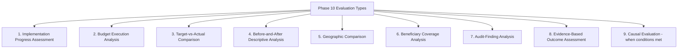
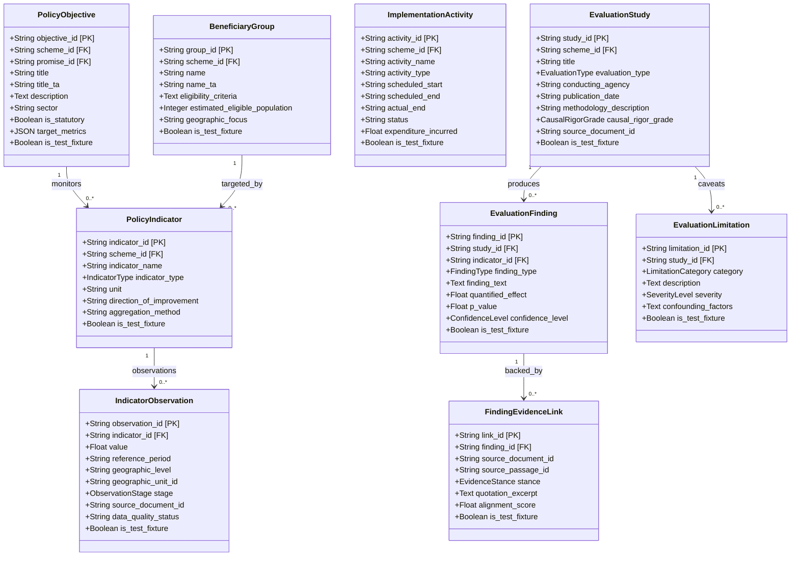
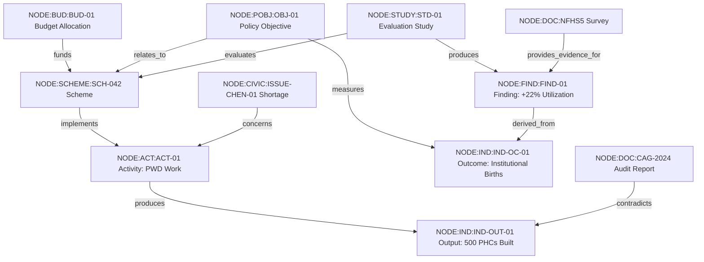

# Phase 10 — Public Policy Outcome and Impact Evaluation Architecture

## 1. Executive Summary & Mission

Phase 10 of **CIVICLENS TN** introduces the **Public Policy Outcome & Impact Evaluation Architecture**. 

Its defining capability is an **Evidence-Backed Policy Evaluation Explorer** that systematically connects:
1. A policy's stated objectives and intended beneficiary groups,
2. Budgetary inputs and financial allocations,
3. Physical implementation activities and tangible outputs,
4. Measured outcome and long-term impact indicators,
5. Independent evaluation findings, statutory audit observations, and citizen evidence.

```
+---------------------------------------------------------------------------------------------------+
|                                      THE RESULTS CHAIN                                            |
|                                                                                                   |
|  [INPUTS] ----------> [ACTIVITIES] ----------> [OUTPUTS] ----------> [OUTCOMES] ----------> [IMPACTS] |
|  Budget Allocations    Tenders, Works,         Physical Facilities,  Service Utilization,  Long-Term      |
|  & Staff Resources     Training Sessions       Kits Distributed      Behavioral Change     Societal Gains |
|                                                                                                   |
|  (e.g., ₹1,000 Cr      (e.g., 500 PHCs         (e.g., 500 PHCs       (e.g., 35% increase   (e.g., Maternal|
|   budgeted)             renovation work)        operationalized)      in institutional      Mortality Rate |
|                                                                       deliveries)           drops by 18%)  |
+---------------------------------------------------------------------------------------------------+
```

> [!IMPORTANT]
> **Core Architectural Principles & Directives:**
> 1. **Zero Fabrication Policy:** Real Phase 10 evaluation datasets have **NOT** yet been collected or scraped separately. All database schemas, evaluation models, provenance chains, metric formulations, and test fixtures are fully established before real-world dataset ingestion.
> 2. **Reuse Existing Infrastructure (Phases 1–9):** Phase 10 does **not** duplicate existing analyzers (e.g., budget analyzers, claim verification engines, news scrapers, civic grievance classifiers) or construct a parallel evidence graph. Instead, it reuses existing canonical models and extends the **Unified Civic Intelligence & Evidence Graph** (`CivicGraphNode` and `CivicEvidenceEdge`).
> 3. **Epistemic Integrity & Non-Equivalence Guardrail:** **Money spent or activities completed do NOT equal public benefit.** An input (money allocated) or an output (facility built) must never be conflated with an outcome (improved literacy, reduced maternal mortality, poverty alleviation).
> 4. **Strict Causal Discipline:** Correlation or temporal coincidence is never labeled as "causal impact" without a defensible counterfactual, verified identification assumptions, and rigorous quasi-experimental or experimental methodology. When assumptions fail, the system strictly downgrades the assessment to descriptive before-and-after analysis.
> 5. **Multi-Source Evidence Triangulation:** Official departmental claims of success are systematically corroborated or challenged against Comptroller and Auditor General (CAG) audit findings, independent survey datasets, civic grievance trends, and journalistic reports.
> 6. **Strict Provenance & Auditability:** Every observation, finding, and indicator is bound to a cryptographic document record with source URL, retrieval timestamp, page/table locator, and SHA-256 digest.

---

## 2. Comprehensive Project Audit (Phases 1–9 Infrastructure)

Phase 10 builds directly upon the foundational engineering accomplished across Phases 1 through 9:

### 2.1 Scheme and Budget Models (Phases 1 & 2)
- **Phase 1 Budget Engine:**
  - `BudgetDepartment`: Administrative departments (e.g., Health, School Education, PWD).
  - `BudgetScheme`: Scheme identities, demand numbers, major/minor accounting heads.
  - `BudgetRecord`: Detailed financial allocations covering Budget Estimates (BE), Revised Estimates (RE), and Actual Expenditures (Actuals) across fiscal years (FY 2011–12 to FY 2024–25).
  - *Phase 10 Reuse:* Provides the **Input layer** (financial inputs and budget execution variance).
- **Phase 2 Historical Scheme Intelligence:**
  - `HistoricalScheme`: Long-term scheme evolution, eligibility criteria, beneficiary targets, and policy objectives.
  - `SchemeCategory` & semantic embeddings: Sectoral classification and cross-scheme thematic clustering.
  - *Phase 10 Reuse:* Provides the canonical scheme registry and historical policy antecedents.

### 2.2 Political Promises & Manifesto Commitments (Phase 3)
- `PoliticalPromise`, `ManifestoDocument`, `ManifestoSource`, `PromiseAssessment`:
  - Granular promises decomposed from party manifestos (e.g., DMK 2021, AIADMK 2021) with verbatim text, categorized objectives, and baseline commitments.
  - *Phase 10 Reuse:* Connects election promises to formal government policy objectives, enabling the evaluation explorer to trace policy lineage from campaign commitment to realized outcome.

### 2.3 News Analysis & Public Discourse (Phase 4)
- `NewsSource`, `Article`, `PoliticalEvent`, `BiasIndicator`, `SourceComparison`:
  - Temporal event timeline, public debate, media scrutiny, and departmental announcements across major Tamil and English dailies (*The Hindu*, *Dinamalar*, *Daily Thanthi*).
  - *Phase 10 Reuse:* Serves as contextual and qualitative implementation evidence, identifying implementation delays, grassroots protests, or local execution bottlenecks.

### 2.4 Funding Transparency & Political Finance (Phase 5)
- `Donor`, `ElectoralTrust`, `Contribution`, `FinancialDocument`, `PartyFinancialStatement`:
  - Corporate and individual donations, electoral trusts, and party expenditures.
  - *Phase 10 Reuse:* Provides financial transparency context for policy priorities, public procurement scrutiny, and policy stakeholder cross-referencing.

### 2.5 Representative & Constituency Records (Phase 6)
- `Representative`, `Constituency`, `ConstituencyWork`, `DevelopmentIndicator`, `ConstituencyGeographicMapping`, `AuditTrailEvent`:
  - Geospatial infrastructure mapping Assembly Constituencies (AC) and districts.
  - Local infrastructure execution via MLACDS and MPLADS works.
  - Baseline district-level development indicators (Census, NFHS, SRS).
  - *Phase 10 Reuse:* Supplies the **Geographic Comparison** backbone, enabling localized outcome comparisons, area-weighted interpolation, and constituency-level beneficiary coverage.

### 2.6 Claim Verification & Statutory Evidence (Phase 7)
- `Claim`, `AtomicClaim`, `EvidenceDocument`, `EvidencePassage`, `ClaimEvidenceRelationship`, `VerificationRun`, `SourceAssessment`:
  - Deconstructed political and policy claims, 5-tier source hierarchy (`TIER_1_STATUTORY` to `TIER_5_UNVERIFIED`), supporting/contradicting stance classification, and confidence scoring.
  - *Phase 10 Reuse:* Provides the verification apparatus for testing ministerial claims of scheme achievements against statutory evidence (e.g., CAG audits, administrative data).

### 2.7 Civic Issue Intelligence & Public Grievance (Phase 8)
- `CivicIssue`, `GrievanceRecord`, `GovernmentDepartment`, `ResolutionEvidence`, `PublicWork`, `ServiceStandard`:
  - Citizen grievances, departmental SLA resolution rates, localized infrastructure failures, and ground-truth citizen verification.
  - *Phase 10 Reuse:* Serves as a vital bottom-up empirical signal of service delivery failure or success, testing whether official "outputs" solved community problems.

### 2.8 Unified Civic Intelligence & Evidence Graph (Phase 9)
- `CivicGraphNode`, `CivicEvidenceEdge`, `GraphEntityType`, `GraphRelationshipType`:
  - Single, strongly typed graph topology connecting all civic entities across Phases 1–8.
  - *Phase 10 Reuse:* **Direct Integration.** Phase 10 entities (`POLICY_OBJECTIVE`, `BENEFICIARY_GROUP`, `POLICY_INDICATOR`, `EVALUATION_FINDING`, `EVALUATION_STUDY`) are registered directly as `CivicGraphNode` entity types, and evaluation links are stored as `CivicEvidenceEdge` edges with full provenance. No parallel graph is created.

---

## 3. Results Chain & The Evaluation Framework

The foundational paradigm of Phase 10 is the **Results Chain** (Theory of Change), which prevents the pervasive cognitive trap of assuming that spending public money or performing activities automatically improves citizens' lives.


### 3.1 Twelve Core Conceptual Entities

Phase 10 explicitly models twelve distinct conceptual components:

1. **Policy Objective:** The formal statutory, policy, or programmatic purpose articulated by the Government of Tamil Nadu (e.g., "Ensure all girl students from government schools continue into tertiary education").
2. **Intended Beneficiary Group:** The target socio-demographic population, with explicit eligibility criteria, estimated total universe, and geographic focus (e.g., "Girls studying in classes 6-12 in Tamil Nadu government schools entering higher education").
3. **Budget Allocation:** Financial resources budgeted by the State Legislature (Budget Estimates [BE] and Revised Estimates [RE]) under specific accounting heads.
4. **Actual Expenditure:** Final audited fiscal disbursements from the State Treasury and Comptroller and Auditor General (CAG) appropriation accounts.
5. **Implementation Activity:** Specific administrative actions, procurement processes, construction contracts, or field operational drives undertaken to execute the scheme.
6. **Output Indicator:** Direct, tangible, countable physical deliverables or administrative transactions produced (e.g., number of bicycles distributed, number of school classrooms built).
7. **Outcome Indicator:** Quantitative or qualitative measurement of intermediate behavioral change, service access, utilization rate, or quality of life in the beneficiary group (e.g., gross enrollment ratio in higher education, anemia prevalence rate).
8. **Baseline Value:** Measured value of an indicator immediately prior to scheme launch or reference year (with reference period, geographic unit, and data source).
9. **Follow-Up Value:** Measured value of the indicator at subsequent measurement intervals post-implementation.
10. **Evaluation Finding:** Synthesized empirical conclusions reached by a structured evaluation study, classifying effect size, direction, and significance.
11. **Supporting and Contradicting Evidence:** Documented empirical passages and records supporting, questioning, or contradicting official implementation claims (e.g., CAG audit noting idle facilities, or academic survey confirming cash transfer receipt).
12. **Limitations and Uncertainty:** Explicitly documented data gaps, attrition, potential confounding variables, historical events (e.g., COVID-19 pandemic), and methodological caveats.

---

## 4. Nine Supported Evaluation Types

The architecture provides specialized analytical pipelines for nine evaluation types:



| # | Evaluation Type | Primary Question Addressed | Typical Data Sources | Key Output Metric |
|---|---|---|---|---|
| **1** | **Implementation Progress Assessment** | Are planned administrative phases and infrastructure milestones on schedule? | Department Policy Notes, PWD work progress reports, Citizen Portals | Milestone Completion Rate (MCR), Delay in Months |
| **2** | **Budget Execution Analysis** | Was the allocated budget released, absorbed, or surrendered across the fiscal cycle? | TN Budget Books, Detailed Demands for Grants (DDG), CAG Appropriation Accounts | Budget Execution Rate (BER), Absorption Velocity, Surrender Ratio |
| **3** | **Target-versus-Actual Comparison** | Did the scheme deliver the physical deliverables it committed to deliver? | Policy Notes, Legislative Assembly questions, Scheme dashboards | Physical Target Realization Ratio (PTRR) |
| **4** | **Before-and-After Descriptive Analysis** | How did key socioeconomic indicators evolve between baseline and post-rollout periods? | Census 2011, NFHS-4/5, SRS Bulletins, Unified District Information System for Education (UDISE+) | Percentage Change in Outcome (PCO), Compound Annual Growth Rate |
| **5** | **Geographic Comparison** | Are allocations, outputs, and outcomes evenly distributed across Tamil Nadu's 38 districts? | District Statistical Handbooks, MLACDS/MPLADS reports, Department MIS | Gini Coefficient of Allocation, Spatial Disparity Ratio (SDR) |
| **6** | **Beneficiary Coverage Analysis** | What share of the eligible population received benefits, and were there exclusion/inclusion errors? | Department beneficiary registries, Census population projections, NFHS | Beneficiary Inclusion Rate (BIR), Exclusion Error Rate (EER) |
| **7** | **Audit-Finding Analysis** | Did the Comptroller and Auditor General (CAG) or internal audits uncover irregularities or idle assets? | CAG State Finances Audit Reports, CAG Performance Audits, PAC reports | CAG Irregularity Exposure Ratio (CIER), Idle Capital Ratio (ICR) |
| **8** | **Evidence-Based Outcome Assessment** | Synthesizing administrative data, citizen grievances, news reports, and external surveys, what is the net outcome? | Civic grievance resolutions (Phase 8), News investigations (Phase 4), Fact-checks (Phase 7), Surveys | Outcome Evidence Corroboration Score (OECS), Contradiction Ratio |
| **9** | **Causal Evaluation** | What portion of the observed change is strictly attributable to the policy itself rather than secular trends? | Panel surveys, quasi-experimental datasets with verified control groups | Average Treatment Effect (ATE), DiD Estimator $\beta_3$, $p$-value |

> [!CAUTION]
> **Strict Causal Downgrading Rule:**
> If a study attempts Type 9 (Causal Evaluation) but lacks a valid control group, fails parallel trends, or exhibits unmeasured confounders, the system automatically tags the study as `METHODOLOGICALLY_CONSTRAINED` and downgrades its reporting to Type 4 (`BEFORE_AND_AFTER_DESCRIPTIVE`).

---

## 5. Software Architecture & Database Schema

The Phase 10 architecture introduces `backend/models/policy_evaluation.py`, fully integrated with `Base` and the Unified Evidence Graph.



### 5.1 Enums and Classifications

1. **`IndicatorType`**:
   - `INPUT` (Financial, staffing, hardware resources)
   - `ACTIVITY` (Administrative workflows, tendering, registrations)
   - `OUTPUT` (Direct physical deliverables, units built, disbursements)
   - `OUTCOME` (Intermediate utilization, access changes, quality of life improvements)
   - `IMPACT` (Long-term systemic, demographic, or economic transformations)

2. **`ObservationStage`**:
   - `BASELINE` (Pre-intervention benchmark)
   - `INTERMEDIATE` (Midline or operational checkpoint)
   - `FOLLOW_UP` (Post-intervention endline or evaluation period)
   - `TARGET` (Formally announced planned target)

3. **`EvaluationType`**:
   - `IMPLEMENTATION_PROGRESS`
   - `BUDGET_EXECUTION`
   - `TARGET_VERSUS_ACTUAL`
   - `BEFORE_AND_AFTER_DESCRIPTIVE`
   - `GEOGRAPHIC_COMPARISON`
   - `BENEFICIARY_COVERAGE`
   - `AUDIT_FINDING`
   - `EVIDENCE_BASED_OUTCOME`
   - `CAUSAL_EVALUATION`

4. **`CausalRigorGrade`**:
   - `GRADE_A_EXPERIMENTAL` (Randomized Controlled Trial with verified compliance)
   - `GRADE_B_QUASI_EXPERIMENTAL` (DiD with verified parallel trends, RDD with verified continuity, IV with strong instrument)
   - `GRADE_C_MATCHED_OBSERVATIONAL` (Propensity score matching or covariate balancing without longitudinal counterfactual)
   - `GRADE_D_DESCRIPTIVE_CORRELATIONAL` (Before-and-after without control group, cross-sectional correlation)
   - `GRADE_E_ANECDOTAL_UNSUBSTANTIATED` (Press statement or single testimonial)

5. **`EvidenceStance`**:
   - `SUPPORTS` (Direct documentary evidence corroborating the finding)
   - `CONTRADICTS` (Direct documentary evidence challenging the finding or official claim)
   - `QUALIFIES` (Partial corroboration with major contextual caveats or delays)
   - `NEUTRAL` (Contextual background without directional stance)

---

## 6. Evidence Graph Integration (Zero Duplication)

Phase 10 directly interoperates with the **Unified Civic Intelligence & Evidence Graph** created in Phase 9 (`CivicGraphNode` and `CivicEvidenceEdge`).

### 6.1 Entity Registration in `GraphEntityType`
Phase 10 adds canonical node representations without altering existing schemas:
- `POLICY_OBJECTIVE`
- `BENEFICIARY_GROUP`
- `POLICY_INDICATOR`
- `EVALUATION_STUDY`
- `EVALUATION_FINDING`

### 6.2 Relationship Types in `GraphRelationshipType`
Phase 10 registers semantic relationships:
- `EVALUATES` (Evaluation Study -> Budget Scheme)
- `MEASURES` (Policy Indicator -> Policy Objective)
- `TARGETS` (Policy Objective -> Beneficiary Group)
- Reuses existing edges:
  - `FUNDS` (Budget Record -> Budget Scheme)
  - `IMPLEMENTS` (Implementation Activity / Public Work -> Scheme)
  - `PROVIDES_EVIDENCE_FOR` (Source Document / CAG Audit -> Evaluation Finding)
  - `CONTRADICTS` (Civic Issue / CAG Audit -> Official Outcome Claim)



---

## 7. Evidence-Backed Policy Evaluation Explorer (Architecture)

The front-facing capability of Phase 10 is the **Policy Evaluation Explorer**, architected around three integrated views:

1. **Policy Hierarchy & Results Chain View:**
   - Visual step-through from Policy Objective -> Beneficiary Group -> Budget -> Activities -> Outputs -> Outcomes.
   - Distinct badges and color coding ensuring users never mistake outputs for outcomes.
2. **Evaluation Matrix & Findings Explorer:**
   - Multi-dimensional filtering by Evaluation Type (e.g., CAG Audits, Geographic Disparity, Budget Execution).
   - Direct display of effect size, statistical significance, and Causal Rigor Grade.
3. **Evidence Triangulation & Contradiction Inspector:**
   - Side-by-side juxtaposition of official departmental claims versus statutory CAG audit findings, citizen grievance volume, and field survey results.
   - Granular source citation down to document ID, page number, and cryptographic SHA-256 digest.

---

## 8. Verification and Compliance

- **Zero Real Data Fabrication:** All initial database records, unit tests, and integration tests use strictly labeled test fixtures with `is_test_fixture=True`.
- **Reproducibility:** Test suite verification run via `pytest` validates model integrity, results chain constraints, causal downgrading logic, and graph traversability.
- **Maintainability:** Complete schema lineage documented in `docs/phase10/architecture.md` and `docs/phase10/metric_definitions.md`.
