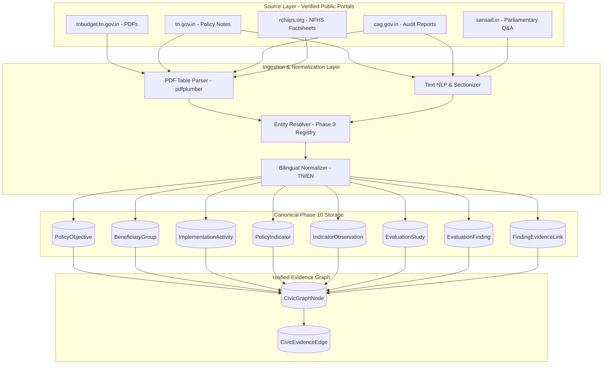

# Phase 10 — Policy Outcome & Impact Evaluation Dataset Requirements

## 1. Executive Summary & Data Governance Strategy

Phase 10 of **CIVICLENS TN** establishes the empirical data pipeline for evaluating public policy outcomes and impacts in Tamil Nadu.

> [!IMPORTANT]
> **Data Governance & Empirical Integrity Directives:**
> 1. **Zero Fabrication Policy:** Real Phase 10 datasets have **NOT** yet been collected or scraped separately. All database schemas, data specifications, processing adapters, and test fixtures are fully established before real-world dataset ingestion.
> 2. **Reality-Tested Availability:** In accordance with Step 4 directives, actual public availability of potential sources has been verified. The project does **not** assume the existence of convenient machine-readable REST APIs or pre-packaged clean CSV datasets where they do not exist.
> 3. **Non-Invasive, Respectful Public Data Acquisition:** Scrapers operate strictly under read-only, rate-limited public access without bypassing portal authentication, CAPTCHAs, or OTP gates.
> 4. **DPDPA 2023 Compliance:** Citizen privacy is preserved. All beneficiary observations and citizen feedback are ingested at aggregate levels (Panchayat, Ward, Block, Taluk, Constituency, District) with automated PII scrubbing.

---

## 2. Source Availability & Feasibility Verification Matrix

Before specifying dataset requirements, a live empirical verification was conducted across all candidate sources:

| Source Portal | Verified URL | Primary Content | Machine-Readable API Exists? | Real Download Formats | Collection Method Feasibility | Known Access Bottlenecks |
|---|---|---|---|---|---|---|
| **Tamil Nadu Budget** | `https://tnbudget.tn.gov.in/` | Budget Speech, Demands for Grants, Citizen's Guide | ❌ **No REST API** | Searchable / Scanned PDF | High via `pdfplumber` / PyMuPDF | Inconsistent table layouts across historical fiscal years; Tamil language tabular scans. |
| **TN Government Portal** | `https://www.tn.gov.in/` | Department Policy Notes, Government Orders (GOs) | ❌ **No REST API** | HTML indices linking to PDF downloads | High via HTTP scraping and PDF text extraction | PDFs vary widely in formatting by department; policy notes published only during budget sessions. |
| **Comptroller & Auditor General** | `https://cag.gov.in/` | State Finances Audit Reports, Performance Audits | ❌ **No REST API** | Downloadable PDF (English & Tamil) | High via portal catalog scrapers and PDF parsing | Multi-hundred-page audit reports; complex nested tables; 1–2 year audit publication lag. |
| **Open Government Data (OGD)** | `https://data.gov.in/` | National & Central Sector Scheme statistics | ⚠️ **Limited / Inconsistent** | CSV / XML / JSON (Requires API Key) | Moderate | Tamil Nadu state-specific scheme coverage is sparse; updates are irregular with significant latency. |
| **Census of India & Surveys** | `https://censusindia.gov.in/` | Census 2011 PCA, NFHS-4/5, SRS Bulletins | ❌ **No Dynamic API** | Static Excel (`.xls`/`.xlsx`), PDF | High via static file ingestion | 2021 Census postponed; baseline relies on 2011 data projected to present, complemented by NFHS-5 (2019-21). |
| **Digital Sansad (Parliament)** | `https://sansad.in/` | Lok Sabha & Rajya Sabha Q&A on CSS in TN | ❌ **No Public API** | HTML text & PDF annexures | Moderate via search form query | Session-based search; query terms required; data limited to Centrally Sponsored Schemes (CSS). |

---

## 3. Detailed Dataset Requirements by Source

### 3.1 Dataset 1: Tamil Nadu Detailed Demands for Grants & Budget Actuals
- **Primary Source:** Finance Department, Government of Tamil Nadu
- **Source URL:** `https://tnbudget.tn.gov.in/`
- **Purpose:** Supplies the **Input layer** (financial resources allocated, revised, and actualized) to calculate Budget Execution Rates ($BER$), absorption velocity, and fiscal underspending.
- **Expected Format:** Multi-page PDF documents published annually (Demands 1 to 54).
- **Key Fields & Schema:**
  - `demand_number`: Administrative Demand Number (e.g., `Demand 15 - Environment and Climate Change`, `Demand 45 - Social Welfare`).
  - `department_id`: Canonical department identifier.
  - `head_of_account`: 15-digit treasury accounting head (Major Head, Sub-Major Head, Minor Head, Sub-Head, Detailed Head).
  - `scheme_name`: Title of the scheme in English and Tamil.
  - `budget_estimate`: Financial allocation announced for upcoming FY (₹ in Crores).
  - `revised_estimate`: Mid-year revised allocation (₹ in Crores).
  - `actual_expenditure`: Realized expenditure for previous FY as certified by AG (Audit).
  - `financial_year`: Fiscal year string (e.g., `2023-2024`).
- **Geographic Coverage:** Statewide (aggregated at department and scheme level).
- **Reporting Period:** Annual (tabled each year during the February/March Budget Session).
- **Access Conditions:** Public open access; no authentication or fees required.
- **Collection Method:** Automated crawler targeting `tnbudget.tn.gov.in/documents/`, followed by `pdfplumber` layout-aware extraction and column-aligned regex parsing.
- **Known Limitations:**
  - "Actuals" for year $T$ are published only in budget year $T+2$ (2-year lag).
  - District-level breakdowns are not published in state budget books (only statewide scheme aggregates).

---

### 3.2 Dataset 2: Tamil Nadu Department Policy Notes & Citizen Charters
- **Primary Source:** Government of Tamil Nadu Department Portals & Assembly Secretariat
- **Source URL:** `https://www.tn.gov.in/policynotes/`
- **Purpose:** Supplies the **Activity and Output layers** (physical targets, completed works, beneficiary counts, and implementation milestones) and stated **Policy Objectives**.
- **Expected Format:** Comprehensive PDF reports (typically 50–250 pages per department).
- **Key Fields & Schema:**
  - `department_name`: Department publishing the policy note.
  - `policy_note_year`: Fiscal cycle (e.g., `2024-2025`).
  - `scheme_title`: Official title of scheme.
  - `policy_objective`: Stated policy goal and strategic justification.
  - `physical_target_planned`: Number of targeted units/beneficiaries for the reporting year.
  - `physical_achievement`: Number of realized units/beneficiaries delivered.
  - `financial_allocation`: Outlay earmarked in the policy note.
  - `beneficiary_criteria`: Explicit eligibility rules and exclusions.
  - `districts_covered`: List of districts where the scheme was rolled out.
- **Geographic Coverage:** State, District, and occasionally Block/Panchayat levels.
- **Reporting Period:** Annual (tabled during Demand-for-Grants debates in the State Assembly).
- **Access Conditions:** Public open access via state government document repository.
- **Collection Method:** Ingestion via headless crawler, PDF structural sectioning by chapter, and table extraction with Tamil-English bilingual character normalization.
- **Known Limitations:**
  - Narrative text contains self-congratulatory descriptions requiring objective NLP extraction.
  - Indicators are self-reported by implementing departments without independent audit validation at the time of publication.

---

### 3.3 Dataset 3: Comptroller and Auditor General (CAG) Audit Reports for Tamil Nadu
- **Primary Source:** Office of the Comptroller and Auditor General of India / Principal Accountant General (Audit-I & Audit-II) Tamil Nadu
- **Source URL:** `https://cag.gov.in/en/audit-reports/state?state=Tamil+Nadu`
- **Purpose:** Supplies the **Audit-Finding layer** and **Contradicting Evidence** for testing implementation efficacy, asset utilization, fund diversion, and compliance.
- **Expected Format:** Searchable PDF reports (State Finances Audit Reports and Performance Audit Reports).
- **Key Fields & Schema:**
  - `report_number_and_year`: Official CAG report identifier (e.g., `Report No. 2 of 2024 (State Finances)`).
  - `audit_type`: `STATE_FINANCES`, `PERFORMANCE_AUDIT`, `COMPLIANCE_AUDIT`.
  - `scheme_name`: Audited scheme name.
  - `department_id`: Department reviewed.
  - `finding_paragraph`: Exact paragraph reference (e.g., `Paragraph 3.2.4`).
  - `finding_category`: Standardized category (`UNSPENT_BALANCES`, `IDLE_ASSETS`, `EXCLUSION_ERRORS`, `PROCUREMENT_IRREGULARITIES`).
  - `quantified_loss_or_unspent`: Monetary amount involved (₹ in Crores).
  - `verbatim_observation`: Raw excerpt of the audit observation.
  - `department_reply`: Official government response recorded in the audit.
- **Geographic Coverage:** Tamil Nadu statewide, with district and municipal spot-audit samples.
- **Reporting Period:** Annual / Periodic (tabled in the Tamil Nadu Legislative Assembly).
- **Access Conditions:** Public open access; available in English and Tamil editions.
- **Collection Method:** PDF text parsing targeting Executive Summaries and chapter headings; regex extraction of audit observations and financial quantities.
- **Known Limitations:**
  - CAG audits are sample-based (typically inspect 10–25% of executing units or districts).
  - Reports are published 12–24 months after the close of the financial year.

---

### 3.4 Dataset 4: National Family Health Survey (NFHS) & Socioeconomic Surveys
- **Primary Source:** International Institute for Population Sciences (IIPS) / Ministry of Health and Family Welfare (MoHFW) / MoSPI
- **Source URL:** `http://rchiips.org/nfhs/` and `https://mospi.gov.in/`
- **Purpose:** Supplies the **Outcome and Impact layers** (independent, household-level health, nutrition, education, and sanitation indicators) for before-and-after and cross-district comparisons.
- **Expected Format:** District Factsheets (PDF), State Reports (PDF), and microdata files (Stata `.dta` / CSV available upon academic registration).
- **Key Fields & Schema:**
  - `district_name`: Tamil Nadu district name (e.g., `Dharmapuri`, `Thoothukudi`).
  - `survey_round`: `NFHS-4 (2015-16)`, `NFHS-5 (2019-21)`.
  - `indicator_code`: Standardized health indicator (e.g., `INSTITUTIONAL_BIRTHS_PERCENT`, `ANEMIA_WOMEN_15_49_PERCENT`, `FEMALE_LITERACY_RATE`).
  - `urban_value`: Percentage/rate in urban areas.
  - `rural_value`: Percentage/rate in rural areas.
  - `total_value`: Overall district value.
  - `sample_size`: Number of households/women surveyed.
- **Geographic Coverage:** All districts of Tamil Nadu (32 districts in NFHS-4, 37/38 districts in NFHS-5).
- **Reporting Period:** Multi-year survey cycles (conducted roughly every 4–5 years).
- **Access Conditions:** District Factsheets and State Reports are open public access; raw household microdata requires institutional registration.
- **Collection Method:** Tabular scraping of published District Factsheet tables into normalized observation tables.
- **Known Limitations:**
  - Low temporal frequency (not suitable for monthly or annual progress tracking).
  - New districts created through bifurcation require geographic boundary reconciliation.

---

### 3.5 Dataset 5: Census of India & Sample Registration System (SRS) Bulletins
- **Primary Source:** Office of the Registrar General & Census Commissioner, India (ORGI)
- **Source URL:** `https://censusindia.gov.in/`
- **Purpose:** Supplies **Beneficiary Universe Baselines** ($N_{\text{eligible}}$) and demographic benchmarks (population, gender ratio, SC/ST distribution, female literacy).
- **Expected Format:** Excel spreadsheets (`.xlsx`) and PDF demographic bulletins.
- **Key Fields & Schema:**
  - `geographic_unit_id`: District or Taluk Census Code (e.g., `TN-01` to `TN-38`).
  - `total_population`: Aggregate population count.
  - `female_population`: Female population count.
  - `sc_st_population`: Scheduled Caste / Scheduled Tribe population count.
  - `literacy_rate`: Measured literacy percentage.
  - `work_participation_rate`: Worker population ratio.
- **Geographic Coverage:** State, District, Taluk, Village, and Census Town levels.
- **Reporting Period:** Decennial (2011 baseline), supplemented by annual SRS vital statistics bulletins (IMR, MMR, CBR, CDR).
- **Access Conditions:** Open public download.
- **Collection Method:** Tabular ingestion and database seeding into `development_indicators` (reusing Phase 6 model).
- **Known Limitations:**
  - 2021 decennial Census was postponed; all current population denominators rely on official ORGI projections.

---

### 3.6 Dataset 6: Digital Sansad (Parliament of India Unstarred & Starred Q&A)
- **Primary Source:** Lok Sabha and Rajya Sabha Secretariats
- **Source URL:** `https://sansad.in/ls/questions/questions-search`
- **Purpose:** Supplies independent Union Ministry reporting on Centrally Sponsored Schemes (CSS) implemented in Tamil Nadu (e.g., Jal Jeevan Mission, PMAY-G, Samagra Shiksha, MGNREGA), including central funds released, state matching shares, and verified physical progress.
- **Expected Format:** Searchable HTML answers and PDF annexure tables.
- **Key Fields & Schema:**
  - `question_number`: Lok Sabha / Rajya Sabha Question ID (e.g., `LS-USQ-2140`).
  - `session_year`: Parliamentary session and year.
  - `ministry_name`: Union Ministry (e.g., `Ministry of Jal Shakti`).
  - `scheme_name`: Central/CSS Scheme title.
  - `funds_released_to_tn`: Central grant released to Tamil Nadu (₹ in Crores).
  - `reported_physical_coverage`: Tap water connections, houses constructed, roads built in Tamil Nadu.
  - `district_breakdown`: District-level annexure figures where provided.
- **Geographic Coverage:** Tamil Nadu statewide and district-level annexures.
- **Reporting Period:** Sessional (3 times per year: Budget, Monsoon, Winter).
- **Access Conditions:** Open public search interface.
- **Collection Method:** Targeted keyword query scraper matching scheme names and "Tamil Nadu", followed by PDF annexure parser.
- **Known Limitations:**
  - Covers only Centrally Sponsored Schemes and Central Sector Schemes; purely State-funded schemes are not reported in Parliament.

---

## 4. Ingestion Architecture & Data Pipeline Flow

---

## 5. Labelled Test Fixtures Strategy (Pre-Ingestion Phase)

In strict adherence to the **Zero Fabrication Policy**:
- Until physical scrapers and extraction batches run against the above real portals, all system tests utilize strictly labeled fixtures in `tests/fixtures/phase10_fixtures.py`.
- Every test record is flagged with `is_test_fixture=True`.
- Primary keys follow the unambiguous deterministic prefixes:
  - `OBJ-TEST-*` for Policy Objectives
  - `BEN-TEST-*` for Beneficiary Groups
  - `ACT-TEST-*` for Implementation Activities
  - `IND-TEST-*` for Policy Indicators
  - `OBS-TEST-*` for Indicator Observations
  - `STD-TEST-*` for Evaluation Studies
  - `FIND-TEST-*` for Evaluation Findings
  - `EVL-TEST-*` for Finding Evidence Links
  - `LIM-TEST-*` for Evaluation Limitations
