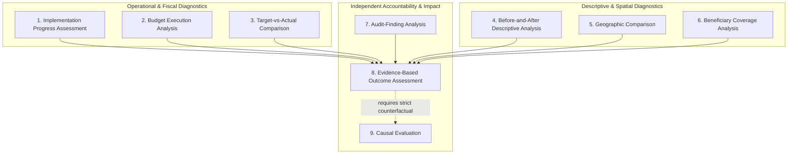
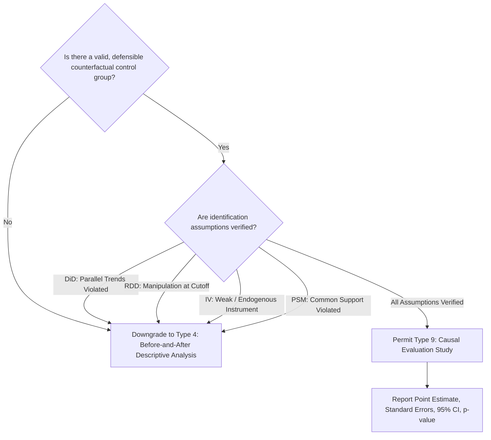

# Phase 10 — Policy Outcome and Impact Evaluation Methodology

## 1. Methodological Foundation & Epistemic Principles

Public policy evaluation in **CIVICLENS TN** adheres to strict epistemic standards developed to protect civic transparency against confirmation bias, selective government publicity, and flawed causal attribution.

The central methodological mandate of Phase 10 is:
> **Financial expenditure and activity completion do not constitute evidence of public benefit.**

A government may spend 100% of its budgetary allocation and construct 1,000 community health clinics, yet child immunization rates may remain stagnant or maternal mortality may fail to improve due to lack of medical personnel, absent pharmaceuticals, or poor physical accessibility. Conversely, a policy may achieve high public awareness while generating unintended adverse side effects. 

Phase 10 enforces a methodological framework that systematically separates inputs, activities, outputs, outcomes, and long-term impacts, and subjects every empirical claim to multi-source triangulation.

---

## 2. The Five-Tier Results Chain (Theory of Change)

To prevent conflation between means and ends, every policy analyzed within CIVICLENS TN is mapped onto the Five-Tier Results Chain:

```
+-------------------------------------------------------------------------------------------------------+
| LEVEL 1: INPUTS       | Financial, human, administrative, and technological resources mobilized.       |
|                       | (e.g., ₹2,500 Crores allocated in Budget Demand 15; 1,200 data operators hired)|
+-----------------------+-------------------------------------------------------------------------------+
| LEVEL 2: ACTIVITIES   | Administrative processes, procurement tenders, registration camps, training.  |
|                       | (e.g., Tenders floated for IT portal; 3,500 beneficiary enrollment camps held) |
+-----------------------+-------------------------------------------------------------------------------+
| LEVEL 3: OUTPUTS      | Direct physical deliverables and administrative transactions generated.       |
|                       | (e.g., 1.06 Crore monthly debit card disbursements; 250 schools upgraded)     |
+-----------------------+-------------------------------------------------------------------------------+
| LEVEL 4: OUTCOMES     | Intermediate behavioral shifts, service access, utilization, and welfare gains.|
|                       | (e.g., 28% decrease in informal loan borrowing; 14% rise in female college GE) |
+-----------------------+-------------------------------------------------------------------------------+
| LEVEL 5: IMPACTS      | Long-term structural, demographic, intergenerational, and macroeconomic gains.|
|                       | (e.g., Permanent drop in multidimensional poverty; rise in female labor force) |
+-------------------------------------------------------------------------------------------------------+
```

### 2.1 Concrete Tamil Nadu Policy Demonstrations

The distinction is illustrated across major flagship Tamil Nadu welfare schemes:

#### Case Study A: *Kalaignar Magalir Urimai Thittam* (Basic Income for Women)
- **Input:** State budget outlay of ₹12,000 Crore allocated under Social Welfare Department (Demand 45).
- **Activity:** Scrutiny of 1.63 Crore ration card applications, biometrics verification, grievance appeal camps.
- **Output:** Monthly direct benefit transfer of ₹1,000 credited to 1.15 Crore verified women heads of families.
- **Outcome:** Enhanced household disposable income, reduction in high-interest micro-credit debt, increased female financial autonomy.
- **Impact:** Long-term intergenerational human capital investment and female empowerment.
- *Methodological Warning:* Counting 1.15 Crore payments (Output) confirms administrative delivery, but does *not* measure whether household nutritional intake improved or debt burdens fell (Outcome).

#### Case Study B: *Illam Thedi Kalvi* (Education at Doorsteps)
- **Input:** ₹200 Crore special government allocation, mobilization of 200,000 community education volunteers.
- **Activity:** Volunteer training sessions, evening learning center venue identification.
- **Output:** 180,000 community centers operationalized; learning kits distributed to 30 lakh children.
- **Outcome:** Recovery of post-COVID foundational literacy and numeracy (FLN) deficits measured through standardized tests.
- **Impact:** Elimination of learning loss gap, long-term secondary school completion rate improvement.
- *Methodological Warning:* Number of study centers opened (Output) is not proof of learning recovery (Outcome).

---

## 3. Operationalizing the Twelve Core Concepts

Phase 10 standardizes 12 core concepts across the database models, calculation engines, and UI layers:

| Concept | Formal Definition | Data Source / Provenance | Example Record |
|---|---|---|---|
| **1. Policy Objective** | Explicit goal articulated in statute, government order (GO), or official policy note. | TN Gazette, Department Policy Notes, Manifesto commitments | "Achieve universal primary healthcare access within 5 km" |
| **2. Intended Beneficiary Group** | Legally eligible target population, with criteria, exclusions, and universe size. | Scheme Guidelines, Social Welfare Dept GOs, Census | "Women heads of families with annual income below ₹2.5 Lakh" |
| **3. Budget Allocation** | Legislative appropriation (Budget Estimate and Revised Estimate) by accounting head. | Tamil Nadu Finance Dept Detailed Demands for Grants (DDG) | ₹1,500.00 Cr (FY 2023-24 Budget Estimate under Head 2210) |
| **4. Actual Expenditure** | Final audited state expenditure recorded by the Accountant General (Audit). | CAG State Finances Audit Reports, Appropriation Accounts | ₹1,280.45 Cr (Actual expenditure realized, 85.3% execution) |
| **5. Implementation Activity** | Operational process or physical work task required to produce outputs. | PWD Work Portals, TN Tender Bulletins, District MIS | "Construction of 120 Primary Health Sub-Centres in Salem" |
| **6. Output Indicator** | Countable tangible unit of goods or services directly produced. | Department Annual Administrative Reports, Scheme MIS | "Number of bicycles distributed to Class 11 students" (Target: 500,000) |
| **7. Outcome Indicator** | Measure of intermediate condition, utilization, or behavioral change. | NFHS surveys, UDISE+ education reports, Sample Registration System | "Gross Enrollment Ratio (GER) of female students in higher education" |
| **8. Baseline Value** | Empirically verified value prior to policy intervention. | Pre-launch survey, Census 2011, NFHS-4 (2015-16) | 48.2% female higher education GER in Tamil Nadu (2018) |
| **9. Follow-Up Value** | Measured value of the identical indicator during or after policy execution. | Post-launch survey, AISHE 2022-23, NFHS-5 (2019-21) | 54.1% female higher education GER in Tamil Nadu (2023) |
| **10. Evaluation Finding** | Structured analytical conclusion regarding magnitude, direction, and significance. | Peer-reviewed study, CAG Performance Audit, Internal M&E report | "+5.9 percentage point increase in female GER (p < 0.01)" |
| **11. Supporting & Contradicting Evidence** | Empirical passages corroborating or refuting official delivery claims. | CAG audit reports, field investigations, citizen grievance records | Contradicting: "CAG Report 3 of 2024 notes 32% of PHCs lacked pharmacists" |
| **12. Limitations & Uncertainty** | Explicit documentation of data gaps, sampling bias, confounders, and caveats. | Evaluation study methodology disclosures, statistical confidence bounds | "COVID-19 school closures confounded FLN observations between 2020-2022" |

---

## 4. Methodologies for the Nine Supported Evaluation Types

The architecture implements distinct methodologies for nine evaluation archetypes:



### 4.1 Evaluation Type 1: Implementation Progress Assessment
- **Objective:** Determine whether administrative milestones, procurement, and physical construction are tracking planned timelines.
- **Methodology:**
  1. Extract scheduled start dates, end dates, and intermediate milestones from Government Orders (GOs) and Department Policy Notes.
  2. Ingest real-time execution status from public departmental dashboards and PWD e-tender platforms.
  3. Compute Milestone Completion Rate ($MCR$) and Slippage Duration (months).
- **Epistemic Boundary:** On-time completion indicates administrative velocity, not social effectiveness.

### 4.2 Evaluation Type 2: Budget Execution Analysis
- **Objective:** Evaluate the fidelity of financial execution across the fiscal cycle.
- **Methodology:**
  1. Parse Budget Estimates ($BE$), Revised Estimates ($RE$), and Final Actuals ($A$) from Tamil Nadu Budget books.
  2. Compute Budget Execution Rate:
     $$BER = \frac{\text{Actual Expenditure}}{\text{Budget Estimate}} \times 100$$
  3. Detect March Rush / Lumpy Expenditure: Measure the proportion of total fiscal expenditure incurred in the final quarter (Q4) or month of March.
  4. Quantify surrender of funds and supplementary grant additions.
- **Epistemic Boundary:** Under-utilization indicates operational bottlenecks; over-spending does not indicate superior outcomes and may signify cost overruns.

### 4.3 Evaluation Type 3: Target-versus-Actual Comparison
- **Objective:** Benchmark announced physical targets against verified deliverables.
- **Methodology:**
  1. Record quantitative targets announced in the annual Budget Speech, Manifesto, or Department Policy Note.
  2. Extract reported physical achievements from the subsequent year's Policy Note and Legislative Assembly replies.
  3. Compute Physical Target Realization Ratio:
     $$PTRR = \frac{\text{Actual Outputs Delivered}}{\text{Targeted Outputs Planned}} \times 100$$
- **Epistemic Boundary:** Over-achievement may reflect lowered initial targets or relaxed quality criteria.

### 4.4 Evaluation Type 4: Before-and-After Descriptive Analysis
- **Objective:** Track the temporal trajectory of outcome indicators before and after scheme inception.
- **Methodology:**
  1. Establish verified baseline indicator value $Y_0$ at baseline reference year $T_0$.
  2. Ingest follow-up indicator value $Y_1$ at follow-up year $T_1$.
  3. Compute Percentage Change:
     $$\Delta\% = \frac{Y_1 - Y_0}{Y_0} \times 100$$
- **Epistemic Boundary:** **No causality may be claimed.** The observed change may be driven by broader economic growth, concurrent Union government schemes, or demographic transitions.

### 4.5 Evaluation Type 5: Geographic Comparison
- **Objective:** Uncover regional, district-level, and rural-urban spatial disparities in policy allocation and outcomes.
- **Methodology:**
  1. Disaggregate outputs and outcomes across Tamil Nadu's 38 districts.
  2. Calculate per capita or per target beneficiary allocations.
  3. Compute spatial concentration metrics:
     - Coefficient of Variation ($CV$) across districts.
     - Spatial Disparity Ratio ($SDR$): Ratio of top quintile districts to bottom quintile districts.
- **Epistemic Boundary:** Disparities may reflect purposeful targeting (e.g., higher funds to historically aspirational districts like Ariyalur or Ramanathapuram).

### 4.6 Evaluation Type 6: Beneficiary Coverage Analysis
- **Objective:** Quantify the extent to which eligible citizens receive scheme benefits.
- **Methodology:**
  1. Estimate target eligible universe $N_{\text{eligible}}$ using Census 2011 projections, SECC, or NFHS surveys.
  2. Ingest verified active beneficiary count $N_{\text{enrolled}}$ from departmental registries.
  3. Compute:
     $$\text{Beneficiary Inclusion Rate } (BIR) = \frac{N_{\text{enrolled}} \cap N_{\text{eligible}}}{N_{\text{eligible}}} \times 100$$
     $$\text{Exclusion Error Rate } (EER) = \frac{N_{\text{eligible}} \setminus N_{\text{enrolled}}}{N_{\text{eligible}}} \times 100$$
- **Epistemic Boundary:** Administrative beneficiary counts may include duplicate entries, ghost beneficiaries, or ineligible inclusions.

### 4.7 Evaluation Type 7: Audit-Finding Analysis
- **Objective:** Systematically integrate observations from the Comptroller and Auditor General (CAG) of India, Public Accounts Committee (PAC), and social audits.
- **Methodology:**
  1. Ingest CAG State Finances Audit Reports and Sectoral Performance Audit Reports for Tamil Nadu.
  2. Classify audit findings into standard typologies:
     - `UNSPENT_BALANCES_PARKED_OUTSIDE_TREASURY`
     - `UNPRODUCTIVE_OR_IDLE_INFRASTRUCTURE`
     - `MISALLOCATION_OR_DIVERSION_OF_FUNDS`
     - `BENEFICIARY_SELECTION_DEFICIENCIES`
     - `LACK_OF_STATUTORY_MONITORING`
  3. Cross-link audit findings directly to Scheme nodes and Output nodes in the Unified Evidence Graph.
- **Epistemic Boundary:** Audit findings identify non-compliance and implementation failure, but do not provide an estimate of average net social benefit.

### 4.8 Evaluation Type 8: Evidence-Based Outcome Assessment
- **Objective:** Multi-source triangulation to determine the net weight of empirical evidence regarding policy outcomes.
- **Methodology:**
  1. Gather all available evidence streams:
     - Official departmental administrative reports (Tier 2).
     - Statutory CAG audit reports (Tier 1).
     - Independent survey datasets like NFHS, ASER, UDISE+ (Tier 2/4).
     - Citizen grievance records from Phase 8 (Tier 4).
     - Investigative journalism reports from Phase 4 (Tier 3/4).
  2. Classify each piece of evidence by stance: `SUPPORTS`, `CONTRADICTS`, `QUALIFIES`, or `NEUTRAL`.
  3. Compute the **Outcome Evidence Corroboration Score (OECS)**:
     $$OECS = \frac{\sum w_i \cdot \mathbb{I}(\text{SUPPORTS}) - \sum w_j \cdot \mathbb{I}(\text{CONTRADICTS})}{\sum w_k}$$
     Where weights $w$ are determined by the Source Credibility Tier (Tier 1 = 1.0, Tier 2 = 0.8, Tier 3 = 0.6, Tier 4 = 0.4).
- **Epistemic Boundary:** Synthesizes observed corroboration, but remains observational unless an explicit causal model is validated.

---

## 5. Causal Evaluation Methodology & The Downgrading Protocol

Causal evaluation (Type 9) is permitted **only** when rigorous experimental or quasi-experimental criteria are met.



### 5.1 Permitted Causal Designs and Identification Assumptions

1. **Difference-in-Differences (DiD):**
   - *Model:* $Y_{it} = \alpha + \beta_1 \text{Treated}_i + \beta_2 \text{Post}_t + \beta_3 (\text{Treated}_i \times \text{Post}_t) + \epsilon_{it}$
   - *Mandatory Assumption:* **Parallel Trends Assumption.** Pre-treatment outcome trajectories between treatment and comparison groups must be statistically indistinguishable.
2. **Regression Discontinuity Design (RDD):**
   - *Model:* Sharp or Fuzzy RDD utilizing an administrative eligibility cutoff (e.g., landholding $\le 2$ hectares, income $< ₹2.5\text{L}$).
   - *Mandatory Assumption:* Continuity of potential outcomes at the cutoff; McCrary density test verifying no sorting/manipulation around the threshold.
3. **Instrumental Variables (IV):**
   - *Mandatory Assumption:* Instrument relevance ($F\text{-statistic} > 10$ in first stage) and exclusion restriction (instrument affects outcome *only* through treatment).
4. **Propensity Score Matching (PSM):**
   - *Mandatory Assumption:* Conditional independence (unconfoundedness on observables) and common support overlap across treatment and control distributions.
5. **Randomized Controlled Trials (RCT):**
   - *Mandatory Assumption:* True random assignment, verified baseline balance, minimal sample attrition ($< 5\%$).

### 5.2 Mandatory Causal Downgrading Protocol

If any of the following failure modes occur:
1. Absence of a contemporaneous control group,
2. Statistical failure of the parallel trends test ($p < 0.05$ on pre-period lead coefficients),
3. Severe differential sample attrition between survey rounds,
4. Confounding macro events (e.g., statewide lockdown during COVID-19) with no unaffected control group,

**The system executes an automatic methodological downgrade:**
- Causal claim status: `DOWNGRADED_TO_DESCRIPTIVE`
- Causal Rigor Grade: downgraded to `GRADE_D_DESCRIPTIVE_CORRELATIONAL`
- UI Display: Suppresses causal language ("caused", "resulted in", "impact of") and replaces with descriptive language ("was accompanied by", "followed by", "observed change during the period").

---

## 6. Multi-Source Evidence Triangulation & Contradiction Resolution

To ensure complete fairness and pluralism, CIVICLENS TN does not censor conflicting findings. Instead, it places official government assertions alongside independent investigations.

### 6.1 Evidence Stance Taxonomy
- **`SUPPORTS`**: Provides empirical corroboration that the stated output was delivered or outcome was achieved with comparable magnitude.
- **`CONTRADICTS`**: Presents empirical evidence of failure, non-delivery, severe delays, or adverse outcomes.
- **`QUALIFIES`**: Confirms broad progress but reveals major conditional bottlenecks (e.g., schools built but 40% lack running water or teachers).
- **`NEUTRAL`**: Provides factual context (e.g., historical background, budget head restructuring) without taking a stance.

### 6.2 Managing Divergent Findings
When a statutory source (e.g., CAG Report) contradicts an administrative source (e.g., Department Policy Note):
1. Both records are linked to the Evaluation Finding node.
2. The finding's `has_contradicting_evidence` flag is set to `True`.
3. The platform computes the **Contradiction Ratio ($CR$)**:
   $$CR = \frac{N_{\text{contradicting}}}{N_{\text{supporting}} + N_{\text{contradicting}}}$$
4. The UI prominently renders an **"Empirical Divergence Notice"**, inviting users to compare verbatim excerpts and primary source documents directly.

---

## 7. Limitations and Uncertainty Governance

Every evaluation summary produced by Phase 10 must document four mandatory limitation categories:

1. **Data Completeness & Latency:** Known delays between scheme operation and indicator publication (e.g., NFHS conducted once every 4–5 years).
2. **Measurement & Aggregation Gaps:** District-level aggregation masking intra-district block or panchayat disparities.
3. **External Confounders:** State or national economic shocks, drought, monsoon failures, inflation, or concurrent Union government interventions.
4. **Survivorship & Reporting Bias:** Department administrative data self-reported by implementing officers versus independent citizen-reported complaints.
