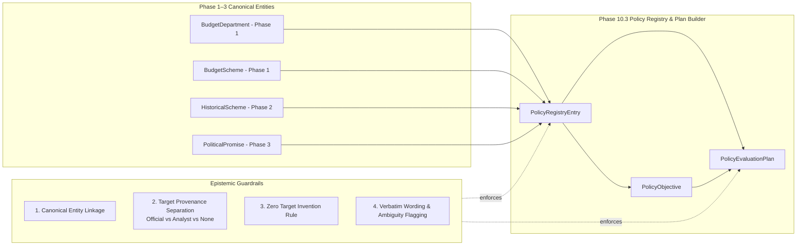

# Phase 10 — Policy Registry and Evaluation Plan Builder

## 1. Executive Summary & Architectural Role

Phase 10.3 of **CIVICLENS TN** introduces the **Policy Evaluation Registry** (`PolicyRegistryEntry`) and the **Evaluation Plan Builder** (`PolicyEvaluationPlan`).

Rather than evaluating public policies in isolation or creating disconnected policy records, every evaluation in CIVICLENS TN is anchored to an existing canonical scheme or commitment from Phases 1–3 (`BudgetScheme`, `HistoricalScheme`, or `PoliticalPromise`).

> [!IMPORTANT]
> **Core Epistemic Directives (Phase 10.3):**
> 1. **Canonical Entity Linkage:** Every policy registry entry and evaluation plan must refer to an existing canonical scheme or policy entity (`budget_scheme_id`, `historical_scheme_id`, `promise_id`, or `canonical_scheme_code`).
> 2. **Target Provenance Separation:** Officially stated government targets (`OFFICIALLY_STATED`) are strictly distinguished from benchmarks proposed or inferred by analysts (`ANALYST_PROPOSED_BENCHMARK`) and policies without a published numeric target (`NO_PUBLISHED_TARGET`).
> 3. **Zero Target Invention:** The system **never** invents a policy target. Recording an `OFFICIALLY_STATED` target without a verifiable documentary source citation (`target_source_reference`) is rejected at the validation layer. Similarly, `NO_PUBLISHED_TARGET` enforces `target_value = None`.
> 4. **Ambiguous Objective Preservation:** When policy objectives are vague, aspirational, or ambiguous, the system preserves the exact `original_objective_wording` verbatim and automatically flags the record (`is_objective_ambiguous = True`, `objective_review_status = FLAGGED_AMBIGUOUS`) for human review.

---

## 2. Policy Registry Schema (`PolicyRegistryEntry`)

The `policy_registry` table ([`backend/models/policy_evaluation.py`](file:///e:/CIVCLENS/backend/models/policy_evaluation.py)) stores all 11 required policy metadata attributes:

| # | Requirement | Column(s) | Type & Constraints | Description |
|---|---|---|---|---|
| **1** | **Policy Identifier** | `policy_id`, `canonical_scheme_code`, `budget_scheme_id`, `historical_scheme_id`, `promise_id` | `String [PK]`, FKs to Phase 1–3 | Deterministic identifier (`POL-*`) linked to canonical Phase 1–3 records. |
| **2** | **Policy Name & Aliases** | `policy_name`, `policy_name_ta`, `aliases` | `String`, `JSON` | Official English and Tamil titles plus acronyms and popular names (e.g., `"Pudhumai Penn"`, `"KMUT"`). |
| **3** | **Responsible Department** | `responsible_department`, `department_id` | `String`, `FK(budget_departments.id)` | Implementing department where documented in Demand for Grants or Policy Notes. |
| **4** | **Objectives** | `objectives_summary`, `original_objective_wording`, `is_objective_ambiguous`, `objective_review_status` | `Text`, `Boolean`, `Enum` | Normalized objective summary alongside preserved verbatim wording and ambiguity review status. |
| **5** | **Intended Beneficiaries** | `intended_beneficiaries` | `Text` (plus child `BeneficiaryGroup` records) | Documented target demographic group and eligibility rules. |
| **6** | **Geographic Scope** | `geographic_scope`, `covered_districts` | `String`, `JSON` | `STATEWIDE`, `RURAL_ONLY`, `URBAN_ONLY`, or `SPECIFIC_DISTRICTS` with explicit district list. |
| **7** | **Start & End Dates** | `start_date`, `end_date` | `String` (`YYYY-MM-DD` or `FY`) | Documented launch date and sunset/completion date (`None` if ongoing). |
| **8** | **Implementation Rules** | `implementation_rules` | `JSON` | Governing GOs, disbursement cadence, conditionality, and nodal agency rules. |
| **9** | **Stated Targets** | `stated_targets` | `JSON` | Verified list of target objects with explicit `target_provenance` and `source_reference`. |
| **10** | **Source Documents** | `source_documents` | `JSON` | Array of canonical document IDs (GOs, Policy Notes, Budget Books, CAG Reports). |
| **11** | **Evaluation Status** | `evaluation_status` | `Enum(PolicyEvaluationStatus)` | `NOT_STARTED`, `PLAN_DEFINED`, `DATA_COLLECTION`, `IN_PROGRESS`, `EVALUATED`, `INCONCLUSIVE`, `FLAGGED_FOR_REVIEW`, `ARCHIVED`. |

---

## 3. Evaluation Plan Builder Schema (`PolicyEvaluationPlan`)

Each policy in the registry can have one or more structured evaluation plans (`policy_evaluation_plans` table) addressing specific empirical evaluation questions across the Results Chain:

| # | Plan Component | Column(s) | Description & Validation Rules |
|---|---|---|---|
| **1** | **Evaluation Question** | `evaluation_question` | Specific, falsifiable empirical question (e.g., *"Did the ₹1,000 monthly stipend increase the transition rate of government school girls into higher education between 2021-22 and 2023-24?"*). |
| **2** | **Objective Being Assessed** | `objective_being_assessed`, `objective_id`, `original_objective_wording` | Exact policy objective under evaluation, retaining verbatim source wording and ambiguity flags. |
| **3** | **Indicator Definition** | `indicator_definition`, `indicator_id`, `indicator_type`, `unit` | Operational formula, numerator/denominator, unit, and Results Chain classification (`INPUT`, `ACTIVITY`, `OUTPUT`, `OUTCOME`, `IMPACT`). |
| **4** | **Baseline Period** | `baseline_period`, `baseline_value` | Pre-intervention reference period (e.g., `"2021-22"`) and baseline measurement if available. |
| **5** | **Comparison Period** | `comparison_period` | Post-rollout follow-up period or comparison window (e.g., `"2023-24"`). |
| **6** | **Target Value & Provenance** | `target_value`, `target_provenance`, `target_source_reference` | Numeric target (if published) paired with mandatory `TargetProvenanceType` (`OFFICIALLY_STATED`, `ANALYST_PROPOSED_BENCHMARK`, or `NO_PUBLISHED_TARGET`). |
| **7** | **Actual Value** | `actual_value` | Realized empirical value in the comparison period, if available (`None` if pending data collection). |
| **8** | **Data Source** | `data_source`, `source_document_ids` | Authoritative dataset or statutory report providing the baseline and actual observations. |
| **9** | **Calculation Method** | `calculation_method` | Explicit mathematical formula (e.g., `PTRR`, `Before-and-After Difference`, `DiD Estimator`). |
| **10** | **Geographic Level** | `geographic_level` | Spatial resolution of the evaluation (`STATE`, `DISTRICT`, `CONSTITUENCY`, `BLOCK`). |
| **11** | **Limitations** | `limitations` | Documented confounders, data lags, attrition risks, or attribution caveats. |

---

## 4. Target Provenance & Zero-Invention Guardrail

A recurring failure in policy analysis is treating an analyst's rule-of-thumb benchmark as an official government failure or success, or inventing a numeric target when a policy document only stated a directional aspiration.

`PolicyRegistryService.validate_target_provenance()` enforces three mutually exclusive provenance categories via `TargetProvenanceType`:

1. **`OFFICIALLY_STATED`**:
   - The quantitative target was explicitly published in an official government document (Budget Speech, Detailed Demand for Grants, Department Policy Note, Government Order, or Party Manifesto).
   - **Validation Rule:** Both `target_value` (numeric) and `target_source_reference` (non-empty citation >= 5 chars) are **mandatory**. Omitting either raises a `ValueError`.
2. **`ANALYST_PROPOSED_BENCHMARK`**:
   - The government did not publish a specific numerical target for this indicator, or an evaluator is comparing the policy against an external benchmark (e.g., national average, WHO standard, SDG target, or historical trend rate).
   - **Validation Rule:** Both `target_value` and `target_source_reference` (explaining the analytical benchmark basis) are mandatory. In all summaries and UI outputs, the value is explicitly labeled as an **Analyst-Proposed Benchmark** and never attributed to the government as an official target.
3. **`NO_PUBLISHED_TARGET`**:
   - No quantitative target was published by the government, and the evaluation plan assesses descriptive change from baseline to comparison period without a target threshold.
   - **Validation Rule:** `target_value` **must** be `None`. Supplying any numeric `target_value` under `NO_PUBLISHED_TARGET` raises an immediate `ValueError` ("Never invent a policy target").

---

## 5. Ambiguous Objective Detection & Verbatim Preservation

Public policy documents and manifestos frequently contain broad, multi-dimensional, or aspirational statements (e.g., *"Ensure holistic and world-class transformation of rural livelihoods"*).

When registering a policy or objective via `PolicyRegistryService`:
1. **Verbatim Preservation:** The exact source text is stored unaltered in `original_objective_wording` (and `PolicyObjective.original_wording`).
2. **Automated & Explicit Ambiguity Detection:** `PolicyRegistryService.assess_objective_ambiguity()` inspects whether the objective relies on vague/aspirational phrasing without measurable criteria or whether an analyst has explicitly flagged `is_objective_ambiguous = True`.
3. **Review Flagging:**
   - `is_objective_ambiguous` is set to `True`.
   - `objective_review_status` is set to `ObjectiveReviewStatus.FLAGGED_AMBIGUOUS`.
   - Any `PolicyEvaluationPlan` assessing that objective automatically receives `is_objective_ambiguous = True` and `plan_status = "FLAGGED_AMBIGUOUS_OBJECTIVE"`, ensuring downstream evaluators and citizens see the ambiguity warning.

---

## 6. Database Migration & Evidence Graph Integration

- **Alembic Migration:** [`alembic/versions/phase10_policy_evaluation_schema.py`](file:///e:/CIVCLENS/alembic/versions/phase10_policy_evaluation_schema.py) creates the `policy_registry`, `policy_evaluation_plans`, and associated Phase 10 tables with foreign keys to `budget_departments`, `budget_schemes`, `historical_schemes`, and `political_promises`.
- **Unified Evidence Graph Integration:** `PolicyRegistryService.sync_policy_and_plan_to_graph()` registers `POLICY_REGISTRY_ENTRY` and `POLICY_EVALUATION_PLAN` nodes in `CivicGraphNode` and connects them via `EVALUATES` edges in `CivicEvidenceEdge` without duplicating the Phase 9 graph.
