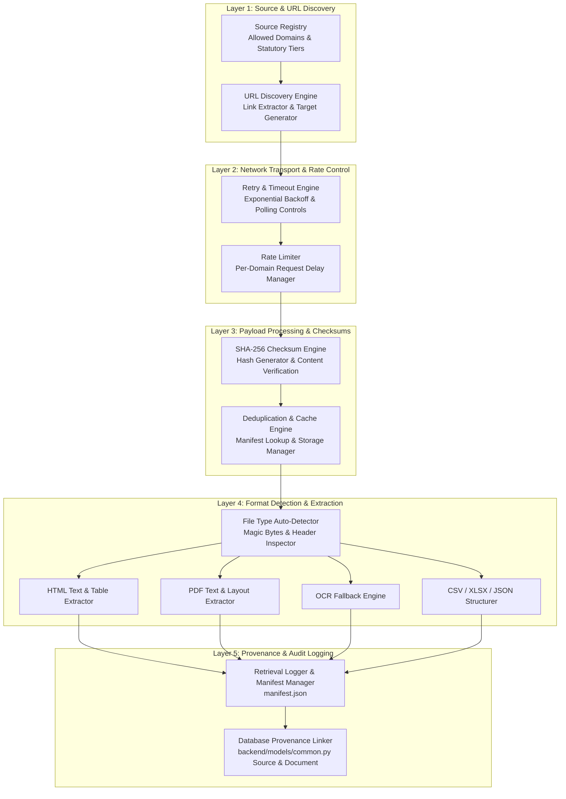

# Phase 6 — Public Record Acquisition Pipeline & Framework

## 1. Executive Summary & Objective

Phase 6 of **CIVICLENS TN** requires a robust, reusable, and compliant public record acquisition system to ingest documents regarding representative performance, parliamentary and assembly proceedings, local area development funds (MPLADS / MLACDS), constituency socioeconomic indicators, census figures, and election returns.

The acquisition pipeline enforces strict data provenance tracking, SHA-256 checksum verification, rate limiting, domain access permissions, format auto-detection, deduplication, retry logic, and fallback extraction (including PDF layout parsing and OCR for scanned documents).

> [!IMPORTANT]
> **Data Integrity & Non-Fabrication Rule:** Real Phase 6 raw datasets are ingested from verified institutional sources or tested against local test fixtures (`tests/fixtures/phase6_fixtures.py`). No arbitrary websites are scraped indiscriminately. All acquisitions respect robots policies, terms of service, and rate limits.

---

## 2. Acquisition Pipeline System Architecture

The acquisition framework operates through six modular layers:



---

## 3. The 13 Core Pipeline Capabilities

### 1. Configurable Source Registry
Maintains an extensible registry of authorized statutory and academic data sources (ECI, Sansad, TN Legislative Assembly, MPLADS, Census India, Data.gov.in, PRS India). Enforces allowed domains, statutory tiers (Tier 1 Statutory, Tier 2 Academic/NGO), and required authentication parameters.

### 2. URL Discovery
Scans landing pages, index tables, and search feeds to extract relative and absolute document links, filtering by target extension (`.pdf`, `.csv`, `.xlsx`, `.json`, `.html`), election term, or constituency keyword.

### 3. Document Download Engine
Executes HTTP GET requests with custom User-Agent headers, session management, redirect following, and streaming payload reception.

### 4. HTML Text & Table Extraction
Parses HTML proceedings and web tables using `BeautifulSoup4`. Extracts clean structured text, metadata tags, and tabular data into clean list/dict representations.

### 5. PDF Text & Layout Extraction
Extracts searchable text and multi-column layouts from native digital PDFs using `pdfplumber` and `pypdf`, preserving paragraph structure and page boundaries.

### 6. Table Extraction Pipeline
Parses tabular data across PDF schedules, HTML `<table>` elements, CSV files, and XLSX spreadsheets into normalized tabular dictionaries.

### 7. OCR Fallback Handler
Detects image-only or low-clarity scanned PDF pages. Automatically triggers Tesseract OCR (`pytesseract` / OCR interface) to extract Tamil and English text when digital text yield falls below threshold.

### 8. SHA-256 Checksum Verification
Computes cryptographic SHA-256 hashes for all ingested payloads before file persistence, guaranteeing data integrity.

### 9. Caching & Deduplication
Checks `manifest.json` for matching SHA-256 hashes or cached source URLs. If a duplicate file is detected, it links to the existing document ID rather than duplicating disk storage.

### 10. Retry & Timeout Handling
Applies configurable request timeouts (default 15.0s) and retry attempts (default 3 retries) with exponential backoff ($t_{\text{wait}} = t_{\text{base}} \times 1.5^{\text{attempt}}$) for transient network glitches.

### 11. Domain-Specific Rate Limiting
Enforces per-domain request throttling (default 1.0s to 3.0s delay between requests) to comply with server policies and prevent server overload.

### 12. Retrieval Logging & Manifest Management
Logs every acquisition attempt, HTTP status code, payload size, duration, and error traceback into `data/raw/representative_performance/manifest.json`.

### 13. Source Provenance Integration
Registers acquired files as ORM entities in `backend/models/common.py`:
- Maps source authority to `Source`.
- Creates raw record entry in `DataSource`.
- Creates document record in `Document` linked to SHA-256 file hash and storage path.

---

## 4. Supported Document Formats & Ingestion Matrix

| Format | Auto-Detection Method | Extraction Pipeline | Output Storage |
|---|---|---|---|
| **PDF** | Magic Bytes `%PDF` | `pdfplumber` + Layout Parser + OCR Fallback | Text & JSON Tables |
| **HTML** | `<html>` or `<!DOCTYPE html>` | `BeautifulSoup4` DOM & Table Parser | Cleaned Text & JSON |
| **CSV** | Text lines with comma separators | `csv.DictReader` / pandas | Structured JSON/SQL |
| **XLSX / XLS** | Magic Bytes `PK\x03\x04` / olefile | `openpyxl` / `xlrd` | Structured JSON/SQL |
| **JSON** | `{...}` / `[...]` root payload | `json.loads` structured validator | Native JSON/SQL |

---

## 5. Storage Directory Layout

Raw acquired files are organized deterministically under `data/raw/representative_performance/`:

```
data/raw/representative_performance/
├── manifest.json                        # Master acquisition index & audit log
├── SRC-ECI-RESULTS/                     # ECI Election Results
│   └── 2021/
│       └── TN_Assembly_2021_a8f3b21e.csv
├── SRC-SANSAD-QUESTIONS/                # Lok Sabha / Rajya Sabha MP Questions
│   └── 2023/
│       └── MP_Questions_2023_c41e90a1.json
├── SRC-TNLA-PROCEEDINGS/                # TN Assembly Proceedings (PDF)
│   └── 2022/
│       └── TNLA_Debate_2022_9d2f11bc.pdf
├── SRC-MPLADS-WORKS/                    # MPLADS Fund Release Statements
│   └── FY2023-24/
│       └── MPLADS_TN_2023_e72a44bb.xlsx
└── SRC-CENSUS-TN/                       # Census 2011 & Demographic Tables
    └── 2011/
        └── TN_District_Census_2011_f10a8812.csv
```

---

## 6. Verification & Test Fixtures Strategy

To support off-line development and continuous integration without live network dependencies:
* Synthetic test fixtures are maintained in `tests/fixtures/phase6_fixtures.py`.
* All mock documents include `is_test_fixture: True` tags.
* Unit tests in `tests/unit/test_phase6_acquisition.py` verify all 13 core capabilities using isolated mock streams.
