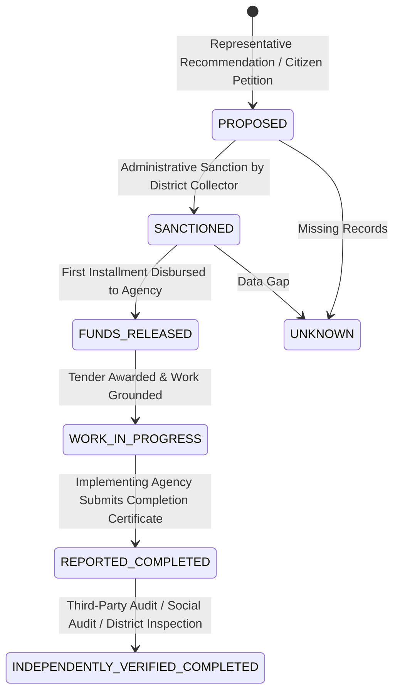

# Phase 6 — Constituency Works and Development Tracking Methodology

## 1. Executive Summary & Purpose

Phase 6 of **CIVICLENS TN** establishes a rigorous data model and verification engine for tracking constituency-level public infrastructure projects and development schemes:
* **MPLADS Records:** Member of Parliament Local Area Development Scheme (covering Lok Sabha and Rajya Sabha MPs from Tamil Nadu).
* **MLACDS Records:** MLA Constituency Development Scheme (covering 234 Tamil Nadu Assembly Constituencies).
* **State & Central Executive Schemes:** Public Works Department (PWD), Rural Development & Panchayat Raj (RDPR), and Municipal Administration infrastructure works.

> [!IMPORTANT]
> **Core Methodological Safeguards:**
> 1. **Allocation $\ne$ Expenditure:** Sanctioned funds and releases are never assumed to be spent. Every transaction separately tracks Sanctioned Amount, Released Amount, and Reported Expenditure.
> 2. **Expenditure $\ne$ Outcome:** Completing a financial transaction or erecting an asset (e.g. drilling a borewell or laying asphalt) does not guarantee the intended civic outcome (clean drinking water or lower accident rates).
> 3. **Strict Attribution Boundaries:** Government projects executed by line ministries in a constituency are **never** automatically attributed to the local MLA or MP unless explicitly funded or recommended under their statutory LAD quota.
> 4. **Independent Audit Verification:** Self-reported portal statuses (`REPORTED_COMPLETED`) are audited against independent district verification and CAG inspection findings.

---

## 2. Project Lifecycle & Status Hierarchy

Civic infrastructure progresses through seven unambiguous states:

### Definitions:
1. **`PROPOSED`:** Representative formally recommends project to District Nodal Authority.
2. **`SANCTIONED`:** District Collector / Nodal Officer issues formal administrative and financial sanction.
3. **`FUNDS_RELEASED`:** Treasury transfers funds to executing agency (DRDA, PWD, BDO).
4. **`WORK_IN_PROGRESS`:** Ground construction or equipment procurement is underway.
5. **`REPORTED_COMPLETED`:** Executing agency files self-reported completion certificate.
6. **`INDEPENDENTLY_VERIFIED_COMPLETED`:** Physical asset verified by CAG audit, social audit, or district inspection team.
7. **`UNKNOWN`:** Contradictory, missing, or corrupt status records.

---

## 3. Data Model & Field Specifications

Stored in `constituency_works` entity ([ConstituencyWork](file:///E:/CIVCLENS/backend/models/representative.py)):

| Field Name | Type | Description |
|---|---|---|
| `work_id` | String (PK) | Canonical identifier (e.g. `MPLADS-TN-PC01-2023-042`). |
| `representative_id` | String (FK, Nullable) | Linked MLA or MP. Set to `NULL` for executive state/central schemes. |
| `constituency_id` | String (FK) | Assembly or Parliamentary constituency where project is physically executed. |
| `scheme_id` | String | Scheme funding source (`MPLADS`, `MLACDS`, `STATE_PWD`, etc.). |
| `project_description` | Text | Title and scope (e.g. *Construction of 2 Smart Classrooms at Govt HSS, Kolathur*). |
| `sanctioned_amount` | Float | Gross approved budget in INR. |
| `released_amount` | Float | Actual capital disbursed from treasury to agency. |
| `reported_expenditure` | Float | Actual bill payments cleared to contractors. |
| `approval_date` | String (Date) | Date of administrative sanction (`YYYY-MM-DD`). |
| `completion_date` | String (Date, Nullable) | Certified physical completion date (`YYYY-MM-DD`). |
| `project_status` | String (Enum) | One of the 7 official status categories. |
| `implementing_agency` | String | Nodal agency executing work (DRDA, PWD, Corporation). |
| `attribution_type` | String (Enum) | `REPRESENTATIVE_SPONSORED`, `EXECUTIVE_STATE_PROJECT`, or `EXECUTIVE_CENTRAL_PROJECT`. |
| `verification_source` | String (Nullable) | Citation of audit report or physical inspection reference. |
| `has_conflicting_status`| Boolean | True if independent audit contradicts agency self-reporting. |
| `data_quality_issues` | JSON Array | Automated audit flags (missing dates, expenditure overruns). |
| `last_updated` | String (Date) | Date record was updated. |

---

## 4. Key Methodological Guardrails

### 4.1 Financial Reconciliation & Disclaimers
* **Unspent Balances:** Unspent funds are explicitly computed:
  $$\text{Unspent Balance} = \text{Released Amount} - \text{Reported Expenditure}$$
* **Pending Releases:** Treasury bottlenecks are surfaced:
  $$\text{Unreleased Funds} = \text{Sanctioned Amount} - \text{Released Amount}$$
* **Expenditure Cap Assertion:** If `reported_expenditure > released_amount`, the service flags `EXPENDITURE_EXCEEDS_RELEASE` and marks `has_conflicting_status = True`.

### 4.2 Non-Attribution of General Executive Schemes
* Elected MLAs and MPs frequently hold public rallies inaugurating major state or central highways, flyovers, medical colleges, or water pipelines funded entirely by state departmental budgets.
* **The Safeguard:** Only projects funded through statutory discretionary quotas (`MPLADS` / `MLACDS`) are categorized as `REPRESENTATIVE_SPONSORED`.
* General executive schemes are categorized as `EXECUTIVE_STATE_PROJECT` or `EXECUTIVE_CENTRAL_PROJECT` with `representative_id = NULL`, preventing unearned credit or unfair penalty for executive delays.

### 4.3 Handling Conflicting Statuses
* If a portal self-reports a project as `REPORTED_COMPLETED`, but an independent district inspection or CAG report discovers the work is incomplete or abandoned:
  1. `has_conflicting_status` is flagged as `True`.
  2. The issue `AUDIT_STATUS_CONFLICT` is logged into `data_quality_issues`.
  3. The project is quarantined from positive completion credit until reconciled.

---

## 5. Verification & Test Suite

The methodology and implementation are verified in `tests/unit/test_phase6_constituency_works.py` covering:
1. **Financial Totals & Reconciliations:** Accurate aggregation of sanctioned, released, expenditure, and unspent balances.
2. **Missing Dates Handling:** Flagging completed projects lacking completion dates or sanctioned projects lacking approval dates.
3. **Conflicting Status Resolution:** Detecting contradictions between self-reported portal claims and audit findings.
4. **Attribution Boundaries:** Verifying executive projects clear `representative_id` to prevent false individual attribution.
5. **Duplicate Projects & Geographic Mapping:** Resolving projects to valid constituencies and identifying duplicates.
