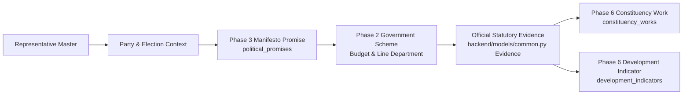

# Phase 6 — Political Promise Cross-Reference & Performance Methodology

## 1. Executive Summary & Purpose

Phase 6 of **CIVICLENS TN** connects public representative performance tracking with the established **Phase 3 Political Promise Tracker** and **Phase 2 Historical Scheme Intelligence**.

The goal is to provide an empirical, auditable chain linking electoral commitments made to voters with tangible legislative, financial, and developmental actions:

> [!IMPORTANT]
> **Core Methodological Safeguards:**
> 1. **Strict Non-Creation Rule:** Phase 6 does **not** create or synthesize political promises. All promise linkages must reference verified, pre-existing `PoliticalPromise` entities from Phase 3.
> 2. **Scheme Existence $\ne$ Promise Fulfillment:** The fact that a government scheme exists (or shares keywords with a promise) does **not** prove the specific promise commitment was met.
> 3. **Project Completion $\ne$ Development Outcome:** Completing a physical work (e.g. constructing an RO plant) is an output, not automatic proof of a broader socioeconomic outcome (potable tap water access).
> 4. **Temporal Sanity (Conflicting Dates):** Pre-existing government programs completed before an election cannot be claimed as fulfillment of subsequent election manifesto promises.

---

## 2. The 6-Tier Fulfillment Evidence Hierarchy

To eliminate superficial binary claims ("Broken" vs. "Kept"), CIVICLENS TN categorizes promise delivery into six transparent evidence stages:

| Stage Code | Stage Name | Definition & Evidence Standard |
|---|---|---|
| `STAGE 1` | `PROMISE_IDENTIFIED` | Promise is extracted from the representative's party manifesto for the target election cycle. No subsequent action documented yet. |
| `STAGE 2` | `RELEVANT_SCHEME_IDENTIFIED` | Existing or newly created departmental scheme linked via Phase 2 scheme intelligence. *(Disclaimer: Scheme existence alone is not proof of fulfillment).* |
| `STAGE 3` | `POLICY_ACTION_DOCUMENTED` | Verified Government Order (G.O.), budgetary Demand on Grants allocation, or legislative Act documented in `Evidence`. |
| `STAGE 4` | `PROJECT_WORK_RECORDED` | Tangible physical project ground-executed under MPLADS, MLACDS, or line department scheme in the representative's constituency. |
| `STAGE 5` | `OUTCOME_INDICATOR_OBSERVED` | Quantifiable improvement observed in an official socioeconomic or demographic development indicator over baseline. |
| `STAGE 6` | `INSUFFICIENT_EVIDENCE` | Documented claims are ambiguous, contradictory, temporally conflicting, or lack statutory verification. |

---

## 3. Data Model & Storage Specifications

Stored in `promise_performance_links` entity ([PromisePerformanceLink](file:///E:/CIVCLENS/backend/models/representative.py)):

| Field Name | Type | Description |
|---|---|---|
| `link_id` | String (PK) | Canonical link identifier (e.g. `LNK-REP013-PROM412-SCH05`). |
| `representative_id` | String (FK) | Canonical elected representative. |
| `promise_id` | String (FK) | Reference to Phase 3 `political_promises.promise_id`. |
| `party_id` | String (FK) | Political party sponsoring the manifesto. |
| `election_id` | String (FK) | Election cycle establishing the mandate. |
| `scheme_id` | String (Nullable) | Associated state or central scheme code. |
| `evidence_id` | Integer (FK, Nullable) | Link to statutory proof in `backend/models/common.py` `Evidence`. |
| `work_id` | String (FK, Nullable) | Link to physical project in `constituency_works`. |
| `indicator_id` | String (FK, Nullable) | Link to development metric in `development_indicators`. |
| `evidence_stage` | String (Enum) | One of the 6 official evidence stages. |
| `matching_method` | String | `PARTY_MANIFESTO_DIRECT`, `SEMANTIC_SIMILARITY`, or `KEYWORD_MATCH`. |
| `match_confidence` | Float | Algorithm confidence score (0.0 to 1.0). |
| `has_conflicting_dates`| Boolean | True if temporal chronology is inverted (e.g. action predates promise). |
| `evidence_summary` | Text | Narrative audit explanation of the linkage. |

---

## 4. Methodological Distinctions & Caveats

### 4.1 Scheme Existence vs. Specific Promise Fulfillment
* **The Fallacy:** A political party promises to *"Provide ₹1,000 monthly financial assistance to all women heads of households"*. An analyst observes an existing scheme called *"Moovalur Ramamirtham Ammaiyar Scheme"* and marks the promise fulfilled.
* **The CIVICLENS TN Rule:** A scheme match merely advances evidence to `RELEVANT_SCHEME_IDENTIFIED`. Progression to `POLICY_ACTION_DOCUMENTED` requires specific evidence (e.g. G.O. Ms. No. 12 establishing the *Kalaignar Magalir Urimai Thittam* with specified budget and eligibility).

### 4.2 Project Output vs. Broader Developmental Outcome
* **The Fallacy:** Building 10 classrooms under MLACDS automatically fulfills a promise to *"Eliminate school dropouts in Kolathur"*.
* **The CIVICLENS TN Rule:** Building classrooms is recorded at `PROJECT_WORK_RECORDED`. Advancing to `OUTCOME_INDICATOR_OBSERVED` requires empirical Census or UDISE+ indicator proof showing a reduction in the constituency secondary dropout rate.

### 4.3 Conflicting Dates & Temporal Sanity
* If a project was executed in **2018**, but the linked promise was made in the **2021** election manifesto:
  1. `has_conflicting_dates` is flagged as `True`.
  2. The stage is downgraded to `INSUFFICIENT_EVIDENCE`.
  3. The link is excluded from representative performance credit.

---

## 5. Verification & Test Suite

The pipeline is verified in `tests/unit/test_phase6_promise_cross_reference.py` covering:
1. **Representative & Promise Chain Linking:** Verified link traversal from representative to promise, scheme, and evidence.
2. **Strict Non-Creation Rejection:** Attempting to link a non-existent promise raises `PromiseNotFoundError`.
3. **Temporal Inversion Detection:** Flagging links where action dates predate election manifestos.
4. **Evidence Stage Progression:** Verifying proper classification across the 6-tier hierarchy.
5. **Representative Scorecard Aggregation:** Verifying coverage networks and mandatory disclaimers.
