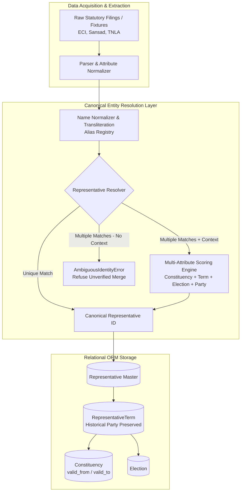

# Phase 6 — Representative & Constituency Canonical Registry

## 1. Executive Summary & Purpose

Phase 6 of **CIVICLENS TN** introduces the canonical registry and mapping engine for elected public representatives:
- **Tamil Nadu MLAs** (234 Assembly seats in Tamil Nadu Legislative Assembly)
- **Lok Sabha MPs** (39 Parliamentary Constituencies representing Tamil Nadu)
- **Rajya Sabha MPs** (18 members elected by the state legislature to the Council of States)
- **Historical Representatives & Multi-Term Tenures** (tracking politicians across multiple election cycles, changing parties, or moving constituencies)
- **Constituency Boundary & Naming Changes** (handling historical delimitation reorganizations such as the 1976 and 2008 Delimitation Orders)

> [!IMPORTANT]
> **Identity Disambiguation Rule:** Public representatives must **never be identified solely by name**. In Tamil Nadu electoral history, dozens of candidates share identical names or initials (e.g. *R. Chandrasekar*, *S. Muthusamy*, *K. Ponmudy*). All entity resolution requires multi-attribute context including election cycle, constituency, tenure dates, and party affiliation.

---

## 2. Canonical Registry Architecture

---

## 3. Core Entities & Field Specifications

### 3.1 `Representative`
Stores master person records for elected public officials:
- `representative_id` (PK, String): Unique canonical identifier (e.g. `REP-MLA-013-STALIN`, `REP-MP-001-VEERASWAMY`).
- `official_name` (String): Standardized official full name.
- `aliases` (JSON Array): Multilingual aliases and variations (e.g. `["M. K. Stalin", "MK Stalin", "மு.க. ஸ்டாலின்"]`).
- `representative_type` (Enum): `MLA`, `LOK_SABHA_MP`, or `RAJYA_SABHA_MP`.
- `party_id` (FK, Nullable): Current or primary political party.
- `constituency_id` (FK, Nullable): Current or latest constituency.
- `election_id` (FK, Nullable): Latest election cycle.
- `term_start` (String, Date): Start date of current tenure.
- `term_end` (String, Date, Nullable): End date of tenure (NULL if active).
- `source_document_ids` (JSON Array): References to source filings in `backend/models/common.py` `Document`.
- `person_id` (FK, Nullable): Link to Phase 4 `PoliticalPerson`.

### 3.2 `Constituency`
Stores Assembly and Parliamentary electoral divisions with temporal validity:
- `constituency_id` (PK, String): Unique identifier (e.g. `AC-013-2008`, `PC-001-2008`).
- `official_name` (String): Gazette name of constituency (e.g. `Kolathur`, `Chennai North`).
- `constituency_type` (Enum): `ASSEMBLY` (234 seats) or `PARLIAMENTARY` (39 seats).
- `district` (String): Administrative district (e.g. `Chennai`, `Salem`).
- `state` (String): Default `Tamil Nadu`.
- `valid_from` (String, Year): Starting boundary validity (e.g. `2008`).
- `valid_to` (String, Year, Nullable): Boundary sunset date (NULL if active).
- `reservation_status` (Enum): `GENERAL`, `SC`, `ST`.
- `delimitation_year` (Integer): e.g. `1976` or `2008`.
- `predecessor_id` / `successor_id`: Traceability for merged, renamed, or redrawn constituencies.
- `source_document_ids` (JSON Array): Statutory delimitation notifications.

### 3.3 `RepresentativeTerm`
Preserves historical integrity for each tenure served by a representative:
- `term_id` (PK, String): Unique tenure record (e.g. `TERM-REP-013-2021`).
- `representative_id` (FK): Canonical representative.
- `constituency_id` (FK, Nullable): Represented constituency (NULL for Rajya Sabha MPs who represent the state at large).
- `election_id` (FK, Nullable): Election result that established the term.
- `party_id` (FK): **Historical party affiliation during this specific term**.
- `term_number` (Integer): Ordinal term count (1, 2, 3...).
- `house_type` (String): `TN_ASSEMBLY`, `LOK_SABHA`, or `RAJYA_SABHA`.
- `term_start` / `term_end`: Term tenure dates.
- `is_active_term` (Boolean): True if currently serving.
- `votes_polled`, `win_margin_votes`, `win_margin_percent`: Electoral performance metrics.

### 3.4 `ConstituencyBoundaryHistory`
Tracks historical changes across delimitation eras:
- `history_id` (PK): Unique change record.
- `constituency_id` (FK): Target constituency.
- `historical_name`: Name during prior delimitation period.
- `delimitation_order`: Delimitation commission notification reference.
- `valid_from` / `valid_to`: Active period.
- `change_summary`: Narrative of redrawn boundaries, merged wards, or shifted reservation status.

---

## 4. Disambiguation & Entity Resolution Strategy

### 4.1 Strict Multi-Attribute Disambiguation Algorithm

When matching ingested raw documents (Hansard debates, question records, MPLADS entries) to canonical representatives:

1. **Exact Name & Alias Lookup:** Identify all candidate representatives whose official name or aliases match the normalized query.
2. **Ambiguity Detection:**
   - If exactly **one** candidate matches and no conflicting parameters are specified $\rightarrow$ successfully resolved.
   - If **multiple** candidates match and **no context** is provided $\rightarrow$ raise `AmbiguousIdentityError`. **Never merge blindly.**
3. **Contextual Weighted Scoring:**
   When multiple candidates match, evaluate contextual attributes:
   $$\text{Score} = S_{\text{type}} + S_{\text{constituency}} + S_{\text{election}} + S_{\text{term\_year}} + S_{\text{party}}$$
   - **Representative Type Match:** $+25$ points (mismatch: $-50$ points penalty).
   - **Constituency Match:** $+40$ points (or $+35$ if matched across historical terms).
   - **Election Match:** $+30$ points (or $+25$ for historical election match).
   - **Term Year Active Match:** $+25$ points.
   - **Historical Party Match:** $+20$ points for term party match ($+15$ for current party).
4. **Resolution Threshold:**
   - Candidate with the highest score is selected only if:
     1. $\text{Score}_{\text{winner}} > 0$
     2. $\text{Score}_{\text{winner}} - \text{Score}_{\text{runner\_up}} \ge 10.0$ (clear statistical margin).
   - Otherwise, an `AmbiguousIdentityError` is raised.

---

## 5. Preservation of Historical Realities

### 5.1 Historical Party Affiliations
Politicians in Tamil Nadu periodically switch parties (e.g. defection, faction splits, coalition realignments). 
* **The Rule:** The system preserves the party affiliation held *at the time of the term* in `RepresentativeTerm.party_id`.
* **Example:** If Representative *X* won under Party *A* in the 2011 election, and later joined Party *B* in 2021, queries for the 2011–2016 term return Party *A*, while queries for 2021 return Party *B*. The current affiliation on `Representative.party_id` is never retroactively imposed.

### 5.2 Rajya Sabha Representation Model
* Unlike MLAs and Lok Sabha MPs, Rajya Sabha members represent the state of Tamil Nadu as a whole rather than a geographic constituency.
* The registry models Rajya Sabha representatives with `constituency_id = NULL` and `house_type = RAJYA_SABHA`, preventing false constraints or failed lookups.

### 5.3 Delimitation Boundaries
* Constituencies redrawn or renamed under the 2008 Delimitation Order (e.g. `Triplicane` merged into `Chepauk-Thiruvallikeni`, or `Periyakulam` reorganizations) maintain distinct IDs with explicit `valid_from` and `valid_to` bounds.
* Queries specify the reference election year to resolve the correct geographical boundary.

---

## 6. Verification & Test Suite

The registry and disambiguation engine are verified in `tests/unit/test_phase6_registry.py` covering:
1. **Duplicate Names Disambiguation:** Resolving two distinct representatives sharing identical names across different constituencies.
2. **Name-Only Rejection:** Verifying that querying ambiguous names without context raises `AmbiguousIdentityError`.
3. **Historical Party Preservation:** Confirming historical terms maintain the correct party affiliation across career transitions.
4. **Constituency Boundary Changes:** Querying pre- and post-delimitation constituencies with date bounds.
5. **Rajya Sabha State-Wide Members:** Handling non-constituency representatives cleanly.
6. **Multilingual Alias Matching:** Resolving queries in Tamil script and English transliterations.
