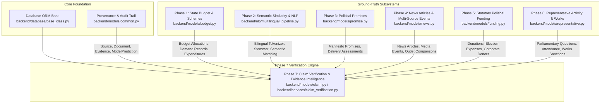
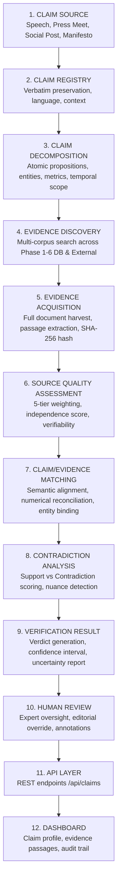
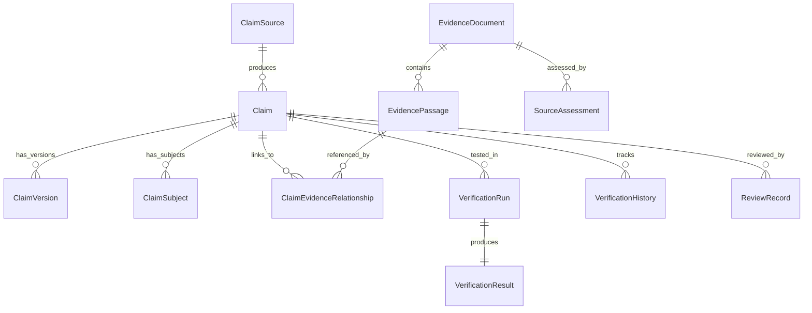

# Phase 7 — Political Claim Verification & Evidence Intelligence Architecture

## 1. Executive Summary & Objective

Phase 7 of **CIVICLENS TN** introduces the **Political Claim Verification & Evidence Intelligence** module. Its goal is to provide a transparent, multi-source, reproducible evidence engine for analyzing public claims, electoral assertions, policy announcements, and political statements made in Tamil Nadu.

> [!IMPORTANT]
> **Core System Constraints & Non-Negotiable Directives:**
> 1. **Preserve Original Claim:** Verbatim text, language, speaker, date, and context must remain unedited.
> 2. **Identify Exact Proposition:** Decompose compound statements into discrete, checkable atomic propositions.
> 3. **Distinguish Evidence from Interpretation:** Primary factual evidence is isolated from analytical inference and editorial opinion.
> 4. **Seek Both Supporting and Contradicting Evidence:** Verification is strictly non-partisan; the pipeline actively retrieves and scores both confirmatory and disconfirmatory evidence.
> 5. **Expose Uncertainty & Source Limitations:** If evidence is partial, conflicting, or unavailable, the system explicitly flags uncertainty rather than forcing a binary verdict.
> 6. **Retain Source-Level Provenance:** Every evidence passage links directly to its parent document, page/paragraph, timestamp, and SHA-256 hash.
> 7. **Allow Human Review:** Automated verification runs are auditable recommendations; human experts can inspect, validate, override, or annotate results.
> 8. **No Truthfulness Rankings for Politicians or Parties:** The system evaluates **individual verifiable propositions**, never assigning aggregate "honesty" or "deception" scorecards to candidates or political organizations.

---

## 2. Integration with Existing Repository Infrastructure (Phases 1–6 Audit)

Phase 7 builds upon the proven database, models, NLP pipelines, and REST APIs developed across Phases 1 through 6, avoiding redundancy:

### Module Audit & Evidence Contribution:
- **Phase 1 (Budget & Expenditure):** Supplies ground-truth fiscal numbers (Budget Estimates, Revised Estimates, Actual Expenditure) across 10+ financial years. Used to verify fiscal allocation claims.
- **Phase 2 (Scheme Intelligence & NLP):** Supplies multilingual (Tamil/English) tokenization, normalization, entity extraction, and semantic embeddings for claim matching.
- **Phase 3 (Promise Tracker):** Supplies party manifesto promises and implementation assessments (Implemented, Partially Implemented, Unclear). Used to verify claims about election promise delivery.
- **Phase 4 (Tamil News & Multi-Source Reporting):** Supplies indexed news articles across Tamil and English publications, timeline tracking, and cross-outlet divergence. Used to discover claims and contemporaneous reports.
- **Phase 5 (Political Funding):** Supplies audited ECI disclosures (Form 24A donations, electoral trusts, campaign expenditure returns). Used to verify claims regarding political money and corporate donations.
- **Phase 6 (Representative Performance):** Supplies parliamentary attendance, question records (starred/unstarred), debates, MPLADS/MLACDS allocations, and constituency indicators. Used to verify claims about elected officials' conduct.

---

## 3. End-to-End Verification Pipeline

The verification engine follows an 11-stage linear processing architecture:

### Pipeline Functional Details:
1. **CLAIM SOURCE:** Ingestion of raw speech audio/transcripts, press releases, social media assertions, and manifesto texts.
2. **CLAIM REGISTRY:** Immutable recording of the original utterance, retaining bilingual text, speaker, date, venue, and medium.
3. **CLAIM DECOMPOSITION:** Parsing complex claims into discrete verifiable propositions, isolating specific temporal scopes, numerical metrics, geographic extents, and target populations.
4. **EVIDENCE DISCOVERY:** Querying internal Phase 1–6 databases and external official portals for corroborating or refuting documents.
5. **EVIDENCE ACQUISITION:** Retrieving official documents, extracting relevant paragraphs/passages, and securing cryptographic SHA-256 hashes.
6. **SOURCE QUALITY ASSESSMENT:** Computing objective credibility and independence scores based on institutional tiering (Tiers 1–5).
7. **CLAIM/EVIDENCE MATCHING:** Measuring semantic similarity, binding extracted entities to canonical databases, and reconciling claimed numerical figures against official statistics.
8. **CONTRADICTION ANALYSIS:** Evaluating degree of factual contradiction, contextual omissions, temporal discrepancies, or definitional shifts.
9. **VERIFICATION RESULT:** Synthesizing an evidence-backed preliminary verdict (`SUPPORTED`, `CONTRADICTED`, `PARTIALLY_SUPPORTED`, `MISLEADING_CONTEXT`, `UNVERIFIABLE_INSUFFICIENT_EVIDENCE`, `DISPUTED_METHODOLOGY`).
10. **HUMAN REVIEW:** Providing a review workspace for civic analysts to inspect supporting passages, evaluate edge cases, and confirm or override the preliminary automated finding.
11. **API LAYER:** Exposing full structured claim profiles, evidence relationships, and review history via RESTful endpoints.
12. **DASHBOARD:** Presenting interactive evidence breakdowns, passage highlights, and uncertainty disclosures for public scrutiny.

---

## 4. Core Data Entities

Phase 7 defines 12 relational entities in `backend/models/claim.py`:

### Entity Schema Definitions:
1. **`Claim`:** Root entity preserving canonical claim ID, original text, normalized text, primary language, category, speaker ID, source reference, and current verification status.
2. **`ClaimVersion`:** Versioning record capturing editorial corrections to transcripts, language transliterations, or contextual notes without overwriting the original claim.
3. **`ClaimSubject`:** Atomic decomposed subject or entity (politician, political party, government department, scheme, geographical region, or statistical indicator).
4. **`ClaimSource`:** Provenance entity detailing where, when, and how the claim was uttered or published (URL, media type, archive link, collection date).
5. **`EvidenceDocument`:** Statutory document, press release, audit report, legislative transcript, or fact-check article acquired as evidence.
6. **`EvidencePassage`:** Exact textual paragraph, table cell, or statement extracted from an `EvidenceDocument`, including page number and context.
7. **`ClaimEvidenceRelationship`:** Junction entity modeling the explicit relationship (`SUPPORTS`, `CONTRADICTS`, `PARTIALLY_SUPPORTS`, `CONTEXTUALIZES`, `NEUTRAL`) between a `Claim` and an `EvidencePassage`.
8. **`VerificationRun`:** Execution log tracking an automated verification pipeline pass (engine version, models used, timestamp, duration).
9. **`VerificationResult`:** Computed verification finding containing the verdict, numerical confidence score, summary rationale, supporting score, contradicting score, and uncertainty analysis.
10. **`VerificationHistory`:** Audit log capturing every verdict transition, rationale update, or confidence adjustment over time.
11. **`SourceAssessment`:** Objective evaluation of an evidence source's reliability tier (Tier 1 to 5), institutional independence, and verifiability score.
12. **`ReviewRecord`:** Record of human expert intervention (reviewer identity, action, comments, timestamp, override status).

---

## 5. Supported Claim Categories

The module natively supports 11 standardized claim categories:
1. `GOVERNMENT_SCHEMES`: Claims regarding welfare schemes, eligibility rules, beneficiary coverage, and rollout dates (e.g., Kalaignar Magalir Urimai Thogai, Pudhumai Penn).
2. `BUDGET_EXPENDITURE`: Claims about state budget outlays, revised estimates, deficits, debt burdens, and department funds.
3. `ELECTION_RESULTS`: Claims regarding voter turnouts, victory margins, polling station counts, candidate vote shares, and EVM data.
4. `POLITICAL_PROMISES`: Claims regarding election manifesto fulfillment, broken promises, or newly introduced policy actions.
5. `REPRESENTATIVE_ACTIVITY`: Claims concerning MLA/MP parliamentary attendance, starred questions, debate participation, and bills introduced.
6. `PUBLIC_FUNDING`: Claims regarding corporate political donations, electoral trust allocations, and campaign spending filings.
7. `DEMOGRAPHIC_STATISTICS`: Claims concerning population growth, sex ratio, fertility, urban migration, and community representation.
8. `PUBLIC_INFRASTRUCTURE`: Claims regarding highway construction, bus procurement, airport expansion, irrigation canals, and rural electrification.
9. `HEALTHCARE_EDUCATION`: Claims regarding medical college seats, infant mortality rate (IMR), maternal mortality, government school enrollment, and Gross Enrollment Ratio (GER).
10. `EMPLOYMENT_ECONOMIC`: Claims regarding job creation figures, state unemployment rate, Gross State Domestic Product (GSDP), per capita income, and industrial investment.
11. `OTHER_PUBLIC_INTEREST`: Other verifiable claims of significant public civic interest in Tamil Nadu.
