# Phase 7 — Political Claim Registry and Claim Ingestion Architecture

## 1. Overview & Objectives

Phase 7.2 of **CIVICLENS TN** introduces the **Claim Registry & Ingestion Pipeline**. It provides a structured, multi-channel intake gateway for public political statements, electoral assertions, legislative speeches, media reports, and citizen submissions in Tamil Nadu.

> [!IMPORTANT]
> **Core Ingestion Directives:**
> 1. **Verbatim Preservation:** The exact original wording of the statement must be preserved permanently without alteration, paraphrasing, or editorial clean-up in the primary storage record.
> 2. **Strict Non-Inference Rule:** The system **never** guesses or infers the speaker, party, role, date, or context if they cannot be verified with certainty from the primary source. Missing attributes remain explicitly `null` / `None`.
> 3. **Attribution Distinction:** Statements must be categorized by their attribution modality (`DIRECT_QUOTE`, `PARAPHRASE`, `JOURNALIST_DESCRIPTION`, `USER_SUBMITTED`, `AUTOMATED_EXTRACTION`).
> 4. **Deduplication Without Over-Merging:** Identical statements made on different dates or by different politicians are distinct political events and must be preserved with their own identifiers. Only identical statements from the same event are flagged as exact duplicates.
> 5. **Audit-Trail Versioning:** Revisions to transcripts, phonetic transliterations, or newly discovered contextual notes are stored as separate `ClaimVersion` records; they never overwrite the original claim text.

---

## 2. Ingestion Pipeline Across 8 Candidate Channels

```mermaid
flowchart TD
    subgraph 8 Intake Channels
        C1[1. Public Speeches & Rallies]
        C2[2. Official Govt Statements]
        C3[3. Party Press Releases]
        C4[4. Legislative Floor Hansard]
        C5[5. Election Manifestos]
        C6[6. Tamil & English News Articles]
        C7[7. Independent Fact-Checks]
        C8[8. Citizen User Submissions]
    end

    subgraph Claim Ingestion Service
        C1 & C2 & C3 & C4 & C5 & C6 & C7 & C8 --> INTAKE[ClaimIngestionService<br/>backend/services/claim_ingestion.py]
        INTAKE --> FP[Content Fingerprinting & Normalization<br/>SHA-256 NFC Unicode]
        FP --> DUP[Deduplication & Distinction Engine]
        DUP -->|Exact Match on Same Event| RES_DUP[DUPLICATE_EXACT<br/>Preserve Existing Record]
        DUP -->|Correction / Added Context| RES_VER[VERSION_ADDED<br/>Register ClaimVersion]
        DUP -->|Same Text, Different Date/Speaker| RES_REIT[DISTINCT_REITERATION<br/>Register New Claim with Cross-Reference]
        DUP -->|New Statement| RES_NEW[CREATED<br/>Register Canonical Claim]
    end

    subgraph Database Layer
        RES_NEW & RES_REIT --> DB_CLAIM[(political_claims)]
        RES_VER --> DB_VER[(claim_versions)]
    end
```

### Channel Ingestion Protocols:
1. **Public Speeches & Campaign Rallies (`PUBLIC_SPEECH`):**
   - Transcribed from audio/video broadcasts or party YouTube channels.
   - Preserves venue and speech date.
   - Enforces attribution check: statements enclosed in quotes or spoken on video are `DIRECT_QUOTE`; summarized remarks are `PARAPHRASE`.
2. **Official Government Statements (`OFFICIAL_STATEMENT`):**
   - Harvested from Tamil Nadu DIPR or Central PIB communiques.
   - Retains official issuing department and administrative title.
   - Partisan affiliation is strictly `None` (executive civil communications are non-partisan).
3. **Political Party Press Releases (`PRESS_RELEASE`):**
   - Formal bulletins released on official party letterhead or portal.
   - Records spokesperson name and formal party tag.
4. **Legislative Records (`LEGISLATIVE_RECORD`):**
   - Extracted from Tamil Nadu Legislative Assembly proceedings or Sansad (Lok Sabha / Rajya Sabha) question answers.
   - Retains formal question ID (starred/unstarred) and parliamentary session date.
5. **Political Manifestos (`MANIFESTO`):**
   - Ingested from official party election manifestos (DMK, AIADMK, BJP, INC, etc.).
   - Attributed to the party election committee; records election year and page number.
6. **News Articles (`NEWS_ARTICLE`):**
   - Sourced from Tamil and English news media via Phase 4 pipelines.
   - Explicitly separates direct politician quotes (`DIRECT_QUOTE`) from journalistic summaries (`JOURNALIST_DESCRIPTION`).
   - Publication date is recorded, but the claim date is NOT inferred unless the article explicitly specifies the speech date.
7. **Independent Fact-Check Articles (`FACT_CHECK_ARTICLE`):**
   - Ingested from IFCN-accredited organizations via ClaimReview JSON-LD markup.
   - Stores reviewed claim text and fact-checker citation URL.
8. **User Submissions (`MANUAL_SUBMISSION`):**
   - Submitted by civic users and researchers via public form.
   - Marked with `attribution_type=USER_SUBMITTED` and `review_status=PENDING_REVIEW`.

---

## 3. Required Metadata Schema per Claim

For every registered claim, the system stores the following mandatory and conditional fields:

| Field | Type | Description | Strict Ingestion Policy |
|---|---|---|---|
| `claim_id` | String | Unique identifier (e.g. `CLM-2024-001`) | Immutable primary key. |
| `original_text` | Text | Exact verbatim wording | Immutable; preserved exactly as uttered or written. |
| `language` | String | Primary language (`ta`, `en`, `bilingual`) | Preserves Tamil script, English, or transliterations. |
| `speaker_name` | String | Identity of speaker / politician | Stored only where identified; **`None` if unverified**. |
| `speaker_role` | String | Official or constitutional role | Stored where supported (e.g. `Chief Minister`); **`None` if unverified**. |
| `party` | String | Political party affiliation | Stored where supported; **`None` if unverified**. |
| `claim_date` | DateTime | Exact date statement was uttered | Recorded only when verified from source; **`None` if unverified**. |
| `publication_date`| DateTime | Date document or article published | Recorded where applicable (e.g. newspaper date). |
| `claim_source_url`| String | Canonical URL of source video or doc | Verifiable origin link. |
| `source_document_id`| String| Reference to ingested document ID | Foreign link to Phase 1–6 or Phase 7 documents. |
| `claim_category` | Enum | One of 11 standardized categories | Mandatory classification. |
| `geographic_scope`| String | Geographic extent (`Tamil Nadu`, `Madurai`) | Defaults to `Tamil Nadu` if statewide. |
| `extraction_method`| String | Mechanism of intake | e.g. `SPEECH_TRANSCRIPT`, `NEWS_TEXT_EXTRACTOR`. |
| `attribution_type`| Enum | Quotation / reporting modality | `DIRECT_QUOTE`, `PARAPHRASE`, `JOURNALIST_DESCRIPTION`, `USER_SUBMITTED`. |
| `candidate_source_type`| Enum | Ingestion channel | `PUBLIC_SPEECH`, `NEWS_ARTICLE`, `MANIFESTO`, etc. |
| `review_status` | Enum | Human review state | Defaults to `PENDING_REVIEW`. |
| `created_at` | DateTime | Ingestion timestamp | Automatic UTC timestamp; never backfills `claim_date`. |

---

## 4. Attribution Distinction Taxonomy

| Attribution Type | Operational Definition | Example |
|---|---|---|
| **`DIRECT_QUOTE`** | Exact words spoken on audio/video or printed between quotation marks in primary text. | *"நாங்கள் ஆட்சிக்கு வந்தால் நீட் தேர்வு ரத்து செய்யப்படும்"* |
| **`PARAPHRASE`** | Reported speech where the core argument is conveyed in indirect grammar without exact quotes. | *The Minister stated that NEET would be abolished if their alliance assumed office.* |
| **`JOURNALIST_DESCRIPTION`**| Analytical observation, event narrative, or reporter's summary of what occurred. | *The opposition staged a walkout protesting the government's delay in NEET legislation.* |
| **`USER_SUBMITTED`** | Candidate claim submitted by an external citizen or researcher via intake portal. | *Citizen submission reporting a politician's promise during a neighborhood ward visit.* |
| **`AUTOMATED_EXTRACTION`** | Candidate proposition parsed automatically by NLP dependency parsing or named entity triggers. | *Automated ClaimReview parser extraction from factcheck.pib.gov.in.* |

---

## 5. Deduplication & Material Distinction Policy

The deduplication engine distinguishes between genuine duplicate records and distinct political reiterations:

### 5.1 Content Fingerprinting
$$\text{Fingerprint} = \text{SHA256}(\text{CollapseWhitespace}(\text{StripPunctuation}(\text{UnicodeNormalize}_{\text{NFC}}(\text{Text}))))$$

### 5.2 Decision Logic
1. **Exact Duplicate (`DUPLICATE_EXACT`):**
   - Matching fingerprint + same speaker name + same claim date (or both None).
   - **Action:** Reject redundant database write; return existing `claim_id`.
2. **Materially Distinct Reiteration (`DISTINCT_REITERATION`):**
   - Matching fingerprint, but uttered on a **different date** (e.g. repeated campaign promise at two different rallies) or by a **different politician**.
   - **Action:** Create a distinct `Claim` record with a unique `claim_id`. Cross-reference previous instances in `metadata_json["related_reiteration_claim_ids"]`.
3. **Correction or Supplemental Context (`VERSION_ADDED`):**
   - When new evidence clarifies the exact wording of a previously recorded audio snippet, or adds bilingual transliteration.
   - **Action:** Call `add_claim_version(claim_id, ...)`. Create `ClaimVersion` (v2, v3, ...). The canonical `original_text` remains untouched.

---

## 6. REST API Ingestion Endpoints

- **`POST /api/claims/ingest`:** Full pipeline intake for single claim candidates with deduplication and attribution.
- **`POST /api/claims/check-duplicate`:** Pre-submission check returning duplicate probability and related claim IDs.
- **`POST /api/claims/<claim_id>/version`:** Adds an auditable revision or transliteration version to an existing claim.
