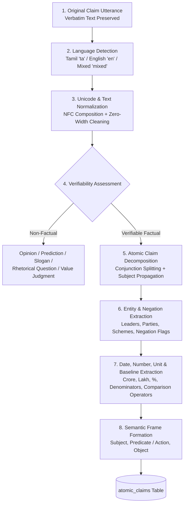

# Phase 7 — Multilingual Claim Decomposition and NLP Processing Architecture

## 1. Overview & Objectives

Phase 7.4 of **CIVICLENS TN** introduces the **Multilingual Claim Decomposition & NLP Processing Pipeline**. It provides a rigorous, culturally nuanced natural language understanding engine designed for Tamil, English, and code-switched (mixed / Tanglish) political discourse in Tamil Nadu.

> [!IMPORTANT]
> **Core NLP Principles:**
> 1. **Immutable Verbatim Preservation:** The original utterance or written statement is **never** mutated, truncated, or paraphrased in primary storage.
> 2. **Tamil Text Integrity:** For Tamil claims, the exact Tamil Unicode text is preserved across all processing steps. English translations or transliterations are generated strictly as auxiliary metadata (`translation_text`) for cross-lingual evidence retrieval, and **must never replace the original Tamil text**.
> 3. **Non-Factual Distinction:** The system **does not force every political statement into a fact-checkable category**. Subjective opinions, future predictions, value judgments, rhetorical questions, party slogans, and vague generalities are classified into their respective non-factual categories and excluded from automated truth-verdicts.
> 4. **Quantitative Precision:** Quantitative claims must capture complete mathematical context, including Indian numerical scales (Crore, Lakh), discrete units, denominators (e.g. *per month*, *of GSDP*), comparison baselines (*from X to Y*), and fiscal timeframes.
> 5. **Coreference-Aware Decomposition:** Compound sentences joined by coordinating conjunctions (*and*, *but*, *மற்றும்*, *ஆனால்*) are split into distinct atomic verifiable claims with subject inheritance.

---

## 2. The 7-Stage Multilingual NLP Pipeline



### Pipeline Execution Stages:

1. **Original Claim Ingestion:** Verbatim text accepted via API or batch processor without preprocessing.
2. **Language Detection (`LanguageDetector`):**
   - Identifies script composition via Unicode ranges (`\u0B80-\u0BFF` for Tamil, `[a-zA-Z]` for Latin).
   - Classifies as:
     - `ta`: Pure or dominant Tamil script (> 70% Tamil letters).
     - `en`: Pure English script (> 85% Latin letters).
     - `mixed`: Code-switched text with both Tamil script and English terms (e.g., *"KMUT scheme-il 1000 rupees வழங்கப்பட்டுள்ளது"*).
3. **Unicode Normalization (`TextNormalizer`):**
   - Applies Unicode **NFC** canonical composition, guaranteeing that Tamil base consonants (*mei*) and vowel signs (*uyirmei*) combine deterministically.
   - Strips invisible formatting noise, including zero-width spaces (`\u200B`), zero-width joiners (`\u200D`), and zero-width non-joiners (`\u200C`).
4. **Verifiability Assessment (`VerifiabilityClassifier`):**
   - Imparts critical epistemic humility to the pipeline by identifying non-testable speech acts.
5. **Atomic Claim Decomposition (`AtomicClaimDecomposer`):**
   - Deconstructs compound multi-clause utterances into atomic propositions.
   - Propagates implicit subjects across dependent clauses (e.g., *"DMK government allocated Rs 13,720 crore for KMUT and distributed 10,000 laptops"* -> Clause 2 inherits *"DMK government"* as subject).
6. **Entity Extraction & Negation Detection:**
   - Matches known Tamil Nadu political leaders, registered political parties, flagship schemes, and administrative departments.
   - Detects negative polarity (*"did not"*, *"இல்லை"*, *"வழங்கப்படவில்லை"*), marking `is_negated=True`.
7. **Quantitative & Temporal Attribute Extraction:**
   - Detects numerical values with Indian counting systems (Crore = $10^7$, Lakh = $10^5$).
   - Captures units (*INR*, *%*, *students*, *jobs*), denominators (*per month*, *of GSDP*), comparison operators (*INCREASE_BY*, *GREATER_THAN*), baselines (*from X to Y*), and fiscal timeframes (*2024-25*).
8. **Semantic Frame Assembly & Persistence:**
   - Generates an `AtomicClaim` record containing structured Subject-Predicate-Object (SPO) fields.

---

## 3. Verifiability Taxonomy & Speech-Act Categorization

CIVICLENS TN strictly enforces that **only testable, empirical propositions enter the fact-checking workflow**:

| Category | Definition | Example in Tamil / English | Treatment in Pipeline |
|---|---|---|---|
| `VERIFIABLE_FACTUAL` | Concrete empirical claim with measurable metrics, policies, or dates. | *"கலைஞர் மகளிர் உரிமைத் திட்டத்திற்கு ரூ.13,720 கோடி நிதி ஒதுக்கப்பட்டுள்ளது"* / *"Fiscal deficit is 3.44% of GSDP"* | Proceed to evidence matching & verification |
| `OPINION` | Subjective viewpoint, personal feeling, or qualitative praise/criticism. | *"அரசு மிகச் சிறப்பாக செயல்படுகிறது"* / *"In my opinion, this administration has performed brilliantly"* | Logged as `OPINION`; verification skipped |
| `PREDICTION` | Future-tense speculation or election forecast lacking empirical confirmation. | *"2030க்குள் தமிழ்நாடு 1 டிரில்லியன் டாலர் பொருளாதாரமாக மாறும்"* / *"We will win 200 seats in the next election"* | Logged as `PREDICTION`; verification skipped |
| `VALUE_JUDGMENT` | Moral or ethical characterization. | *"இது முற்றிலும் அயோக்கியத்தனமான திட்டம்"* / *"The policy is corrupt to the core"* | Logged as `VALUE_JUDGMENT`; verification skipped |
| `RHETORICAL_QUESTION` | Question posed for dramatic effect without an empirical assertion. | *"மக்களுக்கு இந்த அரசு என்ன செய்தது?"* / *"Can anyone deny our historic progress?"* | Logged as `RHETORICAL_QUESTION`; verification skipped |
| `SLOGAN` | Ideological rally chant, campaign motto, or cheer. | *"வெல்வோம்! வெல்வோம்!"* / *"வளர்க தமிழ்நாடு!"* / *"Victory is ours!"* | Logged as `SLOGAN`; verification skipped |
| `AMBIGUOUS_UNVERIFIABLE` | Vague assertion lacking temporal, geographical, or quantifiable specifics. | *"எங்கும் வளர்ச்சி காணப்படுகிறது"* / *"Unprecedented transformation is visible everywhere"* | Logged as `AMBIGUOUS_UNVERIFIABLE`; verification skipped |

---

## 4. Quantitative & Comparison Extraction Framework

Political claims in Tamil Nadu frequently revolve around fiscal numbers, social scheme benefits, and comparison against previous regimes. The pipeline extracts and normalizes:

### 4.1 Numerical Scales & Currencies
- **Crores:** `13,720 crore` / `13,720 கோடி` $\rightarrow$ `numeric_value=13720.0`, `unit="crore"`
- **Lakhs:** `1.15 lakh` / `50 லட்சம்` $\rightarrow$ `numeric_value=1.15`, `unit="lakh"`
- **Currency:** `Rs 1000` / `₹1000` / `ரூ.1000` $\rightarrow$ `numeric_value=1000.0`, `unit="INR"`
- **Percentages:** `3.44 percent` / `3.44%` / `3.44 சதவீதம்` $\rightarrow$ `numeric_value=3.44`, `unit="percent"`

### 4.2 Denominators
- `per month` / `மாதந்தோறும்` / `மாதத்திற்கு` $\rightarrow$ Denominator: `"per month"` / `"மாதத்திற்கு"`
- `per student` / `மாணவருக்கு` $\rightarrow$ Denominator: `"per student"` / `"மாணவருக்கு"`
- `of GSDP` / `மாநில மொத்த உற்பத்தியில்` $\rightarrow$ Denominator: `"of GSDP"` / `"மொத்த உற்பத்தியில்"`

### 4.3 Comparison Operators & Baselines
- **Hikes / Increases:** *"increased from Rs 500 to Rs 1000"* / *"ரூ.500 இலிருந்து ரூ.1000 ஆக உயர்த்தப்பட்டுள்ளது"*
  - `comparison_operator`: `"INCREASE_BY"`
  - `baseline_value`: `500.0`
  - `numeric_value`: `1000.0`
- **Thresholds:** *"exceeding 10 lakh beneficiaries"* / *"10 லட்சத்திற்கும் மேற்பட்ட பயனாளிகள்"*
  - `comparison_operator`: `"GREATER_THAN"`
  - `numeric_value`: `10.0`, `unit="lakh"`

---

## 5. Multi-Part Claim Decomposition & Subject Propagation

When politicians make compound statements, each clause must be verified independently against evidence:

### Example:
**Compound Utterance:**
> *"DMK Government allocated Rs 13,720 crore for Kalaignar Magalir Urimai Thittam and distributed 10,000 free bicycles in Chennai."*

**Decomposed Output:**
1. **Atomic Claim 1 (`ACM-...-01`):**
   - `atomic_claim_text`: *"DMK Government allocated Rs 13,720 crore for Kalaignar Magalir Urimai Thittam"*
   - `subject`: *"Kalaignar Magalir Urimai Thittam"*
   - `predicate`: *"allocated"*
   - `numeric_value`: `13720.0`, `unit`: `"crore"`
   - `claim_type`: `"SCHEME_BENEFIT"`
2. **Atomic Claim 2 (`ACM-...-02`):**
   - `atomic_claim_text`: *"distributed 10,000 free bicycles in Chennai"*
   - `subject`: *"DMK Government"* *(inherited from preceding clause)*
   - `predicate`: *"disbursed"*
   - `numeric_value`: `10000.0`, `unit`: `"units"`
   - `geographic_scope`: *"Chennai"*
   - `claim_type`: `"POLICY_DECISION"`

---

## 6. Database Schema: `atomic_claims`

```sql
CREATE TABLE atomic_claims (
    atomic_claim_id VARCHAR PRIMARY KEY,
    claim_id VARCHAR NOT NULL REFERENCES political_claims(claim_id) ON DELETE CASCADE,
    atomic_claim_text TEXT NOT NULL,
    language VARCHAR DEFAULT 'en',
    subject VARCHAR,
    predicate VARCHAR,
    action VARCHAR,
    object TEXT,
    time_period VARCHAR,
    geographic_scope VARCHAR DEFAULT 'Tamil Nadu',
    numeric_value FLOAT,
    unit VARCHAR,
    denominator VARCHAR,
    comparison_operator VARCHAR,
    baseline_value FLOAT,
    claim_type VARCHAR NOT NULL,
    verifiability_status VARCHAR NOT NULL,
    is_verifiable BOOLEAN DEFAULT TRUE,
    is_negated BOOLEAN DEFAULT FALSE,
    decomposition_method VARCHAR DEFAULT 'MULTILINGUAL_NLP_V1',
    confidence FLOAT DEFAULT 1.0,
    translation_text TEXT,
    metadata_json JSON,
    created_at TIMESTAMP WITH TIME ZONE DEFAULT CURRENT_TIMESTAMP
);
```

---

## 7. REST API Integration

- **Direct NLP Analysis Endpoint:**
  - `POST /api/claims/nlp-process`
  - Payload: `{"text": "...", "geographic_scope": "Tamil Nadu"}`
  - Returns complete language detection, text normalization, verifiability status, and decomposed atomic propositions without requiring pre-registration.
- **Claim Decomposition Endpoint:**
  - `POST /api/claims/<claim_id>/decompose`
  - Executes decomposition on registered claim, persisting `AtomicClaim` records in the database.
- **Claim Profile Query:**
  - `GET /api/claims/<claim_id>`
  - Includes decomposed `atomic_claims` array in response.
