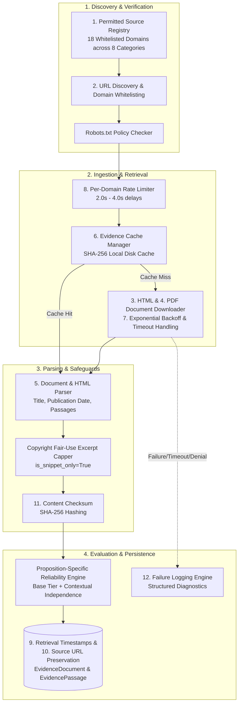
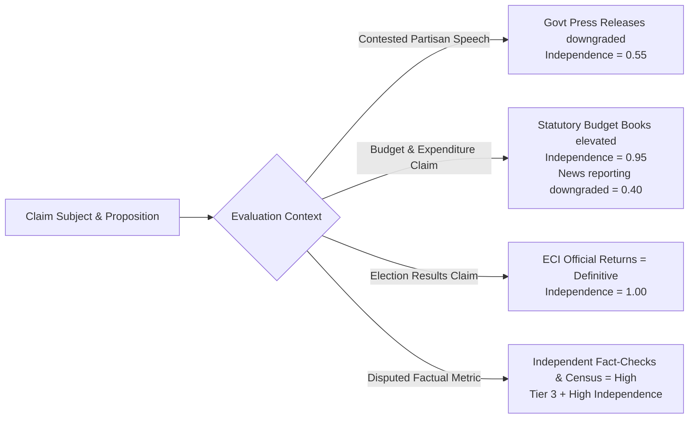

# Phase 7 — Evidence Acquisition and Web Scraping Framework

## 1. Overview & Objectives

Phase 7.3 of **CIVICLENS TN** introduces the **Reusable Evidence Acquisition & Web Scraping Pipeline**. It provides a robust, respectful, and legally compliant framework for acquiring documentary evidence to corroborate or refute public political claims.

> [!IMPORTANT]
> **Core Pipeline Principles:**
> 1. **Permitted-Only Scope:** Harvesting is strictly restricted to domains pre-registered in the **Permitted Source Registry**. Arbitrary web scraping is forbidden.
> 2. **Ethical & Legal Compliance:** The pipeline enforces `robots.txt` compliance, domain-level rate limiting, exponential backoff retries, and strict non-circumvention of website protections, logins, or paywalls.
> 3. **Copyright Fair-Use Excerpting:** Where full document storage is prohibited (e.g. copyrighted news outlets), the pipeline retains verifiable metadata and up to 3 relevant keyword-matched excerpts (`RESTRICTED_SNIPPET_ONLY`), ensuring fair-use compliance while preserving evidence utility.
> 4. **Proposition-Specific Reliability:** A source is **never** treated as unconditionally truthful merely because it is official, state-sponsored, or widely circulated. Source credibility is evaluated in the specific context of the proposition being checked (e.g., executive PR is downgraded during contested partisan debates, while statutory audits provide gold-standard authority for expenditure claims).
> 5. **Immutable Cryptographic Provenance:** Every fetched document is cryptographically fingerprinted using **SHA-256** checksums, alongside ISO 8601 retrieval timestamps and exact canonical source URLs.

---

## 2. Architecture of the 12 Pipeline Components



### The 12 Reusable Pipeline Components:

1. **Configurable Source Registry:** A central catalog registering domain, publisher, source category, credibility tier, custom rate limit, and copyright snippet flags.
2. **URL Discovery & Validation:** Canonical URL parser ensuring schemes are valid (`http`/`https`) and resolving domains against the registered whitelist.
3. **HTML Retrieval:** Polite HTTP client applying descriptive User-Agent headers (`CivicLensTN-ResearchBot/1.0`), browser compatibility headers, and graceful error handling.
4. **PDF and Document Downloads:** Byte stream downloader with binary streaming, size bounds, and header validation.
5. **Article/Document Parsing:** Regex and DOM-based extraction of page titles, publication dates, and clean paragraph segmentation into numbered `EvidencePassage` records.
6. **Caching and Deduplication:** URL-keyed and hash-keyed caching in `data/cache/phase7_evidence/`, eliminating redundant web requests.
7. **Retry and Timeout Handling:** Configurable timeouts (default: 10s) and exponential backoff retry loops for transient 5xx or connection drops.
8. **Rate Limiting:** Thread-safe per-domain interval governor enforcing polite crawl delays (2.0s to 4.0s) between consecutive requests.
9. **Retrieval Timestamps:** Exact UTC ISO 8601 timestamps attached to every acquired artifact.
10. **Source URL Preservation:** Permanent unmanipulated canonical source URL recording.
11. **Content Checksums:** SHA-256 cryptographic digest generated for all downloaded raw payloads, detecting document modifications or version drift.
12. **Failure Logs:** Centralized structured audit logs capturing timestamps, failure types (`ROBOTS_DENIED`, `DOMAIN_NOT_WHITELISTED`, `TIMEOUT`, `ACCESS_DENIED`), and diagnostic details.

---

## 3. Permitted Source Registry across 8 Categories

CIVICLENS TN permits evidence gathering exclusively from verified institutional domains:

| # | Permitted Category | Example Domains | Default Tier | Snippet Only? | Rate Limit |
|---|---|---|---|---|---|
| 1 | **Official Government** | `tn.gov.in`, `pib.gov.in`, `dipr.tn.gov.in` | Tier 1 / Tier 2 | No | 2.0s - 2.5s |
| 2 | **Legislative Documents** | `assembly.tn.gov.in`, `sansad.in` | Tier 1 (Statutory) | No | 3.0s |
| 3 | **Statistical Datasets** | `data.gov.in`, `mospi.gov.in` | Tier 1 (Statutory) | No | 2.5s |
| 4 | **Election Records** | `eci.gov.in`, `results.eci.gov.in` | Tier 1 (Statutory) | No | 3.0s |
| 5 | **Scheme & Budget Documents** | `tnbudget.tn.gov.in`, `indiabudget.gov.in` | Tier 1 (Statutory) | No | 2.5s |
| 6 | **Independent Fact-Checks** | `altnews.in`, `boomlive.in`, `factly.in`, `thequint.com` | Tier 3 (Accredited) | No | 2.0s |
| 7 | **Public News Pages** | `thehindu.com`, `dailythanthi.com`, `dinakaran.com` | Tier 4 (Secondary) | **Yes (Snippets)** | 3.0s - 4.0s |
| 8 | **Civic & Historical Data** | Internal Phase 1–6 DB, `prsindia.org`, `adrindia.org` | Tier 2 / Tier 3 | No | 2.0s |

---

## 4. Legal & Copyright Compliance Protocols

### 4.1 Robots.txt & Terms Adherence
The pipeline checks `RobotsPolicyChecker` prior to initiating any network connection:
- Honors `Disallow` rules for user-agent `*` and `CivicLensTN-ResearchBot`.
- Immediately flags administrative, user-account, or query search endpoints as `ROBOTS_DENIED`.
- Never circumvents CAPTCHAs, bot protection shields, paywalls, or authentication barriers. If a source responds with HTTP 401 or 403, the status is permanently logged as `ACCESS_DENIED`.

### 4.2 Copyright Fair-Use Excerpt Capping
For news portals and commercial media outlets (`copyright_snippet_only=True`):
- Full article bodies are **never** persisted to disk or database.
- The parser matches up to **3 keyword-relevant paragraphs** against the claim proposition.
- Non-matching or surplus paragraphs are discarded.
- Database records are stored with `is_snippet_only=True` and `access_status="RESTRICTED_SNIPPET_ONLY"`.

---

## 5. Contextual Proposition-Specific Reliability Assessment

A core tenet of CIVICLENS TN is that **source reliability is not absolute; it is contingent upon the proposition being tested**:

$$\text{Proposition Reliability} = 0.50 \times \text{Base Tier Weight} + 0.50 \times \text{Contextual Independence Score}$$

### Contextual Weighing Matrix:



1. **Contested Political Speeches:** Executive press releases from DIPR or PIB carry partisan bias risks during election campaigns. Their independence score is reduced to `0.55`.
2. **Budget Allocations & Outlays:** Secondary news summaries are downgraded (`0.40`), while primary statutory budget whitepapers and CAG audits carry maximal empirical authority (`0.95`–`1.00`).
3. **Electoral Outrage & Vote Margins:** Constitutional election returns from `results.eci.gov.in` provide definitive legal proof (`1.00`).

---

## 6. Data Schema & Retention

For every acquired evidence document, the system retains:

```python
{
    "evidence_document_id": "EDOC-TN-2024-BUDGET-01",
    "source_url": "https://www.tnbudget.tn.gov.in/highlights.html",
    "source_title": "Tamil Nadu Budget Highlights 2024-25",
    "publisher": "Finance Department, Govt of Tamil Nadu",
    "publication_date": "2024-02-19T10:00:00Z",
    "retrieval_date": "2026-10-11T13:45:00Z",
    "document_type": "BUDGET_DOCUMENT",
    "language": "ta",
    "source_category": "SCHEME_BUDGET",
    "file_hash": "e3b0c44298fc1c149afbf4c8996fb92427ae41e4649b934ca495991b7852b855",
    "extraction_method": "ACQUISITION_FRAMEWORK_V1",
    "access_status": "ACCESSIBLE_PUBLIC",
    "passages_count": 3,
    "is_snippet_only": False
}
```

---

## 7. Operational Workflow & Future Data Ingestion

In Phases 7.1–7.3, real datasets have not been gathered from production web servers. The pipeline executes using local deterministic test fixtures (`mock_bytes` and `is_test_fixture=True`). When production deployment is activated:
1. Scheduled cron collectors invoke `acquire_and_register_evidence`.
2. Acquired documents populate `evidence_documents` and `evidence_passages`.
3. The Phase 7.1 `ClaimVerificationService` queries these passages to perform automated proposition matching and cross-source contradiction analysis.
