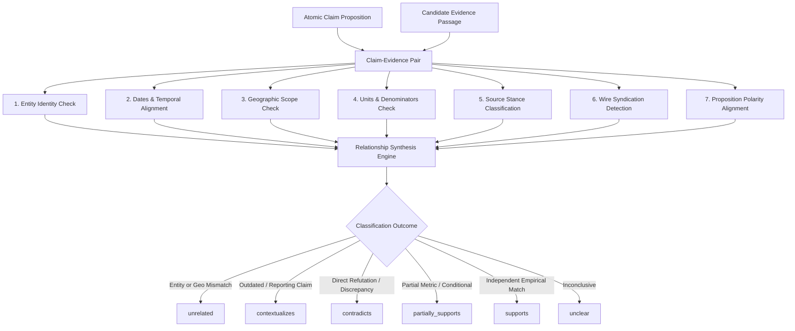

# Phase 7.6 — Claim and Evidence Relationship Analysis Methodology

## 1. Executive Summary

Phase 7.6 establishes the **Evidence Relationship Analysis Engine** for CIVICLENS TN. Once evidence candidates are retrieved from statutory repositories, Hansard transcripts, budget books, audit filings, and journalistic archives (Phase 7.5), this engine classifies the exact logical and factual relationship between each atomic claim proposition and candidate evidence passage.

The system performs multi-dimensional validation across entity identity, temporal windows, geographic jurisdiction, quantitative units/denominators, proposition action, source stance, and news syndication.

---

## 2. Core Epistemic Principles

1. **Explicit Multi-Class Taxonomy**: Evidence cannot simply be reduced to binary "true/false". Every retrieved passage is categorized into one of six nuanced relationships:
   - `supports`
   - `contradicts`
   - `partially_supports`
   - `contextualizes`
   - `unrelated`
   - `unclear`
2. **Absence of Evidence is Not Evidence of Absence**: The failure to locate an official document or public record must **never** be interpreted as proof that a political claim is false. Claims lacking evidence are classified as `UNVERIFIABLE_INSUFFICIENT_EVIDENCE` with uncertainties explicitly documented.
3. **Contradictory Evidence Must Remain Visible**: Disconfirming and counter-factual evidence is never suppressed, pruned, or subordinated. Contradictions are displayed alongside supporting passages to provide complete civic transparency.
4. **Anti-Echo-Chamber Safeguard (Syndication Deduplication)**: Multiple news outlets publishing identical syndicated wire reports (e.g. PTI, ANI, government press release wire copies) are clustered together and **never counted as multiple independent corroborating sources**.
5. **Reporting a Claim vs. Independently Establishing a Fact**: A news article that merely reports *"Leader X claimed that scheme Y achieved 100% target"* proves only that the speech was uttered; it does not constitute independent corroboration of the underlying proposition.
6. **No Politician or Party Truthfulness Rankings**: The engine strictly evaluates discrete claim propositions against empirical records. No aggregate politician rankings, party leaderboards, or scorecards are generated.

---

## 3. Relationship Taxonomy

| Relationship Type | Definition | Verification Criteria |
| :--- | :--- | :--- |
| **`supports`** | The passage affirms the core proposition with empirical data or statutory verification. | Entity matches; contemporaneous period; matching jurisdiction; matching quantitative figures/units; source independently establishes fact. |
| **`contradicts`** | The passage directly refutes the proposition, reveals a major discrepancy, or proves non-delivery. | Entity matches; contemporaneous period; statutory audit or empirical record shows significant deficit, delay, cancellation, or opposite metric. |
| **`partially_supports`** | The passage corroborates elements of the claim, but reveals qualified delivery, unit divergence, or partial scope. | Proposition delivered partially (e.g., 60% of promised target); denominator or unit differences; scheme implemented in pilot phase only. |
| **`contextualizes`** | The passage provides relevant historical background, policy evolution, or fiscal framework without direct verification. | Outdated historical baseline (e.g. 2019 report cited for 2024 claim); broader national comparisons; source merely reports third-party claims. |
| **`unrelated`** | The passage does not address the claim entity or subject matter. | Entity mismatch (different scheme or leader); geographic mismatch (another state's program without comparative relevance). |
| **`unclear`** | Evidence wording is ambiguous, inconclusive, or contradictory within itself. | Conflicting statements within the same passage; insufficient technical clarity. |

---

## 4. Multi-Dimensional Validation Pipeline



### 4.1. Entity Identity Check (`EntityIdentityChecker`)
- Compares target entity (politician, scheme, department, state corporation) against passage text and metadata.
- Resolves Tamil, English, and transliterated aliases (e.g. *"Kalaignar Magalir Urimai Thittam"* $\leftrightarrow$ *"KMUT"* $\leftrightarrow$ *"மகளிர் உரிமைத் திட்டம்"*).
- If the passage discusses an entirely distinct scheme, it is flagged as `ENTITY_MISMATCH` and classified as `unrelated`.

### 4.2. Dates and Reporting Periods Check (`TemporalAlignmentChecker`)
- Extracts fiscal years (`2023-24`), calendar years, and reporting dates.
- Detects contemporaneous alignment vs **outdated historical evidence**:
  - If evidence reporting year precedes the claim period by $\ge 2$ years, it is flagged with `is_outdated = True`.
  - An outdated document **cannot** prove or disprove contemporary performance; it can only `contextualize` historical baseline trends.

### 4.3. Geographic Scope Check (`GeographicScopeChecker`)
- Validates Tamil Nadu state jurisdiction and district boundaries (Chennai, Coimbatore, Madurai, etc.).
- Flags All-India national aggregates as `BROADER_NATIONAL`.
- Flags reports concerning other states (Karnataka, Uttar Pradesh, etc.) as `GEOGRAPHIC_MISMATCH` (`unrelated`).

### 4.4. Units and Denominators Check (`QuantitativeConsistencyChecker`)
- Verifies numerical value, scale, currency unit, and denominator:
  - **Scale check**: Crores vs Lakhs (factor of 100).
  - **Temporal denominator**: ₹1,000 *per month* vs ₹12,000 *per year*.
  - **Population denominator**: Total state population vs eligible women household heads.
- Tolerates minor reporting variances ($\pm 5\%$), but flags significant divergences as `VALUE_CONTRADICTION`.

### 4.5. Source Stance: Reporting a Claim vs. Independent Fact (`SourceStanceClassifier`)
- Differentiates between:
  - **`REPORTING_CLAIM`**: Articles that contain speech attributions (*"claimed that"*, *"alleged that"*, *"said in an election rally"*). These attest only to the utterance, not empirical truth.
  - **`INDEPENDENT_FACT`**: Statutory records, CAG audit filings, Government Orders (G.O.), legislative Hansard answers, official gazettes, and verified ground data.

### 4.6. Wire Syndication Deduplication (`SyndicationDeduplicator`)
- Wire agencies (PTI, ANI, UNI) often produce identical syndicated articles republished across dozens of newspapers and web portals.
- The engine computes 40-word text fingerprints and Jaccard token similarity ($\ge 75\%$).
- All duplicate occurrences are assigned a common `syndication_cluster_id` and flagged with `is_syndicated_copy = True`.
- In downstream verification synthesis, a syndication cluster is treated as **one single source**, preventing manufactured consensus.

---

## 5. Entity Schema & Data Model

### `ClaimEvidenceRelationship`
```sql
CREATE TABLE claim_evidence_relationships (
    relationship_id VARCHAR PRIMARY KEY,
    claim_id VARCHAR NOT NULL REFERENCES political_claims(claim_id) ON DELETE CASCADE,
    atomic_claim_id VARCHAR REFERENCES atomic_claims(atomic_claim_id) ON DELETE CASCADE,
    evidence_document_id VARCHAR REFERENCES evidence_documents(document_id) ON DELETE CASCADE,
    passage_id VARCHAR NOT NULL REFERENCES evidence_passages(passage_id) ON DELETE CASCADE,
    
    relationship_type VARCHAR NOT NULL, -- supports, contradicts, partially_supports, contextualizes, unrelated, unclear
    supporting_text_reference TEXT,
    contradicting_text_reference TEXT,
    analysis_method VARCHAR DEFAULT 'MULTI_DIMENSIONAL_EVIDENCE_RELATIONSHIP_V1',
    confidence FLOAT DEFAULT 1.0,
    model_version VARCHAR DEFAULT 'civiclens-evidence-rel-v1.0',
    human_review_status VARCHAR DEFAULT 'PENDING_REVIEW',
    
    entity_alignment VARCHAR,      -- EXACT_MATCH, RELATED_ENTITY, ENTITY_MISMATCH
    temporal_alignment VARCHAR,    -- CONTEMPORANEOUS, OUTDATED, FUTURE_PROJECTION
    geographic_alignment VARCHAR,  -- EXACT_JURISDICTION, BROADER_NATIONAL, GEOGRAPHIC_MISMATCH
    quantitative_alignment VARCHAR,-- EXACT_MATCH, VALUE_CONTRADICTION, UNIT_MISMATCH
    proposition_alignment VARCHAR, -- IDENTICAL_PROPOSITION, RELATED_CONTEXT
    source_stance VARCHAR,         -- INDEPENDENT_FACT, REPORTING_CLAIM
    
    is_outdated BOOLEAN DEFAULT FALSE,
    is_syndicated_copy BOOLEAN DEFAULT FALSE,
    syndication_cluster_id VARCHAR,
    reasoning_summary TEXT,
    created_at TIMESTAMP WITH TIME ZONE DEFAULT CURRENT_TIMESTAMP
);
```

---

## 6. REST API Endpoints

### 1. Analyze Claim-Evidence Relationships
- **Route**: `POST /api/claims/<claim_id>/analyze-evidence`
- **Payload**:
  ```json
  {
    "atomic_claim_id": "optional-atomic-id"
  }
  ```
- **Response**:
  ```json
  {
    "success": true,
    "data": {
      "claim_id": "CLM-TN-2024-001",
      "relationships_count": 3,
      "relationships": [
        {
          "relationship_id": "CER-CLM-TN-2024-001-EPASS-01",
          "relationship_type": "supports",
          "supporting_text_reference": "Government Order G.O. (Ms) No. 49 sanctioned ₹7,000 crores for 1.15 crore beneficiaries.",
          "contradicting_text_reference": null,
          "confidence": 0.92,
          "entity_alignment": "EXACT_MATCH",
          "temporal_alignment": "CONTEMPORANEOUS",
          "is_outdated": false,
          "is_syndicated_copy": false,
          "source_stance": "INDEPENDENT_FACT"
        }
      ],
      "epistemic_disclaimer": "Contradictory evidence is retained and displayed alongside supporting findings. Absences of records do not prove falsehood."
    }
  }
  ```

### 2. Retrieve Established Relationships
- **Route**: `GET /api/claims/<claim_id>/relationships`
- **Description**: Returns all relationships, keeping all supporting and contradictory passages transparently visible.
