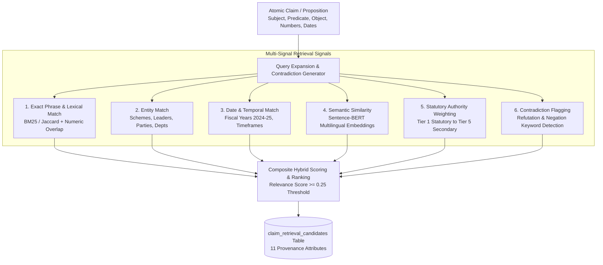

# Phase 7 — Claim-to-Evidence Retrieval Engine Architecture

## 1. Overview & Objectives

Phase 7.5 of **CIVICLENS TN** introduces the **Claim-to-Evidence Retrieval Engine**. It searches statutory government documents, budget records, legislative Hansard transcripts, and accredited fact-checks to discover passages relevant to an atomic political claim.

> [!IMPORTANT]
> **Core Retrieval Principles:**
> 1. **Relevance $\neq$ Truth:** The system **never interprets retrieval rank as evidence of truth**. Candidate evidence is ranked strictly by topical relevance and contextual suitability for the query proposition, not its truth value.
> 2. **Multi-Signal Hybrid Search:** Combines dense semantic similarity, exact keyword/phrase matching, named entity matching, temporal alignment, and statutory authority weighting.
> 3. **Active Contradiction Retrieval:** The retriever explicitly expands queries to discover counter-evidence, CAG audit objections, delays, and budget shortfalls. Contradictory evidence is preserved and surfaced alongside corroborating records.
> 4. **No Snippet Dependency:** Where underlying statutory documents or budget books are accessible, the engine retrieves from granular `EvidencePassage` records rather than shallow search snippets.
> 5. **Cross-Lingual Tamil-English Retrieval:** Tamil claims discover relevant English statutory documents (e.g. Budget Highlights, RBI reports) via auxiliary cross-lingual alignment without mutating the original Tamil proposition.

---

## 2. Multi-Signal Hybrid Retrieval Architecture



### The 6 Retrieval Signals:

1. **Exact Phrase & Keyword Search:**
   - Detects exact multi-word continuous substrings in candidate passages.
   - Computes token overlap (Jaccard score) over content words (excluding Tamil and English stopwords).
   - Enforces exact numeric token matching (e.g. `13,720` or `1000`).
2. **Entity & Semantic Actor Matching:**
   - Matches named schemes (*Kalaignar Magalir Urimai Thittam*, *Pudhumai Penn*), political figures (*M.K. Stalin*, *Edappadi Palaniswami*), and departments against passage text and document titles.
3. **Date & Temporal Matching:**
   - Matches fiscal years (*2024-25*) and calendar years (*2024*). Neutral score ($0.5$) applied when query has no specific temporal constraint.
4. **Dense Semantic Similarity:**
   - Utilizes `paraphrase-multilingual-MiniLM-L12-v2` dense vector embeddings or character/subword n-gram cosine similarity vectors for multilingual matching.
5. **Statutory Tier Authority:**
   - Incorporates source credibility tier ($1.0$ for Tier 1 Statutory Gazettes/Audits down to $0.40$ for Tier 5 secondary blogs).
6. **Active Contradiction Discovery:**
   - Query expansion detects counter-evidence keywords (*shortfall*, *audit objection*, *delayed*, *irregularity*, *வழங்கப்படவில்லை*, *முறைகேடு*).
   - Surfaces contradictory evidence for the downstream verification stage.

---

## 3. Composite Scoring Formula

$$\text{retrieval\_score} = 0.30 \times \text{Semantic} + 0.25 \times \text{Keyword} + 0.25 \times \text{Entity} + 0.10 \times \text{Date} + 0.10 \times \text{Tier Authority}$$

- **Contradiction Bonus:** When an entity and keyword overlap occurs alongside contradictory signals (*is_potentially_contradictory=True*), the candidate receives a $+0.10$ boost to ensure counter-evidence is surfaced in the top candidates.
- **Relevance Threshold:** Candidates scoring below $0.25$ are deemed irrelevant and pruned.
- **Top-K Selection:** Top $K$ (default: 10) candidate passages are ranked and recorded.

---

## 4. Retained Provenance Schema (`claim_retrieval_candidates`)

For every retrieved evidence candidate, the system stores:

```sql
CREATE TABLE claim_retrieval_candidates (
    candidate_id VARCHAR PRIMARY KEY,
    claim_id VARCHAR NOT NULL REFERENCES political_claims(claim_id) ON DELETE CASCADE,
    atomic_claim_id VARCHAR,
    evidence_document_id VARCHAR NOT NULL REFERENCES evidence_documents(document_id) ON DELETE CASCADE,
    evidence_passage_id VARCHAR NOT NULL REFERENCES evidence_passages(passage_id) ON DELETE CASCADE,
    retrieval_score FLOAT NOT NULL,
    semantic_similarity FLOAT DEFAULT 0.0,
    keyword_match FLOAT DEFAULT 0.0,
    entity_match FLOAT DEFAULT 0.0,
    date_match FLOAT DEFAULT 0.0,
    retrieval_method VARCHAR DEFAULT 'HYBRID_MULTI_SIGNAL_V1',
    model_version VARCHAR DEFAULT 'paraphrase-multilingual-MiniLM-L12-v2',
    retrieval_timestamp TIMESTAMP WITH TIME ZONE DEFAULT CURRENT_TIMESTAMP,
    is_potentially_contradictory BOOLEAN DEFAULT FALSE,
    rank INTEGER DEFAULT 1,
    metadata_json JSON,
    created_at TIMESTAMP WITH TIME ZONE DEFAULT CURRENT_TIMESTAMP
);
```

---

## 5. Epistemic Verification Disclaimer

Every retrieved candidate carries an immutable system disclaimer:
> *"Candidate retrieval rank reflects topical relevance to the query proposition, NOT empirical veracity or truth. Do not interpret retrieval rank as evidence of truth."*

---

## 6. REST API Endpoints

- **`POST /api/claims/<claim_id>/retrieve-evidence`**
  - **Payload:**
    ```json
    {
      "atomic_claim_id": "ACM-CLM-01-01",
      "top_k": 10,
      "min_score_threshold": 0.25,
      "source_categories": ["OFFICIAL_GOVERNMENT", "SCHEME_BUDGET"]
    }
    ```
  - **Response:**
    - List of ranked candidates with individual match signals, passages, source titles, URLs, and contradiction flags.
