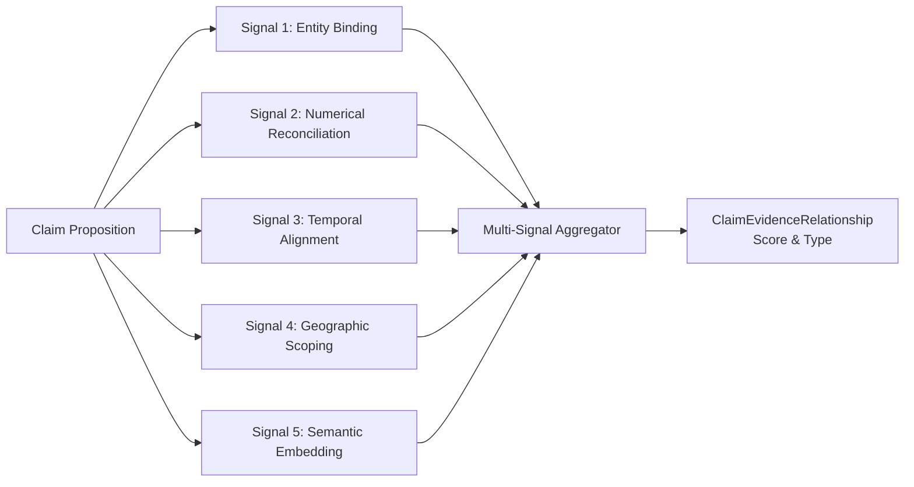
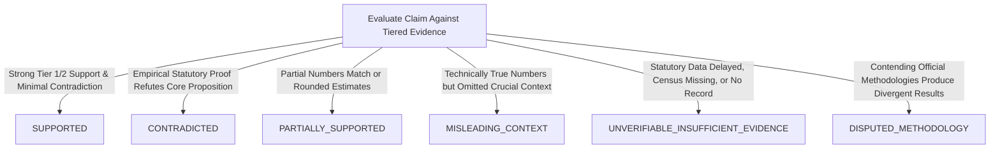

# Phase 7 — Political Claim Verification Methodology & Analytical Standards

## 1. Core Principles of Verification

The verification engine in **CIVICLENS TN** adheres to strict scientific and ethical protocols designed to eliminate partisan bias, maintain transparency, and expose uncertainty.

### 1.1 Non-Negotiable Directives
1. **Preserve Original Utterance:** Original statements must be stored unaltered, preserving Tamil script, regional phrasing, colloquial terms, and contextual preamble.
2. **Atomic Decomposition:** A complex political speech often combines multiple distinct claims. Each proposition must be isolated and evaluated independently.
3. **Distinguish Evidence from Interpretation:** Evidence consists of verified empirical data points (e.g. Budget Book FY23 line item ₹7,000 Cr; ECI Form 21E certificate). Interpretation is the argumentative spin placed upon those numbers. CIVICLENS reports empirical facts and contrasts them against the claim.
4. **Active Disconfirmation Search:** The pipeline never conducts one-sided searches for confirmatory proof. It issues explicit disconfirmation queries to locate refuting records.
5. **Transparent Uncertainty Disclosures:** If data is missing (e.g. pending census, delayed CAG audit), the system issues `UNVERIFIABLE_INSUFFICIENT_EVIDENCE` with detailed limitation notes rather than speculating.
6. **No Politician or Party Leaderboards:** The platform explicitly forbids generating aggregate "truth scores", "lie meters", or ranking parties by honesty.

---

## 2. Claim Decomposition Architecture

Political claims are rarely simple atomic assertions; they frequently contain compound assertions mixing past achievements, statistical metrics, and future aspirations.

```mermaid
flowchart TD
    RAW[Raw Speech Claim<br/>'In 2021 we allocated ₹5,000 Cr and built 100 bridges across Cauvery delta']
    --> DECOMP[Decomposition Engine]
    DECOMP --> P1[Proposition 1: Temporal & Fiscal Scope<br/>Year: 2021 | Metric: ₹5,000 Cr Allocation]
    DECOMP --> P2[Proposition 2: Physical Asset Scope<br/>Asset: 100 Bridges | Geography: Cauvery Delta]
    P1 --> V1[Check against Phase 1 Budget Records]
    P2 --> V2[Check against Phase 6 Works & PWD Gazettes]
```

### Decomposition Dimensions
For every registered claim, the decomposition layer identifies:
1. **Target Entity / Subject:** The government, party, politician, or department being discussed (`ClaimSubject`).
2. **Temporal Scope:** The exact historical time window (e.g. `2021-2022`, `Last 3 years`, `Since 2011`).
3. **Quantitative / Numerical Metric:** Explicit numbers, currency figures, percentages, or rank claims (e.g., `₹1,000/month`, `90% turnout`, `Rank #1 in NITI Aayog index`).
4. **Geographic Extent:** State-wide, specific district, assembly constituency, or region (e.g., `Tamil Nadu`, `Madurai`, `Cauvery Delta`).
5. **Target Beneficiary / Policy Scope:** Specific citizen demographic or scheme (e.g., `Women heads of households`, `College students`).

---

## 3. Multi-Signal Evidence Matching

Matching a decomposed claim proposition to documentary evidence relies on five complementary analytical signals:



### 3.1 Signal Definitions & Formulas

1. **Entity Binding Score ($S_{\text{ent}}$):** Matches politicians, departments, and scheme names using Phase 2 alias resolution and Phase 6 representative registry:
   $$S_{\text{ent}} = \frac{|\text{Entities}_{\text{claim}} \cap \text{Entities}_{\text{evidence}}|}{|\text{Entities}_{\text{claim}}|}$$

2. **Numerical Reconciliation Score ($S_{\text{num}}$):** Measures percentage variance between the claimed figure ($V_{\text{claim}}$) and official recorded figure ($V_{\text{evid}}$):
   $$\Delta_{\text{num}} = \frac{|V_{\text{claim}} - V_{\text{evid}}|}{\max(|V_{\text{claim}}|, |V_{\text{evid}}|)}$$
   - If $\Delta_{\text{num}} \le 0.05$ (within 5% margin, e.g. rounding), $S_{\text{num}} = 1.0$ (Strong Match).
   - If $0.05 < \Delta_{\text{num}} \le 0.20$, $S_{\text{num}} = 0.70$ (Approximate / Partial).
   - If $\Delta_{\text{num}} > 0.20$, $S_{\text{num}} = 0.0$ and triggers contradiction flagging.

3. **Temporal Alignment Score ($S_{\text{time}}$):** Checks whether the evidence document covers the exact financial year, legislative session, or election period cited in the claim.

4. **Geographic Scoping Score ($S_{\text{geo}}$):** Verifies constituency-to-district or district-to-state geographical hierarchies (e.g., verifying a claim about Kolathur against Chennai district or State data).

5. **Semantic Embedding Similarity ($S_{\text{sem}}$):** Multilingual cosine similarity computed using Phase 2 bilingual embeddings:
   $$S_{\text{sem}} = \cos(\mathbf{e}_{\text{claim}}, \mathbf{e}_{\text{passage}}) = \frac{\mathbf{e}_{\text{claim}} \cdot \mathbf{e}_{\text{passage}}}{\|\mathbf{e}_{\text{claim}}\| \|\mathbf{e}_{\text{passage}}\|}$$

---

## 4. Contradiction Analysis Framework

When candidate evidence is retrieved, the contradiction analyzer evaluates whether the evidence confirms, refutes, or qualifies the assertion:

| Contradiction Type | Definition | Example Scenario |
|---|---|---|
| **Direct Numerical Refutation** | Official statutory records state a number substantially different from the claim. | Claim: "We allocated ₹10,000 Cr for agriculture in 2022." <br/> Evidence: Budget Demand 5 recorded ₹6,200 Cr. |
| **Temporal Discrepancy** | Claim attributes an outcome to a specific tenure or year when records show it occurred under a different period. | Claim: "Scheme was launched in 2021." <br/> Evidence: G.O. shows original launch in 2017. |
| **Scope / Beneficiary Misrepresentation** | Claim implies universal coverage, but statutory rules restrict eligibility to a narrow subset. | Claim: "Every family in TN receives ₹1,000/month." <br/> Evidence: Scheme guidelines mandate means-tested criteria covering ~1.15 Cr ration card holders. |
| **Contextual Omission** | Claim is technically accurate in isolation but omits critical surrounding facts that alter its meaning. | Claim: "Crime dropped by 40%." <br/> Evidence: Reporting period coincides with COVID lockdown. |
| **Absence of Official Record** | Claim asserts a formal government order, resolution, or assent exists, but official gazettes have no record. | Claim: "NEET was permanently abolished by state decree." <br/> Evidence: Central statutory approval not granted. |

---

## 5. Verdict Taxonomy & Decision Matrix

CIVICLENS TN uses a six-tier standardized verdict taxonomy:



### Verdict Definitions:
1. **`SUPPORTED`:** All core propositions are corroborated by Tier 1 or Tier 2 official statutory evidence with no material discrepancy.
2. **`CONTRADICTED`:** The central factual assertion is directly refuted by official records, audit reports, or gazetted data.
3. **`PARTIALLY_SUPPORTED`:** Portions of the statement are accurate (e.g. scheme was introduced), but quantitative figures or timelines are inaccurate.
4. **`MISLEADING_CONTEXT`:** The figures quoted are formally accurate, but crucial background facts or baseline changes are omitted, conveying an inaccurate impression.
5. **`UNVERIFIABLE_INSUFFICIENT_EVIDENCE`:** Credible primary records do not exist, official releases are delayed, or data has not been systematically gathered by government bodies.
6. **`DISPUTED_METHODOLOGY`:** Multiple authoritative government bodies (e.g. State Planning Commission vs. Central Ministry) employ conflicting sampling or accounting standards.

---

## 6. Human Review & Editorial Governance

The system enforces human-in-the-loop oversight to ensure accountable AI:

1. **Automated Run as Recommendation:** Every pipeline execution generates a `VerificationRun` and a proposed `VerificationResult`.
2. **Review Record Auditing:** Human reviewers (civic researchers, journalists, subject-matter experts) review candidate evidence passages, assess edge-case nuances, and create a `ReviewRecord`.
3. **Review Actions:**
   - `CONFIRMED`: Reviewer agrees with automated verdict and rationale.
   - `OVERRIDDEN`: Reviewer modifies the verdict with mandatory documented rationale.
   - `ANNOTATED`: Reviewer appends contextual caveats or local knowledge.
   - `ESCALATED`: Reviewer flags claim for multi-expert panel consultation.
4. **Permanent Audit Trail:** The automated finding, human review decisions, previous statuses, and timestamps are preserved in `VerificationHistory`.
