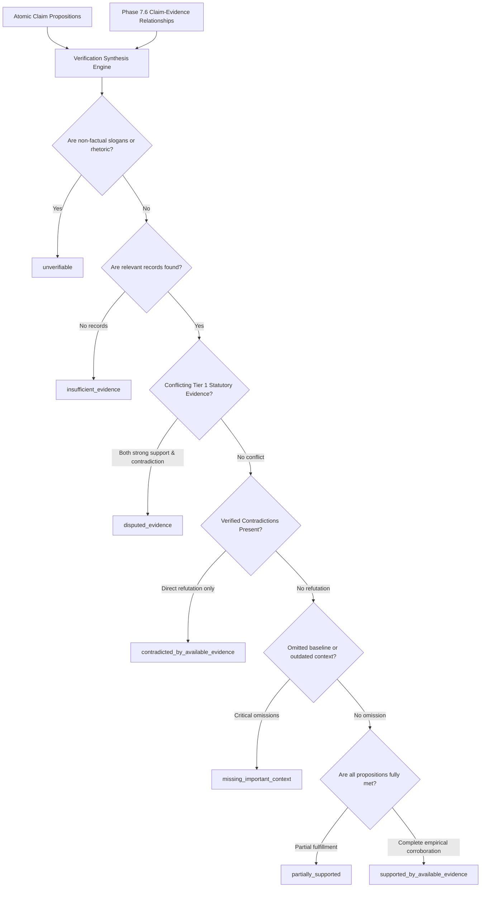
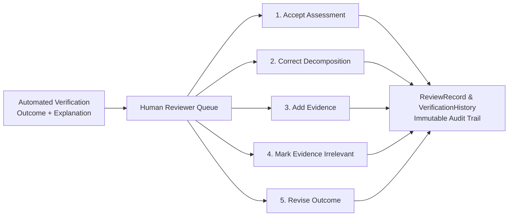

# Phase 7 — Political Claim Verification Methodology & Analytical Standards

## 1. Executive Summary & Epistemic Principles

The verification engine in **CIVICLENS TN** adheres to strict scientific, transparent, and ethical protocols designed to eliminate partisan bias, maintain transparency, and expose uncertainty.

### 1.1 Fundamental Directives
1. **Evidence Assessments, Not Moral Judgments**: Outcomes are evidence assessments based on indexed public records, **never judgments about a person's honesty, character, or political intent**.
2. **Preserve Original Utterance Verbatim**: Original statements are stored unaltered, preserving Tamil script, regional phrasing, colloquial expressions, and context.
3. **Atomic Claim Decomposition**: Complex political assertions mixing past achievements, statistical numbers, and policy promises are isolated into verifiable atomic propositions and evaluated independently.
4. **Identify Supported, Contradicted, and Unresolved Propositions**: Every verification explanation must explicitly state which parts of a compound claim are supported, which are contradicted, and which remain unresolved.
5. **No Outcome Based Solely on Semantic Similarity**: Semantic embeddings guide evidence discovery; final verification outcomes are never assigned based on semantic similarity alone, requiring strict empirical entity, numerical, temporal, and proposition validation.
6. **No Binary Fallacies on Missing Data**: The system **never** marks a claim as contradicted simply because a document cannot be found. If critical evidence is missing, the claim is classified as `insufficient_evidence` or `unverifiable`.
7. **Anti-Echo-Chamber Syndication Safeguards**: Multiple news outlets reprinting identical PTI, ANI, or government press release wire copies are clustered and treated as a single source of evidence.
8. **Permanent Visibility of Contradictions**: Disconfirming and counter-evidence is permanently retained and displayed alongside supporting documents.
9. **Strictly No Politician or Party Honesty Rankings**: The platform explicitly forbids generating aggregate "truth scores", "lie meters", leaderboards, or scorecards ranking politicians or parties.

---

## 2. Standardized Outcome Taxonomy

CIVICLENS TN uses an eight-label outcome taxonomy reflecting empirical evidence states:

| Outcome Label | Definition | Verification Criteria |
| :--- | :--- | :--- |
| **`supported_by_available_evidence`** | The core proposition is affirmed by official statutory notifications, budget line records, gazettes, or authoritative empirical datasets. | Independent primary statutory records corroborate entity, timeframe, jurisdiction, and metrics without credible contradiction. |
| **`contradicted_by_available_evidence`** | Available official audits (e.g. CAG), legislative answers, or verified datasets directly refute the assertion or reveal substantial failure. | Authoritative primary records establish non-fulfillment, official denial, cancellation, or severe shortfall ($> 20\%$ variance). |
| **`partially_supported`** | Elements of the claim are substantiated, but other metrics, dates, or scopes remain unverified or qualified. | Multi-part claim where one proposition is confirmed but another is unverified, or where delivery is confirmed only in pilot phase. |
| **`missing_important_context`** | The literal assertion may be technically accurate in isolation, but omits vital historical, fiscal, or policy context that alters its meaning. | Cherry-picked baseline years, temporary lockdown effects attributed to policy, or claiming state credit for 100% centrally sponsored funds. |
| **`insufficient_evidence`** | Public records, gazettes, or statistical databases do not contain enough documented information to establish truth or falsehood. | Absence of indexed statutory records. **Absence of evidence is never treated as proof of falsehood.** |
| **`disputed_evidence`** | Highly credible, authoritative sources directly contradict each other regarding the proposition. | Statutory department press release asserts 100% completion while an official CAG audit report reports severe uncompleted delivery. |
| **`unverifiable`** | The statement is a non-factual slogan, rhetorical question, value judgment, or future political promise incapable of empirical testing. | Subjective rhetoric (e.g., *"We are the greatest government in history"*), slogans, or ambiguous undefined commitments. |
| **`pending_review`** | Automated signals are inconclusive or flagged for mandatory expert human-in-the-loop review. | Initial intake phase or low automated confidence threshold ($< 0.50$). |

---

## 3. Verification Synthesis Engine



### 3.1 Explanation Generation Protocol
The engine generates a structured explanation that identifies the evidentiary status of each constituent proposition:
```text
[Overall Synthesis Summary]

Proposition Breakdown:
- Part 1 ['Kalaignar Magalir Urimai Thittam provides ₹1,000 per month']: SUPPORTED by G.O. (Ms) No. 49.
- Part 2 ['Disbursed to all 1.15 crore applicants without delay']: CONTRADICTED by CAG Audit Report (35 lakh rejections noted).
- Part 3 ['Expanded to private college students']: UNRESOLVED. No statutory order issued for college stipend expansion.
```

### 3.2 Source Diversity Metric
To prevent manufactured consensus from syndicated news echo chambers:
$$\text{Source Diversity} = f(\text{Non-Syndicated Clusters}, \text{Distinct Publishers}, \text{Source Tiers})$$
- Evaluates distinct publishing authorities (e.g. Finance Dept, CAG, ECI).
- Clustered wire stories (PTI, ANI, UNI) count as **1 independent corroboration**, regardless of how many websites republished the text.

---

## 4. Human Review Workflow

CIVICLENS TN provides an auditable human-in-the-loop governance mechanism. Automated assessments are never silently overwritten; both the automated baseline and all human revisions are preserved.



### Review Actions Supported:
1. **`accept_assessment`**: Reviewer approves automated outcome. `review_status = ACCEPTED`.
2. **`correct_claim_decomposition`**: Reviewer adjusts, splits, or refines atomic propositions. The system re-synthesizes the outcome under `review_status = IN_REVIEW`.
3. **`add_evidence`**: Reviewer manually submits primary documents or gazette orders. The engine re-evaluates the evidence graph.
4. **`mark_evidence_irrelevant`**: Reviewer excludes misidentified passages from downstream synthesis.
5. **`revise_outcome`**: Reviewer overrides the final outcome label with mandatory rationale. The original `automated_outcome` is permanently preserved.

---

## 5. Database Schema & REST API Contract

### Verification Result Entity
```sql
CREATE TABLE verification_results (
    result_id VARCHAR PRIMARY KEY,
    claim_id VARCHAR NOT NULL REFERENCES political_claims(claim_id) ON DELETE CASCADE,
    run_id VARCHAR REFERENCES verification_runs(run_id),
    
    outcome VARCHAR NOT NULL, -- supported_by_available_evidence, contradicted_by_available_evidence, etc.
    explanation TEXT NOT NULL,
    atomic_claim_ids JSON,
    supporting_evidence_ids JSON,
    contradicting_evidence_ids JSON,
    context_evidence_ids JSON,
    source_diversity JSON,
    
    confidence FLOAT DEFAULT 0.0,
    uncertainty_indicator FLOAT DEFAULT 0.0,
    methodology_version VARCHAR DEFAULT 'CIVICLENS_VERIFICATION_METHODOLOGY_V1',
    model_version VARCHAR DEFAULT 'civiclens-verifier-v1.0',
    verification_timestamp TIMESTAMP WITH TIME ZONE DEFAULT CURRENT_TIMESTAMP,
    review_status VARCHAR DEFAULT 'PENDING_REVIEW',
    
    automated_outcome VARCHAR,
    automated_explanation TEXT,
    automated_confidence FLOAT,
    human_revision_notes TEXT,
    is_current BOOLEAN DEFAULT TRUE,
    created_at TIMESTAMP WITH TIME ZONE DEFAULT CURRENT_TIMESTAMP
);
```

### REST API Endpoints

#### 1. Run Automated Verification Pass
- **Route**: `POST /api/claims/<claim_id>/verify`
- **Response**: Returns full result including `outcome`, `explanation`, `atomic_claim_ids`, `source_diversity`, and `confidence`.

#### 2. Submit Human Review Decision
- **Route**: `POST /api/claims/<claim_id>/review`
- **Payload**:
  ```json
  {
    "reviewer_id": "EXPERT-TN-04",
    "action": "revise_outcome",
    "reviewed_outcome": "partially_supported",
    "review_notes": "Statutory audit confirms allocation but notes pilot phase rollout.",
    "explanation": "Revised after auditing G.O. (Ms) No. 49 and CAG progress reports."
  }
  ```

#### 3. Retrieve Verification Profile & Audit History
- **Route**: `GET /api/claims/<claim_id>/verification`
- **Response**: Returns current verification result, all associated `ReviewRecord`s, and `VerificationHistory` audit trails.
