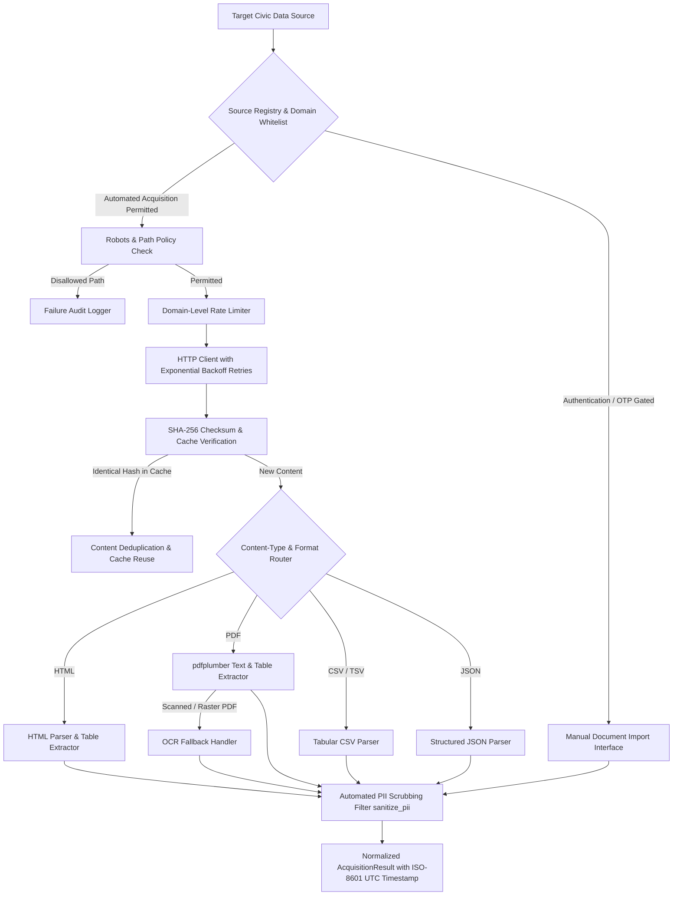

# Phase 8 — Civic Data Acquisition & Web Scraping Pipeline

## 1. Executive Summary & Acquisition Architecture

Phase 8.2 of **CIVICLENS TN** implements a reusable, ethical, and enterprise-grade **Civic Data Acquisition and Web Scraping Framework**.

The system automates the permitted harvesting, parsing, normalization, and cryptographic verification of public civic data across Tamil Nadu, while strictly respecting:
- **Robots.txt & Terms of Service:** Never scrapes forbidden paths or circumvents server directives.
- **Access Control Boundaries:** **Never attempts to bypass citizen login portals, SMS/OTP gates, or CAPTCHAs.**
- **Digital Personal Data Protection Act, 2023 (DPDPA):** Automatically sanitizes private citizen data (names, phone numbers, emails, addresses, petition credentials) during ingestion.
- **Manual Import Interface:** Provides an authorized offline import gateway for official reports, gazettes, and bulletins obtained from portals where automated harvesting is restricted.



---

## 2. The 12 Core Framework Capabilities

### 2.1 Configurable Source Registry
The system utilizes source-specific configurations rather than a brittle one-size-fits-all scraper.
Each entry in [`CivicSourceRegistry`](file:///e:/CIVCLENS/backend/acquisition/civic_acquisition_framework.py#L118-L141) specifies:
- `source_id`: Canonical unique source key (e.g. `TN_PORTAL`, `DARPG_CPGRAMS`, `GCC_CHENNAI`, `TNEGA_CM_HELPLINE`, `TN_TENDERS`, `DATA_GOV_IN`).
- `base_url`: Root entry URL.
- `source_tier`: Institutional credibility tier (Tier 1: Statutory Gazettes, Tier 2: State/Central Depts, Tier 3: Municipal Local Bodies).
- `rate_limit_seconds`: Polite interval between requests to the same domain (e.g. 2.0s to 3.0s; 0.0s for test fixtures).
- `allowed_domains`: Strict domain whitelist.
- `disallowed_paths`: Paths restricted by robots policy or administrative gates (e.g. `/admin`, `/login`, `/portal/en/signin`).
- `requires_manual_import`: Boolean flag designating OTP/CAPTCHA portals.
- `supported_formats`: Permitted file types (`PDF`, `HTML`, `CSV`, `JSON`, `XLSX`).
- `max_retries`: Maximum retry attempts on transient network failures (default 3).
- `timeout_seconds`: Socket timeout per request (default 10.0s).

### 2.2 URL Discovery
[`URLDiscoverer`](file:///e:/CIVCLENS/backend/acquisition/civic_acquisition_framework.py#L182-L224) parses HTML anchor links and resource tags:
- Validates target links against the source's `allowed_domains`.
- Filters out non-HTTP schemes and blacklisted query/path patterns.
- Automatically isolates downloadable files matching target civic extensions (`.pdf`, `.csv`, `.xlsx`, `.json`).

### 2.3 Download and Parsing Interfaces
Modular parser hierarchy handles diverse document structures:
- `HTMLCivicParser`: Sanitizes HTML markup, extracts plain-text passages, and isolates tables.
- `PDFCivicParser`: Uses `pdfplumber` to extract page-by-page text, coordinate-aligned tables, and font metadata.
- `TabularDataParser`: Normalizes CSV, TSV, and JSON feeds into typed list of dictionaries.
- `ManualDocumentImporter`: Ingests authorized offline files with identical hashing, parsing, and PII scrubbing guarantees.

### 2.4 HTML Table Extraction
[`HTMLTableExtractor`](file:///e:/CIVCLENS/backend/acquisition/civic_acquisition_framework.py#L274-L297) implements an event-driven `HTMLParser` that:
- Detects `<table>`, `<tr>`, `<th>`, and `<td>` hierarchies.
- Handles headers and variable column counts.
- Strips excess whitespace and converts tables into list-of-dicts with column name keys.
- Scrubs cell content through `sanitize_pii()`.

### 2.5 PDF Text and Table Extraction
[`PDFCivicParser`](file:///e:/CIVCLENS/backend/acquisition/civic_acquisition_framework.py#L341-L401) interfaces with `pdfplumber`:
- Extracts multi-page text and maintains page numbering.
- Extracts complex municipal and budget tables via `page.extract_tables()`.
- Standardizes empty cells and strips cell line breaks.

### 2.6 OCR Fallback Handling
[`OCRFallbackHandler`](file:///e:/CIVCLENS/backend/acquisition/civic_acquisition_framework.py#L303-L338) handles scanned government orders and raster PDFs:
- Evaluates extracted character count per page; pages with fewer than 20 characters are flagged as scanned images.
- Checks if the Tesseract OCR engine (`pytesseract`) is configured.
- If available, runs optical character recognition on image layers using English and Tamil language packs (`eng+tam`).
- If unavailable, logs `OCR_REQUIRED_ENGINE_UNAVAILABLE` and creates a structured diagnostic record for manual transcription, ensuring zero pipeline crashes.

### 2.7 Caching and SHA-256 Checksums
[`ChecksumCacheManager`](file:///e:/CIVCLENS/backend/acquisition/civic_acquisition_framework.py#L149-L180):
- Computes SHA-256 fingerprints on all ingested raw bytes.
- Stores immutable cached copies under `data/cache/phase8/{sha256}.dat`.
- Avoids redundant HTTP network queries on subsequent pipeline passes.

### 2.8 Content Deduplication
- Detects duplicate files across different URLs (e.g. identical G.O. PDF linked from both DIPR and Municipal Administration portals).
- Marks status as `DUPLICATE` while preserving URL lineage links.

### 2.9 Retry & Timeout Handling
- Exponential backoff retry loop: attempts up to `max_retries` with sleep intervals:
  $$\Delta t_{\text{retry}} = 2^{\text{attempt}} \times 1.0\text{s}$$
- Automatically retries transient errors (HTTP 429 Too Many Requests, HTTP 500, 502, 503, 504).
- Aborts immediately on non-retryable client errors (HTTP 401 Unauthorized, HTTP 403 Forbidden, HTTP 404 Not Found).

### 2.10 Rate Limiting & Politeness
[`RateLimiter`](file:///e:/CIVCLENS/backend/acquisition/civic_acquisition_framework.py#L143-L157) tracks domain timestamps:
- Enforces polite cooldowns between sequential requests to the same domain.
- Configurable per source (default 2.0s; 0.0s for internal test fixtures).

### 2.11 Retrieval Timestamps & Provenance
- Every acquired document records an exact UTC ISO-8601 timestamp `retrieved_at`.
- Preserves raw bytes length, content-type header, publisher name, and HTTP status code in `AcquisitionResult`.

### 2.12 Failure Logging
[`FailureLogManager`](file:///e:/CIVCLENS/backend/acquisition/civic_acquisition_framework.py#L427-L466):
- Records structured failure events containing URL, source ID, error type, HTTP status, timestamp, retry count, and detailed message.
- Exposes query methods for auditability and operational monitoring.

---

## 3. Source-Specific Configuration Matrix

| Source ID | Institutional Entity | Base URL | Rate Limit | Supported Formats | Authentication Status | Collection Strategy |
|:---|:---|:---|:---:|:---|:---|:---|
| `TN_PORTAL` | Government of Tamil Nadu | `https://www.tn.gov.in/` | 2.0s | PDF, HTML | Open Public | Automated crawl of Citizen Charters & G.O.s |
| `DARPG_CPGRAMS`| DARPG / CPGRAMS | `https://darpg.gov.in/` | 2.5s | PDF, HTML | Open Public Bulletins (Individual complaints OTP gated) | Monthly PDF progress report scraper; manual import for RTI releases |
| `TNEGA_CM_HELPLINE`| Mudhalvarin Mugavari | `https://cmhelpline.tnega.org/` | 2.0s | HTML, PDF, JSON | Gated by **Mobile OTP** (`requires_manual_import=True`) | Scrape public FAQs/circulars; **Manual import** for authorized aggregate statistical dumps |
| `GCC_CHENNAI` | Greater Chennai Corporation | `https://chennaicorporation.gov.in/gcc/`| 2.0s | HTML, PDF | Open Public Council/Tenders | Scrape council meeting resolutions & works tenders |
| `TN_TENDERS` | Tamil Nadu e-Procurement | `https://tntenders.gov.in/` | 3.0s | HTML, PDF | Open Public Procurement | Scrape civil maintenance tenders |
| `DATA_GOV_IN` | Open Government Data India | `https://www.data.gov.in/` | 1.5s | CSV, JSON, XLSX | Open API Key | REST API queries for civic amenity metrics |
| `TN_BUDGET` | Finance Department TN | `https://www.tnbudget.tn.gov.in/` | 2.0s | PDF, HTML | Open Public | Budget demand book scraper |
| `LOCAL_FIXTURE`| Test Environment | `http://test-fixture.civiclens.internal/` | 0.0s | PDF, HTML, CSV, JSON | Local Mock | Isolated fixture test harness |

---

## 4. Manual Document Import Interface Workflow

For portals where automated crawling is prohibited or technically gated by mobile OTP/CAPTCHA (such as individual citizen petition status on *Mudhalvarin Mugavari*):

1. **Authorized Acquisition:** Civic analysts or researchers acquire authorized reports, assembly assurances committee bulletins, or RTI disclosures directly through government procedures.
2. **Execution via `ManualDocumentImporter`:**
   ```python
   from backend.acquisition.civic_acquisition_framework import (
       ManualDocumentImporter, ChecksumCacheManager
   )

   cache_mgr = ChecksumCacheManager(cache_dir="data/cache/phase8")
   importer = ManualDocumentImporter(cache_mgr)

   result = importer.import_document(
       file_path_or_bytes="docs/authorized_reports/cm_helpline_march_2024.pdf",
       source_id="TNEGA_CM_HELPLINE",
       document_title="Mudhalvarin Mugavari Monthly Performance Bulletin March 2024",
       file_format="PDF",
       custom_metadata={"reporting_month": "2024-03", "tier": 2}
   )
   ```
3. **Automated Pipeline Processing:**
   - Computes SHA-256 fingerprint and persists into cache.
   - Parses text, tables, and pages via `pdfplumber`.
   - Runs `sanitize_pii()` across all extracted text and table cells.
   - Emits standardized `AcquisitionResult` matching the automated pipeline format.

---

## 5. Strict Privacy Compliance (DPDPA 2023)

In accordance with Phase 8 data governance:
- All text extracted from HTML bodies, PDF pages, CSV cells, and JSON records passes through `sanitize_pii()`.
- Phone numbers, email addresses, 12-digit Aadhaar/UID tokens, citizen names with salutations (`Thiru`, `Tmt`, `Mr.`), and private residential door numbers are permanently replaced with generic redaction placeholders before returning to the application layer.
- Citizen login credentials, passwords, and verification PINs are excluded from capture.
