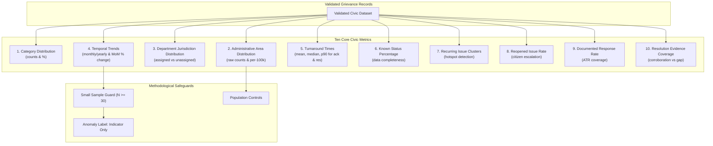

# CIVICLENS TN — Phase 8.7: Civic Issue Analytics and Trend Detection Methodology

**Document Version:** 1.0.0  
**Phase:** 8.7 — Civic Issue Analytics and Trend Detection  
**Status:** Operational Pipeline  
**Standards:** United Nations Statistics Division (UNSD) Civic Data Integrity Guidelines, NITI Aayog Data Governance Quality Index (DGQI), Tamil Nadu e-Governance Analytics Protocols  

---

## 1. Executive Summary

Phase 8.7 defines the mathematical, statistical, and contextual analytics engine for **CIVICLENS TN**. Civic data analytics in public administration is prone to systemic interpretive errors: raw complaint volumes are routinely misconstrued as physical infrastructure failure rates, and geographic areas with high digital literacy are unfairly penalized in uncontextualized rankings.

The Phase 8.7 analytics engine addresses these vulnerabilities by establishing a deterministic framework that:
1. Calculates ten core civic performance metrics with precise mathematical definitions, designated reporting periods, and explicit data source attribution.
2. Enforces the foundational principle: **Complaints $\ne$ Prevalence** (complaints measure reporting activity and portal accessibility, not physical defect counts).
3. Requires population normalization and digital access context for all cross-area comparisons.
4. Enforces small-sample statistical guards ($N \ge 30$, $\ge 3$ baseline periods) to prevent spurious outlier claims.
5. Strictly labels anomalous volume surges as **`INVESTIGATION_INDICATOR_UNUSUAL_VOLUME`** (exploratory administrative indicators requiring field inspection), explicitly barring automated allegations of negligence or malfeasance.

---

## 2. Core Methodological Safeguards

### 2.1 The "Complaints $\ne$ Prevalence" Principle
In public monitoring systems, a common fallacy is equating the volume of complaints filed with the true prevalence of a civic issue. 

$$\text{Complaint Volume} = f(\text{Defect Occurrence}, \text{Citizen Awareness}, \text{Digital Literacy}, \text{Portal Accessibility}, \text{Civic Trust})$$

A municipal ward with 500 potholes filed via a smartphone app does not necessarily have worse roads than a rural panchayat with 5 petitions filed on paper; the former reflects smartphone penetration and municipal awareness campaigns (e.g. GCC 1913), whereas the latter reflects high barriers to grievance filing.

> [!CAUTION]
> **Mandatory Analytics Disclaimer:**  
> *"COMPLAINTS DO NOT EQUAL PREVALENCE: Recorded grievance volume reflects citizen reporting propensity, mobile helpline access, civic awareness, and administrative portal availability. It does NOT measure the true physical prevalence or failure rate of civic infrastructure. Areas or categories with high complaint counts frequently reflect high civic engagement and accessible digital reporting rather than worse public administration."*

### 2.2 Population Normalization & Direct Area Comparison Ban
Direct comparisons of raw complaint counts across administrative areas are methodologically invalid. To provide context:
- Per-capita indicators are computed per 100,000 residents where official census population is recorded:
  $$\text{Rate}_{\text{per 100k}} = \frac{\text{Complaints in Area}}{\text{Area Population}} \times 100{,}000$$
- If population data is missing or unverified, comparative rankings are disabled (`comparison_valid = False`), and a critical missing data warning is attached.
- Even when normalized by population, cross-area comparisons must disclose known digital divides, helpline hours, and portal adoption rates.

---

## 3. The 10 Core Civic Performance Metrics



### Metric Definitions and Formulas

| # | Metric Code | Metric Name | Mathematical Definition | Reporting Period | Unit |
| :--- | :--- | :--- | :--- | :--- | :--- |
| **1** | `ISSUE_COUNT_BY_CATEGORY` | Issue Counts by Category | $C_{\text{cat}} = \sum \mathbb{I}(\text{cat}_i = c)$, $\quad P_{\text{cat}} = \frac{C_{\text{cat}}}{N} \times 100$ | YYYY-MM, YYYY-Q#, YYYY, ALL_TIME | COUNT, % |
| **2** | `ISSUE_COUNT_BY_AREA` | Issue Counts by Area | $C_{\text{area}} = \sum \mathbb{I}(\text{area}_i = a)$, $\quad R_{\text{100k}} = \frac{C_{\text{area}}}{\text{Pop}_a} \times 100{,}000$ | YYYY-MM, YYYY-Q#, YYYY, ALL_TIME | COUNT, PER_100K |
| **3** | `ISSUE_COUNT_BY_DEPARTMENT` | Issue Counts by Department | $C_{\text{dept}} = \sum \mathbb{I}(\text{dept}_i = d)$, $\quad U_{\text{pct}} = \frac{C_{\text{unassigned}}}{N} \times 100$ | YYYY-MM, YYYY-Q#, YYYY, ALL_TIME | COUNT, % |
| **4** | `TEMPORAL_TRENDS_MONTHLY_YEARLY` | Monthly & Yearly Trends | $C_m = \sum_{i \in m} 1$, $\quad \Delta_{\text{MoM}} = \frac{C_m - C_{m-1}}{C_{m-1}} \times 100$ | Monthly sequence, Annual sequence | PERIODS, % |
| **5** | `ACKNOWLEDGEMENT_AND_RESOLUTION_TIME` | Turnaround Times | $\text{TAT}_{\text{ack}} = T_{\text{ack}} - T_{\text{sub}}$, $\quad \text{TAT}_{\text{res}} = T_{\text{res}} - T_{\text{sub}}$<br>Computes Mean, Median (p50), 90th percentile (p90). | YYYY-MM, YYYY, ALL_TIME | HOURS, DAYS |
| **6** | `KNOWN_STATUS_PERCENTAGE` | Known Status Percentage | $\text{KSP} = \frac{\sum \mathbb{I}(\text{status}_i \notin \{\text{unknown}, \text{none}, \text{""}\})}{N} \times 100$ | YYYY-MM, YYYY, ALL_TIME | PERCENTAGE |
| **7** | `RECURRING_ISSUE_CLUSTERS` | Recurring Issue Clusters | $R_{\text{cnt}} = \sum \mathbb{I}(\text{repeat}_i > 1 \lor \text{is\_rec}_i)$, $\quad \text{Rate} = \frac{R_{\text{cnt}}}{N} \times 100$<br>Hotspots: $(\text{Area}, \text{Category})$ with count $> 1$. | YYYY, ALL_TIME | COUNT, % |
| **8** | `REOPENED_ISSUE_METRICS` | Reopened Issue Rate | $R_{\text{open}} = \sum \mathbb{I}(\text{status}_i \in \{\text{reopened}, \text{disputed}\})$<br>$\text{Rate}_{\text{closed}} = \frac{R_{\text{open}}}{C_{\text{closed}} + R_{\text{open}}} \times 100$ | YYYY-MM, YYYY, ALL_TIME | COUNT, % |
| **9** | `DOCUMENTED_RESPONSE_RATE` | Documented Response Rate | $\text{DRR} = \frac{\sum \mathbb{I}(\text{has\_ATR}_i \lor T_{\text{ack}} \lor T_{\text{res}})}{N} \times 100$ | YYYY-MM, YYYY, ALL_TIME | PERCENTAGE |
| **10** | `RESOLUTION_EVIDENCE_COVERAGE` | Resolution Evidence Coverage | $\text{REC} = \frac{\sum \mathbb{I}(\text{resolved}_i \land \text{verified}_i)}{\sum \mathbb{I}(\text{resolved}_i)} \times 100$<br>$\text{Gap} = 100 - \text{REC}$ | YYYY-MM, YYYY, ALL_TIME | PERCENTAGE |

---

## 4. Statistical Anomaly Detection & Small Sample Guards

### 4.1 Sample Size & Baseline Thresholds
Anomaly detection requires a stable historical reference period. The engine enforces the following barriers:
1. **Minimum Sample Size ($N \ge 30$)**: If total records in the dataset or query are below 30, anomaly detection returns `INSUFFICIENT_DATA`.
2. **Minimum Baseline Periods ($\ge 3$)**: If records span fewer than 3 distinct time periods, baseline mean and variance cannot be established, returning `INSUFFICIENT_DATA`.

### 4.2 Mathematical Methodology
Where sufficient data exists across monthly periods $t \in \{1, \dots, T\}$:
$$\mu = \frac{1}{T} \sum_{t=1}^T C_t, \qquad \sigma = \sqrt{\frac{1}{T} \sum_{t=1}^T (C_t - \mu)^2}$$

The standard score ($Z$-score) is computed for each period:
$$Z_t = \frac{C_t - \mu}{\sigma}$$

An anomaly is flagged when $|Z_t| \ge Z_{\text{threshold}}$ (default: $Z = 2.0$ or $2.5$).

### 4.3 Exploratory Labeling Policy
In accordance with ethical data governance standards, anomalous periods are strictly labeled:
- **Indicator Label**: `INVESTIGATION_INDICATOR_UNUSUAL_VOLUME`
- **Barred Terminology**: The engine is strictly prohibited from classifying spikes as "negligence", "malfeasance", "corruption", or "official failure".
- **Reasoning**: Real-world civic surges in Tamil Nadu are routinely driven by external factors such as monsoon flooding (e.g. Northeast Monsoon in November-December), festival mass gatherings, municipal boundary mergers, or proactive ward grievance camps.

---

## 5. Database Schema & Persistence

Computed metrics are persisted in the [`civic_issue_metrics`](file:///e:/CIVCLENS/backend/models/civic_issue.py#L598) table via the `IssueMetric` ORM entity:

```sql
CREATE TABLE civic_issue_metrics (
    id INTEGER PRIMARY KEY,
    metric_code VARCHAR(100) NOT NULL,
    civic_issue_id INTEGER REFERENCES civic_issues(id),
    administrative_area_id INTEGER REFERENCES administrative_areas(id),
    department_id INTEGER REFERENCES civic_departments(id),
    period VARCHAR(50) NOT NULL,
    metric_name VARCHAR(150) NOT NULL,
    metric_value FLOAT NOT NULL,
    unit VARCHAR(50) DEFAULT 'COUNT',
    data_source VARCHAR(150) DEFAULT 'VALIDATED_RECORDS',
    sample_size INTEGER DEFAULT 0,
    caveats TEXT,
    extra_metadata JSON,
    is_test_fixture BOOLEAN DEFAULT FALSE,
    created_at TIMESTAMP DEFAULT CURRENT_TIMESTAMP
);
```

Every metric record stores:
- **`period`**: Reporting timeframe (`2024-01`, `2024-Q1`, `2024`).
- **`data_source`**: Provenance identifier (`GCC_1913`, `CM_HELPLINE_1100`, `DARPG_CPGRAMS`, `TN_CIVIC_ANALYTICS_TEST`).
- **`sample_size`**: Number of underlying records $N$.
- **`caveats`**: Methodological disclaimers attached to the metric.
- **`extra_metadata`**: JSON object containing breakdown distributions, per-capita rates, or statistical percentiles.

---

## 6. Verification & Test Suite

The analytics engine is validated by comprehensive unit tests in [`tests/unit/test_phase8_analytics.py`](file:///e:/CIVCLENS/tests/unit/test_phase8_analytics.py):

| Test ID | Test Scenario | Verified Behavior |
| :--- | :--- | :--- |
| `test_calculate_category_counts` | Category distribution & percentage | Computes counts, percentages, and attaches category visibility caveat. |
| `test_calculate_area_counts` | Area distribution & population | Computes per-100k rates where population exists; returns `None` when missing. |
| `test_calculate_department_counts` | Department assignment | Accurately calculates departmental distribution and unassigned dockets. |
| `test_calculate_temporal_trends` | Time series & MoM changes | Computes monthly/yearly aggregation and percentage changes across periods. |
| `test_calculate_turnaround_times` | Acknowledgement & resolution TAT | Computes mean, median, and p90 turnaround times in hours and days. |
| `test_calculate_known_status_percentage` | Known status completeness | Flags unknown, empty, or unclassified records; computes completeness %. |
| `test_calculate_recurring_clusters` | Recurring clusters & hotspots | Computes recurrence rate and groups top area:category repeat hotspots. |
| `test_calculate_reopened_issues` | Reopened & disputed issues | Computes reopen rate against total volume and against closed volume. |
| `test_calculate_documented_response_rate` | ATR publication rate | Identifies grievances with documented responses/action records. |
| `test_calculate_resolution_evidence_coverage` | Empirical resolution verification | Computes evidence coverage rate and quantifies the evidence gap %. |
| `test_anomaly_detection_small_sample_protection` | Sample size $< 30$ | Safely returns `INSUFFICIENT_DATA` when sample size is below threshold. |
| `test_anomaly_detection_insufficient_periods` | Baseline periods $< 3$ | Safely returns `INSUFFICIENT_DATA` when temporal baseline is insufficient. |
| `test_anomaly_detection_sufficient_data_and_labeling` | Anomaly surge ($Z \ge 1.5$) | Flags anomaly with label `INVESTIGATION_INDICATOR_UNUSUAL_VOLUME`. |
| `test_compare_areas_context_and_caveats` | Cross-area comparison | Enforces population normalization and attaches mandatory comparison warnings. |
| `test_comprehensive_report_and_db_persistence` | Full report & DB write | Runs all 10 metrics, validates report structure, and persists to DB. |

---

## 7. Conclusion

Phase 8.7 ensures that civic analytics in CIVICLENS TN remain mathematically sound, transparently sourced, and methodologically insulated against premature or unjust conclusions. By enforcing population context, small sample protection, and exploratory indicator labeling, the platform provides actionable intelligence that strengthens democratic accountability without misleading the public.
