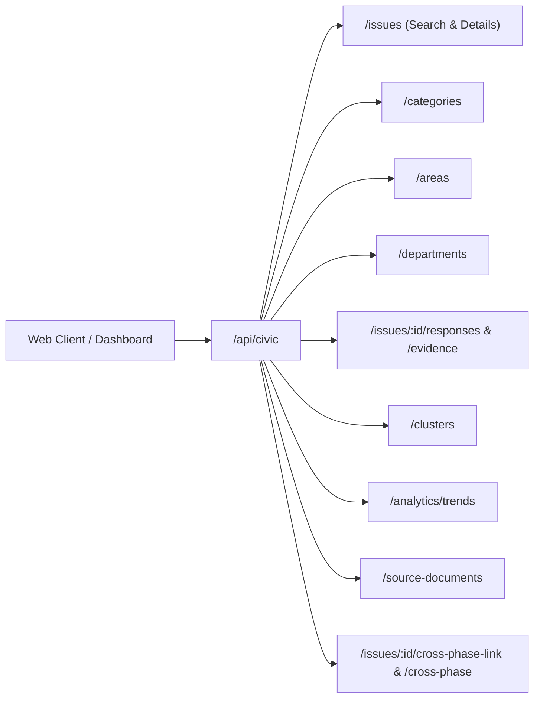

# CIVICLENS TN — Phase 8.8: Civic Issue Database and Cross-Phase API Integration

**Document Version:** 1.0.0  
**Phase:** 8.8 — Civic Issue Database and Cross-Phase API Integration  
**Status:** Operational Pipeline  
**Standards:** OpenAPI 3.0 / REST Guidelines, DPDPA 2023 Statutory Privacy Compliance, Citizen's Charter Standards  

---

## 1. Executive Summary

Phase 8.8 delivers the unified database entities and public REST API for the **CIVICLENS TN Public Grievance and Civic Issue Intelligence System**. It connects Phase 8 seamlessly with earlier platform phases (Phases 1–7) without creating duplicate databases or synthetic causal linkages.

### Core Architectural Principles
1. **Reuse Existing Infrastructure**: Leverages existing database sessions, source registries, provenance utilities, and Flask blueprint routing (`/api/civic`).
2. **Comprehensive Entity Exposure**: Implements complete JSON serialization (`to_dict()`) for all Phase 8 models (`CivicIssue`, `GrievanceRecord`, `IssueCategory`, `CivicDepartment`, `AdministrativeArea`, `ResponseRecord`, `ResolutionEvidence`, `PublicWork`, `IssueEvent`, `IssueMetric`, `DataQualityIssue`, `CivicCrossPhaseLink`).
3. **Strict Anti-Causality Guard**: Prohibits establishing causal links between civic issues and budgets, promises, or representatives solely based on co-location or shared geographic area. Every cross-phase connection requires an explicit documented matching method and provenance summary.
4. **Privacy Safeguards**: Enforces strict citizen privacy and PII redaction across all public responses in compliance with DPDPA 2023.

---

## 2. API Endpoints Overview

The civic intelligence router is mounted at `/api/civic` under the central `/api` blueprint:



### Route Index

| Method | Endpoint | Description |
| :--- | :--- | :--- |
| `GET` | `/api/civic/issues` | Multi-attribute search and filtering across categories, areas, departments, statuses, severities, and date ranges with pagination. |
| `GET` | `/api/civic/issues/<issue_id>` | Full issue details, including category, department, administrative area, SLA standards, public works, and cross-phase relations. |
| `GET` | `/api/civic/categories` | Canonical civic categories with SLA turnaround hours and active issue counts. |
| `GET` | `/api/civic/areas` | Administrative jurisdictions in Tamil Nadu with population context and active issue counts. |
| `GET` | `/api/civic/departments` | Government departments and local body agencies with docket volume. |
| `GET` | `/api/civic/departments/<dept_id>/summary` | Performance summary: total dockets, status breakdown, average resolution days, and SLA compliance rate %. |
| `GET` | `/api/civic/issues/<issue_id>/responses` | Chronological response history, action-taken reports (ATRs), and state transitions. |
| `GET` | `/api/civic/issues/<issue_id>/evidence` | Empirical resolution evidence artifacts (e.g. work orders, completion certificates, site verification photos). |
| `GET` | `/api/civic/clusters` | Recurring issue hotspots grouped by area and category. |
| `GET` | `/api/civic/analytics/trends` | Trend analytics across 10 core metrics with guarded anomaly detection ($N \ge 30$). |
| `GET` | `/api/civic/source-documents` | Statutory source documents, gazettes, and portal dumps with SHA256 checksums. |
| `GET` | `/api/civic/issues/<issue_id>/source-documents` | Source documents associated with an issue or its underlying petitions. |
| `POST` | `/api/civic/issues/<issue_id>/cross-phase-link` | Registers a documented cross-phase relationship to Phase 1-7 entities with strict anti-causality validation. |
| `GET` | `/api/civic/issues/<issue_id>/cross-phase` | Returns all cross-phase relationships with resolved entities from Phases 1–7. |

---

## 3. Cross-Phase Integration & Anti-Causality Guard

### 3.1 Cross-Phase Mappings

Phase 8 connects to earlier platform phases via the explicit junction model `CivicCrossPhaseLink`:

| Phase | Connected Entity | Relationship Nature | Permitted Matching Methods |
| :--- | :--- | :--- | :--- |
| **Phase 1–2: Budgets & Schemes** | `HistoricalScheme`, `BudgetScheme` | `addressed_by_scheme` | `DEPARTMENT_SCHEME_ALIGNMENT`, `EXPLICIT_TENDER_REF` |
| **Phase 3: Political Promises** | `PoliticalPromise` | `promised_remedy` | `MANIFESTO_ITEM_CORRELATION`, `POLICY_COMMITMENT_MATCH` |
| **Phase 4: News Articles** | `Article` | `reported_by_news` | `MEDIA_EVENT_CO_REFERENCE`, `JOURNALISTIC_INVESTIGATION` |
| **Phase 5: Public Funding** | `FinancialDocument` | `funded_by_allocation` | `BUDGET_HEAD_CITING`, `EXPLICIT_TENDER_REF` |
| **Phase 6: Representatives** | `Representative`, `Constituency` | `constituency_representative` | `ELECTORAL_WARD_BOUNDARY_OVERLAP`, `OFFICIAL_JURISDICTION` |
| **Phase 7: Verified Claims** | `Claim` | `evaluated_by_claim` | `FACT_CHECK_EVALUATION`, `EMPIRICAL_DATA_CROSS_REF` |

### 3.2 The Anti-Causality Guard

> [!IMPORTANT]
> **Strict Rule**: *Do not create causal links merely because two records concern the same area.*  
> In municipal data analysis, assuming that a budget allocation or an MLA promise caused or remediated a local civic defect solely because both happened in Chennai or Madurai is fallacious.

The API enforces this guard programmatically at `POST /api/civic/issues/<issue_id>/cross-phase-link`:
- Requires mandatory `matching_method` and `provenance_summary`.
- If `matching_method` is set to `same_area`, `same_district`, or `geographic_proximity_only`, the API **rejects the request with HTTP 400**:
  ```json
  {
    "status": "error",
    "message": "Invalid cross-phase relationship: Cannot create cross-phase links merely because records share a geographic area without explicit empirical connection (e.g. tender reference, scheme sanction, constituency attribution, or news citation)."
  }
  ```

---

## 4. Entity Serialization & Privacy Safeguards

All entities provide deterministic `to_dict()` methods. In compliance with India's Digital Personal Data Protection Act (DPDPA 2023):
- **`GrievanceRecord`**: Serializes `grievance_id`, `issue_category`, `description_or_permitted_summary`, `submission_date`, `status`, `acknowledgement_date`, and `resolution_date`. Citizen names, mobile phone numbers, personal home addresses, and identity numbers are **never included** in serialized representations.
- **`CivicIssue`**: Omits personal petitioner references; exposes sanitized summaries and municipal geographic identifiers.
- **`is_anonymized = True`**: Maintained as an immutable constraint on all grievance records.

---

## 5. Verification & Test Suite

The API and cross-phase database integration are tested by 13 unit and integration tests in [`tests/unit/test_phase8_api_integration.py`](file:///e:/CIVCLENS/tests/unit/test_phase8_api_integration.py):

| Test Case | Scenario Verified | Status |
| :--- | :--- | :--- |
| `test_model_to_dict_and_privacy_safeguards` | Verifies `to_dict()` serialization and confirms zero citizen PII leakage. | Passed |
| `test_search_civic_issues_filters` | Multi-attribute search (keyword, category, status, area, pagination). | Passed |
| `test_get_civic_issue_details` | Full issue profile, category, department, SLA, and response counts. | Passed |
| `test_get_issue_categories` | Canonical categories, turnaround standards, and issue counts. | Passed |
| `test_get_administrative_areas` | Administrative area hierarchy, population context, and issue counts. | Passed |
| `test_get_department_and_summary` | Department listing and SLA performance metrics. | Passed |
| `test_get_issue_responses_history` | Chronological ATRs and state transition event logs. | Passed |
| `test_get_issue_resolution_evidence` | Empirical verification artifacts supporting/refuting closures. | Passed |
| `test_get_recurring_clusters` | Recurring issue hotspots and recurrence rates. | Passed |
| `test_get_trend_analytics` | 10 core metrics and guarded anomaly detection. | Passed |
| `test_get_source_documents` | Statutory source documents with SHA256 hashes and tiers. | Passed |
| `test_cross_phase_link_creation_and_anti_causality_guard` | Rejects superficial "same_area" links (400); creates valid links (201). | Passed |
| `test_cross_phase_entity_resolution` | Resolves linked entities from Phases 1–7 (Schemes, Promises, News, Funding, Reps, Claims). | Passed |

---

## 6. Conclusion

Phase 8.8 successfully integrates the civic issue intelligence system into the core CIVICLENS TN platform. With clean blueprint mounting, robust serialization, strict privacy protection, and guarded cross-phase entity resolution, Phase 8 is ready for full platform dashboards and civic analytics.
