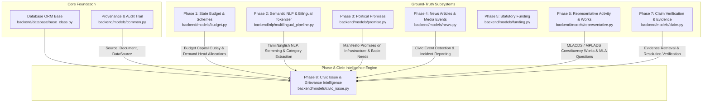
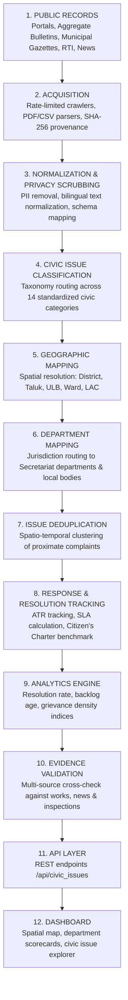
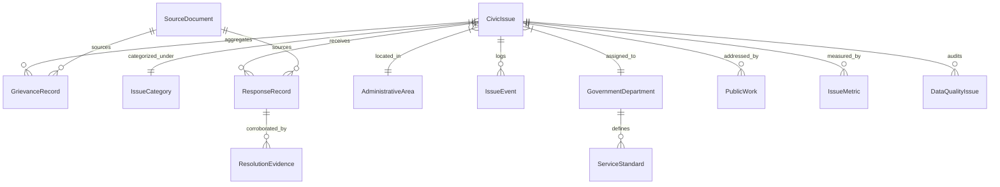

# Phase 8 — Public Grievance & Civic Issue Intelligence Architecture

## 1. Executive Summary & Objective

Phase 8 of **CIVICLENS TN** introduces the **Public Grievance & Civic Issue Intelligence System** for Tamil Nadu. Its objective is to provide a transparent, multi-source, empirically grounded civic intelligence platform that tracks, categorizes, aggregates, and validates citizen grievances, public works, administrative responses, and service delivery performance across Tamil Nadu's 38 districts and urban local bodies.

> [!IMPORTANT]
> **Core Architectural Principles & Directives:**
> 1. **Zero Fabrication Policy:** Real Phase 8 grievance and municipal complaint records have **NOT** been scraped or collected yet. System schemas, data pipelines, normalization models, and test fixtures are fully established before batch harvesting.
> 2. **Strict Privacy First:** Private citizen identities (names, phone numbers, Aadhaar/voter IDs, personal email addresses, home door addresses, and complaint passwords/tokens) are **strictly scrubbed and never stored or exposed**. The platform focuses exclusively on public civic issues, spatial trends, departmental accountability, and aggregate metrics.
> 3. **Non-Intrusive Public Acquisition:** The system interacts only with statutory open data, gazettes, aggregate department reports, RTI releases, and public press publications. It **never bypasses portal authentication, OTP gates, or access controls** of grievance redressal systems.
> 4. **Multi-Source Cross-Verification:** Civic resolutions reported by government departments are corroborated with on-the-ground public works tenders, local news reports, legislative questions, and citizen verification evidence.
> 5. **Reuse Foundation of Phases 1–7:** Seamlessly reuses existing document acquisition, bilingual NLP pipelines, scheme registries, representative tracking, and source traceability foundations.

---

## 2. Integration with Existing Repository Infrastructure (Phases 1–7 Audit)

The Public Grievance & Civic Issue Intelligence module is designed to integrate natively with the existing CIVICLENS TN architecture without reinventing existing capabilities:

### Subsystem Contributions to Civic Intelligence:
- **Phase 0 (Core Provenance & Database):** Reuses `CustomBase` ORM declarative classes and provenance entities (`Source`, `Document`, `DataSource`) to ensure cryptographic traceability (SHA-256) of every ingested civic record or aggregate bulletin.
- **Phase 1 (State Budget & Schemes):** Maps civic issues to statutory budget demands (e.g., Demand 34 - Municipal Administration and Water Supply, Demand 14 - Energy, Demand 21 - Highways and Minor Ports) to analyze whether chronic issues correlate with fiscal under-allocation or slow expenditure.
- **Phase 2 (Bilingual NLP & Semantic Pipeline):** Utilizes `multilingual_pipeline.py` with custom Tamil morphological stemmers, stopword dictionaries, and bilingual tokenizers to classify grievance titles and descriptions into canonical civic categories in both Tamil and English.
- **Phase 3 (Political Promises):** Cross-references localized civic grievances (e.g., drainage completion in Tambaram, drinking water in Ramanathapuram) against ruling and opposition party manifesto commitments.
- **Phase 4 (Tamil News & Incident Intelligence):** Ingests news reports detailing civic infrastructure failures (water contamination, road collapse, hospital medicine stockouts) to cross-validate citizen petitions and official resolution claims.
- **Phase 5 (Funding Transparency):** Supplies data on urban local body financial transfers and statutory allocations.
- **Phase 6 (Representative Activity & Constituency Works):** Directly integrates with `ConstituencyWork` (MLACDS / MPLADS tenders) and `LegislativeActivity` (Assembly questions raised by MLAs on local civic issues) to assess representative responsiveness to local grievances.
- **Phase 7 (Claim Verification & Evidence):** Adapts the multi-tier evidence evaluation engine to verify whether departmental "Action Taken Reports" (ATRs) represent genuine physical resolution or merely bureaucratic closure.

---

## 3. End-to-End Civic Intelligence Pipeline

The civic intelligence system operates as an end-to-end 12-stage pipeline:

### Detailed Pipeline Stage Descriptions:
1. **Public Records Intake:** Identifies published aggregate grievance data, departmental performance bulletins, municipal council minutes, and citizen charter standards across state and municipal authorities.
2. **Acquisition:** Retrieves unstructured documents, CSV/JSON open datasets, and press releases with strict rate limiting, exponential backoff, and cryptographic hashing.
3. **Normalization & Privacy Scrubbing:** Applies automated sanitization regex and named-entity filters to strip all phone numbers, personal names, email addresses, and petition secret tokens. Standardizes date formats, Unicode Tamil text, and numeric metrics.
4. **Civic Issue Classification:** Runs rule-based and NLP keyword extraction against 14 domain-specific civic categories (roads, water supply, drainage, electricity, etc.).
5. **Geographic Mapping:** Standardizes location entities against Tamil Nadu's administrative hierarchy (38 Districts, 312 Taluks, 21 Municipal Corporations, 138 Municipalities, 490 Town Panchayats, 234 Assembly Constituencies).
6. **Department Mapping:** Resolves jurisdictional responsibility to appropriate state Secretariat departments (e.g., MAWS, Highways, TANGEDCO, Health & Family Welfare).
7. **Issue Deduplication:** Clusters multiple reports of the same physical incident (e.g., water main burst or pothole cluster on Anna Salai) within a specified spatial radius and temporal window into a single unified `CivicIssue`.
8. **Response / Resolution Tracking:** Ingests official Action Taken Reports (ATRs) and compares processing timestamps against statutory Service Standards (Citizen's Charters) to flag SLA breaches.
9. **Analytics Engine:** Computes high-level civic metrics including resolution velocity, recurring complaint frequency (recidivism), and geographical grievance density per 100,000 population.
10. **Evidence Validation:** Tests official closure assertions against independent evidence (work completion certificates, geo-tagged photographs from tenders, independent news reports).
11. **API Layer:** Delivers standardized REST endpoints for frontend exploration, research exports, and public civic audits.
12. **Dashboard Layer:** Presents interactive heatmaps, ward-level filters, departmental accountability cards, and civic issue timelines for citizens and analysts.

---

## 4. Core Data Entities

Phase 8 introduces 13 relational entities in `backend/models/civic_issue.py`:

### Entity Specifications:
1. **`CivicIssue`:** The canonical root entity representing a unique real-world civic problem (e.g., chronic waterlogging at Velachery junction, damaged transformer in Madurai). Contains aggregated title, status, severity, geographical coordinates, and lifecycle dates.
2. **`GrievanceRecord`:** Individual public grievance complaint or petition ingested from aggregate reports or public logs. Stores strictly anonymized description, reference tokens, submission date, and source provenance.
3. **`IssueCategory`:** Standardized taxonomy node (14 core categories + subcategories) specifying domain, priority weighting, and default department assignment.
4. **`GovernmentDepartment`:** State secretariat department, directorate, or local body agency (e.g., Greater Chennai Corporation, TANGEDCO, TWAD Board, Highways Department) responsible for civic infrastructure.
5. **`AdministrativeArea`:** Spatial unit in Tamil Nadu (State, District, Taluk, Municipal Corporation, Zone, Ward, Revenue Village, Assembly Constituency) with census codes and spatial bounds.
6. **`ServiceStandard`:** Statutory Citizen's Charter service delivery commitment (e.g., pothole repair within 48 hours, street light bulb replacement within 24 hours, new water connection within 15 days) specifying designated officers and escalation tiers.
7. **`ResponseRecord`:** Official action-taken entry, interim status update, or departmental reply acknowledging, rejecting, or closing a grievance.
8. **`ResolutionEvidence`:** Empirical artifact validating or disputing a claimed resolution (work order, field inspection report, news verification, satellite/photographic evidence, citizen audit).
9. **`PublicWork`:** Linked capital work, maintenance contract, or MLACDS/MPLADS project sanctioned to remediate the underlying civic issue.
10. **`IssueEvent`:** Immutable chronological audit log capturing every state transition (opened, assigned, inspected, delayed, closed, reopened).
11. **`SourceDocument`:** Primary document, gazette notification, municipal resolution, or bulletin from which grievance or response data was acquired.
12. **`IssueMetric`:** Aggregated statistical measure computed at area or department level (e.g., mean resolution days, open backlog count, SLA compliance percentage).
13. **`DataQualityIssue`:** Automated audit record flagging incomplete data, ambiguous location coordinates, delayed response updates, or anomalous closure rates.

---

## 5. Supported Issue Categories

The system supports 14 standardized civic categories:

| Category Code | Display Name (English) | Display Name (Tamil) | Primary Responsible Departments |
|:---|:---|:---|:---|
| `ROADS` | Roads & Footpaths | சாலைகள் மற்றும் நடைபாதைகள் | Highways & Minor Ports, Municipal Corporations, Rural Development |
| `WATER_SUPPLY` | Drinking Water Supply | குடிநீர் வழங்கல் | TWAD Board, CMWSSB, Municipal Administration (MAWS) |
| `DRAINAGE` | Stormwater & Underground Drainage | மழைநீர் வடிகால் & கழிவுநீர் | CMWSSB, Municipal Corporations, Town Panchayats |
| `SANITATION` | Public Sanitation & Toilets | பொது சுகாதாரம் & கழிப்பறைகள் | Health & Family Welfare, Urban Local Bodies |
| `WASTE_MANAGEMENT` | Solid Waste & Garbage Collection | திடக்கழிவு மேலாண்மை | Municipal Corporations, Village Panchayats |
| `STREETLIGHTS` | Street Lighting | தெருவிளக்குகள் | Urban Local Bodies, Village Panchayats, TANGEDCO |
| `PUBLIC_TRANSPORT` | Public Transport & Bus Shelters | பொதுப் போக்குவரத்து | Transport Department (TNSTC, MTC), Highways |
| `HEALTHCARE_ACCESS` | Healthcare Facilities & PHCs | மருத்துவமனை & ஆரம்ப சுகாதார வசதிகள் | Health and Family Welfare Department |
| `EDUCATION_INFRASTRUCTURE`| Government School Infrastructure | பள்ளி கல்வி உள்கட்டமைப்பு | School Education Department, Public Works Department (PWD) |
| `ELECTRICITY` | Power Supply, Transformers & Poles | மின்சார விநியோகம் & மின்மாற்றிகள் | TANGEDCO (Tamil Nadu Generation and Distribution Corp) |
| `PUBLIC_SAFETY_INFRASTRUCTURE`| Safety, Signals & Traffic Lights | பொதுப் பாதுகாப்பு உள்கட்டமைப்பு | Home (Police), Transport, Municipal Corporations |
| `ENVIRONMENTAL_CONCERNS` | Pollution, Lakes & Tree Cover | சுற்றுச்சூழல் & நீர்நிலைகள் | Environment, Climate Change & Forests, TNPCB, WRD |
| `GOVERNMENT_SERVICE_DELAYS`| Delays in Certificates & Welfare | அரசு சேவை தாமதங்கள் | Revenue & Disaster Management, TNeGA, Social Welfare |
| `OTHER_CIVIC_ISSUES` | Other Documented Civic Issues | பிற ஆவணப்படுத்தப்பட்ட குடிமைப் பிரச்சனைகள் | Respective Line Departments |

---

## 6. Strict Privacy Rules & PII Redaction

To safeguard fundamental citizen privacy and comply with the **Digital Personal Data Protection Act, 2023 (DPDPA)**:

1. **No Personal Identifiable Information (PII) Ingestion:**
   - Citizen real names, initials, mobile numbers, WhatsApp numbers, personal emails, residential addresses (flat numbers, house numbers), Aadhaar numbers, ration card numbers, and banking details are **prohibited from persistent storage**.
2. **Automated Redaction Pipeline:**
   - Any raw text ingested from open bulletins or gazetted petitions is processed through `sanitize_pii()` before ORM insertion. Phone numbers matching Indian patterns (`+91`, `0`, or 10-digit formats) are scrubbed to `[PHONE REDACTED]`, email addresses to `[EMAIL REDACTED]`, and citizen names to `[CITIZEN]`.
3. **Complaint Credential Masking:**
   - Internal citizen login passwords, OTP tokens, and confidential petition tracking PINs are completely disregarded.
4. **Preference for Spatial and Statistical Aggregation:**
   - The platform prioritizes aggregate ward-level, district-level, and department-level indicators over single individual petitions.
5. **No Unauthorized Portal Bypass:**
   - The system adheres strictly to robots.txt, terms of service, and public data APIs. It does not attempt to brute force or automate CAPTCHAs or OTP-based grievance submission gateways.

---

## 7. Architectural Quality & Verification Strategy

- **Test Fixtures:** Synthetic fixtures (`tests/fixtures/phase8_fixtures.py`) tagged with `is_test_fixture=True` guarantee zero reliance on uncollected real-world personal grievances.
- **Automated Validation:** Test suite `tests/unit/test_phase8_architecture.py` checks schema validity, privacy filters, category mappings, SLA computations, and cross-phase relations.
- **Auditable Provenance:** Every metric and civic issue links directly to source documents with SHA-256 cryptographic hashes.
