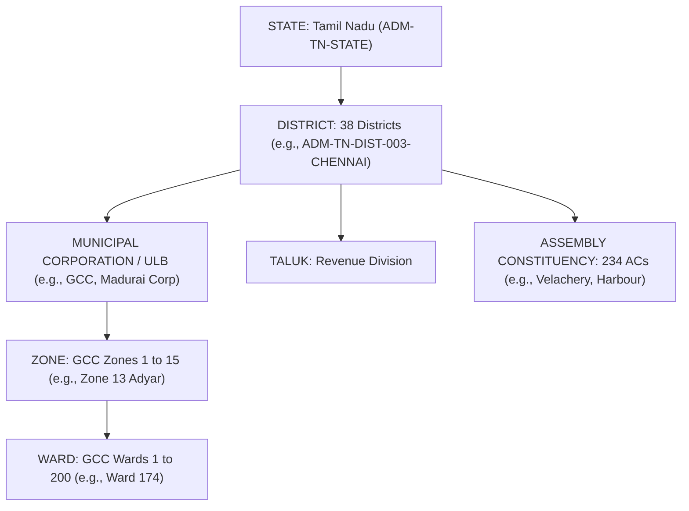

# CIVICLENS TN — Phase 8.5: Geographic Mapping & Department Jurisdiction Resolution

**Document Version:** 1.0.0  
**Phase:** 8.5 — Geographic Mapping & Department Mapping  
**Status:** Operational Pipeline  
**Standards:** Local Government Directory (LGD), Tamil Nadu Municipal Administration Framework, Citizen's Charter Statutory Standards  

---

## 1. Executive Summary

Phase 8.5 implements the spatial and administrative resolution layer of **CIVICLENS TN**. In Tamil Nadu's complex governance hierarchy, public grievances span multiple tiers:
- State Line Departments (Highways, TWAD Board, TANGEDCO, Health, School Education, Revenue).
- Urban Local Bodies (Greater Chennai Corporation with 15 zones & 200 wards, 24 Municipal Corporations, 138 Municipalities).
- Rural Local Bodies (388 Block Panchayats, 12,525 Village Panchayats).
- Legislative Boundaries (234 Assembly Constituencies, 39 Parliamentary Constituencies).

The Phase 8.5 pipeline resolves incoming complaints and clustered civic issues to their canonical **administrative boundaries** and assigns direct operational **departmental accountability** along with statutory **Citizen's Charter service delivery deadlines**.

---

## 2. Spatial Hierarchy & Administrative Boundaries

CIVICLENS TN establishes a strict hierarchical container model across Tamil Nadu:

### 2.1 Resolution Strategies (`CivicGeographicMapper`)
1. **Explicit Code Matching (`EXACT_CODE`)**:
   Matches canonical identifiers (`ADM-TN-DIST-003-CHENNAI`, `ADM-TN-GCC-WARD-174`, `ADM-TN-GCC-ZONE-13-ADYAR`).
2. **Bilingual Text Extraction (`BILINGUAL_NAME` / `TEXT_EXTRACTION`)**:
   Matches Tamil script and English names across all 38 districts (e.g., `செங்கல்பட்டு` $\rightarrow$ Chengalpattu), as well as municipal regex patterns for wards (`Ward 174`, `வார்டு 174`) and zones (`Zone 13`, `மண்டலம் 13`).
3. **Geodesic Coordinate Resolution (`GPS_COORDINATE`)**:
   When GPS latitude and longitude are supplied, computes great-circle Haversine distance against district geographical centroids to anchor the issue.
4. **Coarse Geography Auditing**:
   If an issue can only be resolved to a high-level container (District or State) without ward-level granularity, the mapper flags `is_imprecise = True` and records an automated `DataQualityIssue` (`COARSE_GEOGRAPHY`).

---

## 3. Department Jurisdiction Resolution

Public infrastructure in Tamil Nadu features shared jurisdictions. The `CivicDepartmentResolver` applies deterministic statutory routing rules:

| Category | Geographic Context | Responsible Entity | Line Department Code | Statutory SLA |
| :--- | :--- | :--- | :--- | :--- |
| `ELECTRICITY` | Statewide | TANGEDCO (Tamil Nadu Generation and Distribution Corp) | `DEPT_TANGEDCO` | 24 Hours |
| `GOVERNMENT_SERVICE_DELAYS` | Statewide | Revenue and Disaster Management (Land Records / Taluk Office) | `DEPT_REVENUE` | 360 Hours (15 Days) |
| `ROADS` | Inside GCC Chennai | Greater Chennai Corporation (Works / Bus Route Roads) | `DEPT_GCC` | 48 Hours |
| `ROADS` | Outside Chennai | Highways and Minor Ports Department (State Highways) | `DEPT_HIGHWAYS` | 48 Hours |
| `WATER_SUPPLY` | Chennai Metropolitan | CMWSSB (Metro Water) under MAWS Department | `DEPT_MAWS` | 12 Hours |
| `WATER_SUPPLY` | Rest of Tamil Nadu | TWAD Board (Tamil Nadu Water Supply & Drainage) | `DEPT_MAWS` | 12 Hours |
| `DRAINAGE` | Urban / Rural | Municipal Administration & Water Supply (Drainage Wing) | `DEPT_MAWS` | 24 Hours |
| `WASTE_MANAGEMENT` | Inside GCC Chennai | Greater Chennai Corporation (Solid Waste Management) | `DEPT_GCC` | 24 Hours |
| `STREETLIGHTS` | Inside GCC Chennai | Greater Chennai Corporation (Electrical Wing) | `DEPT_GCC` | 24 Hours |
| `HEALTHCARE_ACCESS` | Statewide | Health and Family Welfare Department (DPH / DME) | `DEPT_HEALTH` | Standard Protocol |
| `EDUCATION_INFRASTRUCTURE`| Statewide | School Education Department / PWD (Buildings) | `DEPT_EDUCATION` | Standard Protocol |

---

## 4. Citizen's Charter Service Standards (SLAs)

Under the Tamil Nadu Right to Services framework and Municipal Citizen's Charters, specific civic complaints have legally designated turnaround times:

- **Pothole Repair & Road Patchwork**: $48\text{ hours}$ (Designated Officer: Assistant Executive Engineer, Works).
- **Streetlight Defect / Bulb Replacement**: $24\text{ hours}$ (Designated Officer: Assistant Engineer, Electrical).
- **Overflowing Dumper Placer Bin**: $24\text{ hours}$ (Designated Officer: Sanitary Inspector / Zonal Conservancy Officer).
- **Drinking Water Contamination / Supply Disruption**: $12\text{ hours}$ (Designated Officer: Area Engineer, CMWSSB / TWAD).
- **Distribution Transformer Failure**: $24\text{ hours}$ (Designated Officer: Assistant Engineer, Operation & Maintenance, TANGEDCO).
- **Online Patta Transfer (Without Subdivision)**: $15\text{ days (360 hours)}$ (Designated Officer: Zonal Deputy Tahsildar).

### SLA Deadline Computation
When a grievance or issue is registered, the pipeline automatically calculates:
$$\text{Target Resolution Date} = \text{Submission Date} + \text{SLA Hours}$$
This timestamp is saved to `civic_issue.target_resolution_date`. If departmental closure occurs after this timestamp, an SLA breach is automatically logged.

---

## 5. Verification & Test Suite

The mapping pipeline is verified by [`tests/unit/test_phase8_mapping.py`](file:///e:/CIVCLENS/tests/unit/test_phase8_mapping.py):
- `test_1_administrative_area_code_resolution`: Code mapping for Districts, GCC Zones, and Wards.
- `test_2_bilingual_district_and_locality_text_matching`: Tamil script district and ward extraction.
- `test_3_gps_coordinates_spatial_resolution`: Haversine nearest district matching.
- `test_4_department_jurisdiction_routing`: Department routing across municipal and state line departments.
- `test_5_citizens_charter_sla_deadline_computation`: SLA deadline calculation.
- `test_6_coarse_geography_data_quality_audit`: Automated logging of `COARSE_GEOGRAPHY` data quality flags.
- `test_7_unified_database_entity_enrichment_integration`: Full database enrichment roundtrip.

**Phase 8 Test Suite Status**: **46/46 passing tests** across all phases.
