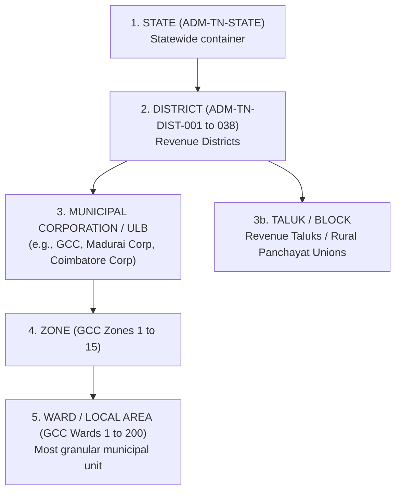

# CIVICLENS TN — Phase 8.5: Geographic Mapping & Department Jurisdiction Methodology

**Document Version:** 1.0.0  
**Phase:** 8.5 — Civic Issue Geographic Mapping and Department Mapping  
**Status:** Operational Pipeline  
**Standards:** Local Government Directory (LGD), Tamil Nadu Municipal Administration Framework, Citizen's Charter Statutory Standards  

---

## 1. Executive Summary

Phase 8.5 defines the spatial and administrative resolution methodology for **CIVICLENS TN**. In public civic monitoring, raw grievances and news reports frequently lack precise geographic metadata or reference ambiguous colloquial place names. Furthermore, infrastructure assets in Tamil Nadu often feature overlapping or contested jurisdictions between urban local bodies (ULBs) and state line departments.

The Phase 8.5 pipeline provides a deterministic, source-anchored framework that:
1. Connects civic issues strictly to official administrative areas supported by evidence (State, District, Corporation/Municipality, Ward).
2. Forbids artificial precision: never infers a ward or micro-location from vague or coarse descriptions.
3. Disambiguates homonymous place names across Tamil Nadu without false assumptions.
4. Harmonizes historical boundary reorganizations (e.g. 2019/2020 district bifurcations).
5. Resolves departmental responsibility and statutory turnaround limits (SLAs), accommodating shared jurisdictions and unresolved statuses.

---

## 2. Administrative Hierarchy & Granularity Levels

Every mapping references official Local Government Directory (LGD) boundaries across five administrative levels:

### Granularity Integrity Rules
1. **No False Precision**: If a source record provides only district-level information (e.g. "Road damage in Madurai District"), the issue is assigned to `ADM-TN-DIST-013-MADURAI` with `geographic_level = "DISTRICT"`. The system **strictly forbids inferring or synthesizing a ward number**.
2. **Missing Location Handling**: If a grievance completely omits geographic context or contains only generic terms, it is mapped to the State container `ADM-TN-STATE` with `warning_flag = "MISSING_LOCATION"`, `confidence < 0.50`, and routed to `review_status = "PENDING_HUMAN_REVIEW"`.
3. **Coarse Geography Auditing**: Any civic issue mapped above the ward level generates an automated `DataQualityIssue` (`COARSE_GEOGRAPHY`) to track geolocation imprecision.

---

## 3. Disambiguation of Ambiguous Place Names

Tamil Nadu features numerous identical locality names (homonyms) in different municipal corporations and revenue districts:

| Ambiguous Place Name | Candidate Locations across Tamil Nadu | Disambiguation Strategy |
| :--- | :--- | :--- |
| **Anna Nagar (அண்ணா நகர்)** | Chennai (Zone 8), Madurai, Tiruchirappalli, Salem | If district or ward is explicit $\rightarrow$ resolves precisely. If text mentions *only* "Anna Nagar" $\rightarrow$ **refuses to assume Chennai**, maps to `ADM-TN-STATE`, flags `AMBIGUOUS_PLACE_NAME`, lists candidates, and requests human review. |
| **Gandhi Nagar (காந்தி நகர்)** | Vellore (Katpadi), Chennai (Adyar), Tiruppur | Contextual district matching or fallback review. |
| **Kottur (கோட்டூர்)** | Chennai (Kotturpuram / Ward 170), Tiruvarur (Kottur Block) | Refuses assumption; checks for river / ward or flags ambiguous. |
| **KK Nagar (கே.கே. நகர்)** | Chennai (Kodambakkam / Zone 10), Madurai, Trichy | Requires explicit district token or flags `AMBIGUOUS_PLACE_NAME`. |
| **Ram Nagar (ராம் நகர்)** | Coimbatore, Madurai, Chennai | Requires explicit district token or flags `AMBIGUOUS_PLACE_NAME`. |

---

## 4. Historical Boundary Reorganizations

Tamil Nadu underwent significant district bifurcations in 2019 and 2020:
- **November 2019 Reorganizations**:
  - Kancheepuram $\rightarrow$ Kancheepuram & **Chengalpattu** (G.O. Ms. No. 427, Revenue).
  - Vellore $\rightarrow$ Vellore, **Ranipet**, and **Tirupathur** (G.O. Ms. No. 428/429).
  - Viluppuram $\rightarrow$ Viluppuram & **Kallakurichi** (G.O. Ms. No. 423).
  - Tirunelveli $\rightarrow$ Tirunelveli & **Tenkasi** (G.O. Ms. No. 424).
- **December 2020 Reorganization**:
  - Nagapattinam $\rightarrow$ Nagapattinam & **Mayiladuthurai** (G.O. Ms. No. 815).

### Reconciliation Method
When historical records (or citizen petitions referencing legacy terminology) mention localities in bifurcated areas (e.g. "Tambaram, Kancheepuram District"):
1. The engine anchors the issue to the **current official boundary** (`ADM-TN-DIST-002-CHENGALPATTU`).
2. Retains historical provenance by logging `warning_flag = "HISTORICAL_BOUNDARY_SPLIT"`.
3. Records `historical_context = "Tambaram was historically part of Kancheepuram District prior to November 2019 reorganization"`.
4. Sets `mapping_method = "HISTORICAL_CROSS_REFERENCE"`.

---

## 5. Department Jurisdiction & Shared Responsibility

### 5.1 Clear Line Department Responsibility
- **Electricity (`ELECTRICITY`)**: Exclusively mapped statewide to `DEPT_TANGEDCO` (24h SLA). Responsible authority: *Superintending Engineer (Distribution), TANGEDCO*.
- **Government Service Delays (`GOVERNMENT_SERVICE_DELAYS`)**: Mapped to `DEPT_REVENUE` (15 days / 360h SLA). Responsible authority: *District Collectorate / Taluk Tahsildar*.
- **Interior Urban Roads**: Inside Chennai $\rightarrow$ `DEPT_GCC` (48h SLA). Outside Chennai $\rightarrow$ Municipal Corporation / ULB.
- **Water Supply**: Inside Chennai $\rightarrow$ `DEPT_MAWS` (CMWSSB Metro Water, 12h SLA). Statewide $\rightarrow$ `DEPT_MAWS` (TWAD Board, 12h SLA).

### 5.2 Shared Department Jurisdiction
*Scenario: State Highway passing through Municipal Corporation boundaries (e.g. Anna Salai, GST Road).*
- Road Surface / Carriageway: `DEPT_HIGHWAYS`
- Footpaths, Stormwater Drains & Streetlights: `DEPT_GCC` / Municipal Corporation
- Engine Output:
  - `department_id = "DEPT_HIGHWAYS"` (Primary)
  - `candidate_departments = ["DEPT_HIGHWAYS", "DEPT_GCC"]`
  - `is_shared_responsibility = True`
  - `department_status = "SHARED"`
  - `responsible_local_authority = "Highways Department (Carriageway) & Greater Chennai Corporation (Lighting & Footpaths)"`

### 5.3 Unclear / Disputed Jurisdiction
*Scenario: Public lake encroachment or canal boundary dispute between Revenue and Water Resources/Local Body.*
- Engine Output:
  - `department_id = None`
  - `candidate_departments = ["DEPT_REVENUE", "DEPT_MAWS"]`
  - `is_shared_responsibility = True`
  - `department_status = "UNRESOLVED"`
  - `review_status = "PENDING_HUMAN_REVIEW"`
  - `responsible_local_authority = "Joint Inspection Committee (Revenue & Local Body)"`

---

## 6. Canonical Mapping Record Specification

Every mapping generated by `CivicMappingIntegrationService` produces a structured `CivicMappingRecord`:

| Field Name | Type | Description |
| :--- | :--- | :--- |
| `issue_id` | Integer | ID of the parent canonical `CivicIssue` entity |
| `administrative_area_id` | String | Canonical area code (`ADM-TN-GCC-WARD-174`, `ADM-TN-DIST-013-MADURAI`, `ADM-TN-STATE`) |
| `geographic_level` | String | Granularity tier (`STATE`, `DISTRICT`, `MUNICIPAL_CORPORATION`, `WARD`) |
| `department_id` | String (Optional) | Primary department code where known (`DEPT_GCC`, `DEPT_TANGEDCO`, etc.) |
| `mapping_method` | String | Algorithmic basis (`EXACT_CODE`, `BILINGUAL_NAME`, `GPS_COORDINATE`, `TEXT_EXTRACTION`, `HISTORICAL_CROSS_REFERENCE`, `FALLBACK_CONTAINER`) |
| `source_reference` | String (Optional) | Native complaint docket token or petition identifier |
| `confidence` | Float | Calibrated confidence score ($0.0$ to $1.0$) |
| `review_status` | String | `AUTOMATED_VERIFIED` or `PENDING_HUMAN_REVIEW` |
| `candidate_departments` | List[String] | Array of possible line departments when shared or unclear |
| `responsible_local_authority` | String (Optional) | Designated executive office (e.g. Zonal Officer, Superintending Engineer) |
| `is_shared_responsibility` | Boolean | True if multiple agencies share jurisdiction |
| `warning_flag` | String (Optional) | Quality flag (`MISSING_LOCATION`, `COARSE_GEOGRAPHY`, `AMBIGUOUS_PLACE_NAME`, `HISTORICAL_BOUNDARY_SPLIT`) |
| `historical_context` | String (Optional) | Administrative history notes regarding district reorganizations |

---

## 7. Verification & Test Suite

The methodology is verified by automated test suites in [`tests/unit/test_phase8_mapping.py`](file:///e:/CIVCLENS/tests/unit/test_phase8_mapping.py):
- `test_1_administrative_area_code_resolution`: Exact code resolution.
- `test_2_bilingual_district_and_locality_text_matching`: Tamil script district & ward extraction.
- `test_3_missing_location_safeguard`: Refuses to invent wards on empty text (`MISSING_LOCATION`).
- `test_4_historical_boundary_reorganizations`: Resolves 2019 bifurcations with historical context notes.
- `test_5_ambiguous_place_name_disambiguation`: Refuses to guess Chennai for "Anna Nagar" homonyms (`AMBIGUOUS_PLACE_NAME`).
- `test_6_gps_coordinates_spatial_resolution`: Haversine nearest district matching.
- `test_7_department_jurisdiction_routing`: Department routing across municipal and state line departments.
- `test_8_shared_department_responsibility`: State highway in GCC limits (`SHARED` status).
- `test_9_unclear_or_disputed_department_responsibility`: Disputed jurisdiction (`UNRESOLVED` status + candidates).
- `test_10_citizens_charter_sla_deadline_computation`: SLA deadline calculation.
- `test_11_canonical_mapping_record_serialization`: All 8 mandatory Phase 8.5 fields validated.
- `test_12_unified_database_entity_enrichment_integration`: Database persistence and relationship linking.

**Phase 8 Test Suite Status**: **51/51 passing tests**.
