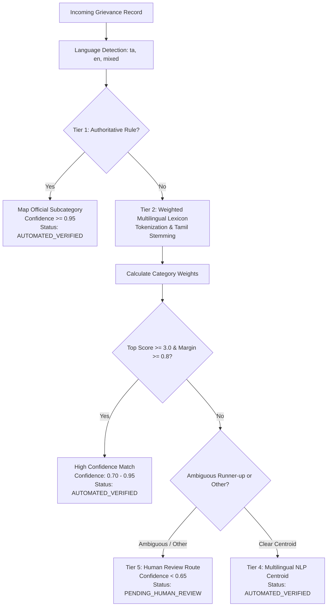

# CIVICLENS TN — Phase 8.4: Civic Issue Classification & Intelligence Methodology

**Document Version:** 1.0.0  
**Phase:** 8.4 — Civic Issue Classification and Duplicate Detection  
**Status:** Operational Pipeline  
**Compliance Standards:** Digital Personal Data Protection Act (DPDPA 2023), Non-Fabrication Directive, Anti-False-Merge Guarantees  

---

## 1. Executive Summary

Phase 8.4 establishes the civic intelligence and deduplication engine for **CIVICLENS TN**. In real-world municipal environments across Tamil Nadu, public grievances arrive in multiple languages (English, Tamil, and Tanglish/code-switched), varying technical terminology, and distinct petition formats.

The Phase 8.4 pipeline accomplishes two critical operational goals:
1. **Multilingual Classification**: Categorizes incoming complaints into the 14 standardized Phase 8 civic domains using a tiered combination of rule-based mapping, weighted multilingual keyword matching, Tamil NLP stemming, and semantic centroid scoring, with automatic routing of low-confidence predictions to human review.
2. **Issue Relationship & Deduplication Intelligence**: Evaluates relationships between grievance records and real-world physical incidents, strictly distinguishing **duplicate records**, **multiple complaints about the same problem**, **recurring issues**, **separate issues in the same area**, and **unrelated reports sharing similar vocabulary**.

### Fundamental Directives
- **Zero Word-Based False Merges**: Records are **NEVER** clustered into the same civic issue solely because they share similar words. Geographic anchoring (district, corporation, zone, ward, and coordinates) takes strict precedence.
- **Source Link Preservation**: Clustered and recurring issues preserve bidirectional database links to every underlying citizen petition (`grievance.civic_issue_id -> civic_issue.id`).
- **Veracity Independence**: Repeated citizen petitions about a problem do **NOT** constitute automatic proof that the issue is valid or resolved. The issue's `resolution_verification_status` remains `PENDING_VERIFICATION` until confirmed by empirical ground truth.

---

## 2. Multilingual Classification Taxonomy

Every grievance is classified into one of 14 standardized categories:

| Category Code | Domain | English Anchor Terms | Tamil Script Keywords | Transliterated / Tanglish Markers |
| :--- | :--- | :--- | :--- | :--- |
| `roads` | Roads & Footpaths | pothole, tarmac, bitumen, crater, footpath, speed breaker | சாலை, குண்டு குழி, தார் சாலை, நடைபாதை, பள்ளம் | saalai, road-la, thar saalai, pallam |
| `water_supply` | Drinking Water Supply | drinking water, pipe burst, water shortage, metro water, twad | குடிநீர், குழாய் உடைப்பு, தண்ணீர் தட்டுப்பாடு, மெட்ரோ வாட்டர் | kudineer, thanni varala, metro water supply |
| `drainage` | Drainage & Sewerage | stormwater drain, sewer overflow, manhole, clogged drain | சாக்கடை, கழிவுநீர், மழைநீர் வடிகால், பாதாள சாக்கடை | sakkadai, drainage water, manhole open |
| `sanitation` | Public Sanitation | public toilet, urinal, unhygienic, mosquito fogging, stench | பொது சுகாதாரம், பொது கழிப்பறை, கொசு மருந்து, துர்நாற்றம் | toilet cleaning, kosu thollai, sanitation |
| `waste_management` | Solid Waste | garbage, trash, compactor bin, dumper placer, dump yard | குப்பை, திடக்கழிவு, குப்பைத் தொட்டி, குப்பை அள்ளாமை | kuppai, kuppai thotti, dustbin overflow |
| `streetlights` | Streetlighting | streetlight, lamp post, dark street, flickering, bulb replacement | தெருவிளக்கு, எரியாத விளக்கு, மின் விளக்கு, கம்பம் | theru vilakku, street light eriyala |
| `public_transport` | Public Bus & Transport | mtc bus, tnstc, bus shelter, route frequency, terminus | பேருந்து, பேருந்து நிறுத்தம், நிழற்குடை, அரசு பேருந்து | bus varala, bus stop shelter, perunthu |
| `healthcare_access` | Healthcare Infrastructure | primary health centre, phc, government hospital, ambulance | ஆரம்ப சுகாதார நிலையம், அரசு மருத்துவமனை, மருந்து தட்டுப்பாடு | maruthuvamanai, doctor illa, 108 ambulance |
| `education_infrastructure` | School Facilities | school building, classroom roof, school desk, student toilet | அரசு பள்ளி, வகுப்பறை, பள்ளி கட்டிடம், பள்ளி கழிப்பறை | palli koodam, school bench, classroom roof |
| `electricity` | Electricity & Power | transformer, power cut, blackout, low voltage, tangedco, tneb | மின்மாற்றி, மின்தடை, மின்சாரம், குறைந்த மின்னழுத்தம், மின்கம்பி | current cut, current illa, eb transformer |
| `public_safety_infrastructure` | Public Safety Assets | traffic signal, stray dog menace, cattle menace, cctv, blind spot | போக்குவரத்து சிக்னல், தெரு நாய், நாய்கள் தொல்லை, மாடுகள் | theru naai, stray dog bite, signal work aagala |
| `environmental_concerns` | Environmental & Ecology | lake encroachment, pollution, chemical discharge, tree felling | ஏரி ஆக்கிரமிப்பு, குளம், சுற்றுச்சூழல் மாசு, மரம் வெட்டுதல் | lake aakkiramippu, kulam pollution |
| `government_service_delays` | Statutory Service Delays | patta transfer, chitta, ration card, smart card, pension delay | பட்டா மாறுதல், ரேஷன் அட்டை, முதியோர் உதவித்தொகை, தாமதம் | patta maathal, ration card delay, pension varala |
| `other_civic_issues` | General Civic (Fallback) | general civic, unclassified, public nuisance | பொது தொல்லை, பிற பிரச்சனைகள் | general disturbance, public nuisance |

---

## 3. Tiered Classification Engine

The classifier operates through five structured tiers (`CivicIssueClassifier`):



### 3.1 Tier 1: Authoritative Portal Rule-Based Mapping
Pre-compiled mapping of authoritative categories published by GCC 1913, DARPG CPGRAMS, and TNeGA Mudhalvarin Mugavari:
- GCC `Potholes on Road` $\rightarrow$ `roads` ($\text{Confidence} = 0.98$)
- GCC `Garbage Not Cleared` $\rightarrow$ `waste_management` ($\text{Confidence} = 0.98$)
- TNeGA `குடிநீர் வழங்கல்` $\rightarrow$ `water_supply` ($\text{Confidence} = 0.98$)
- TNeGA `பட்டா மாறுதல் தாமதம்` $\rightarrow$ `government_service_delays` ($\text{Confidence} = 0.98$)

### 3.2 Tier 2: Weighted Multilingual Keyword Matching
- Discriminative terms are weighted by specificity ($\text{Weight} = 1.0 \text{ to } 4.0$).
- Multi-word phrases receive a $1.5\times$ bonus (e.g., "drinking water contamination" vs standalone "water").
- Normalizes Latin transliterations of Tamil words (`saalai`, `kuppai`, `kudineer`, `current illa`, `aagidichu`, `panni`).

### 3.3 Tier 3: Multilingual NLP & Inflectional Suffix Stemming
- Text undergoes Unicode NFC normalization and punctuation sanitization.
- Tamil inflectional case markers and verb endings are dynamically stripped:
  - `-இல்` (locative: "சாலையில்" $\rightarrow$ "சாலை")
  - `-க்கு` (dative: "குழாய்க்கு" $\rightarrow$ "குழாய்")
  - `-உடன்` (associative: "நீருடன்" $\rightarrow$ "நீர்")
  - `-களுக்கு` / `-களின்` (plural genitive: "விளக்குகளுக்கு" $\rightarrow$ "விளக்கு")
  - `-கிறது` / `-கின்றன` (present tense: "ஒழுகுகிறது" $\rightarrow$ "ஒழுகு")

### 3.4 Tier 4 & 5: Confidence Calibration & Human Review Gating
- Classification outcome tracks:
  - `original_category`: Source portal category string.
  - `normalized_category`: One of 14 `IssueCategoryEnum` codes.
  - `classification_method`: `RULE_BASED`, `KEYWORD_MATCH`, `MULTILINGUAL_NLP`, `SEMANTIC_SIMILARITY`, or `FALLBACK_DEFAULT`.
  - `confidence`: Float between $0.0$ and $1.0$.
  - `model_version`: `civic_classifier_v1.0`.
  - `review_status`:
    - `AUTOMATED_VERIFIED`: Confident match ($\text{Confidence} \ge 0.65$) with unambiguous margin.
    - `PENDING_HUMAN_REVIEW`: Low confidence ($\text{Confidence} < 0.65$), close candidate tie ($\text{Margin} < 0.8$), or unclassified fallback (`other_civic_issues`).

---

## 4. 5-Tier Issue Relationship Taxonomy

When a normalized grievance is processed, `CivicIssueIntelligenceService` evaluates its relationship against all active and historical civic issues in the database:

| Relationship Type | Spatial Criteria | Temporal Criteria | Category Match | Operational Action |
| :--- | :--- | :--- | :--- | :--- |
| **`DUPLICATE`** | Same record reference or identical SHA-256 fingerprint | Same ingestion / lodged date | Exact | Discard duplicate; no issue count or repeat count inflation. |
| **`MULTIPLE_COMPLAINTS_SAME_ISSUE`** | Same ward & street, or GPS distance $\le 350\text{m}$ | Active window ($\le 45\text{ days}$) & status $\ne \text{RESOLVED}$ | Exact | Cluster under existing `CivicIssue`. Link foreign key. Increment `repeat_count`. **Veracity stays PENDING_VERIFICATION**. |
| **`RECURRING_ISSUE`** | Same ward & street, or GPS distance $\le 350\text{m}$ | Prior status = $\text{RESOLVED}$, or elapsed gap $> 60\text{ days}$ | Exact | Provision recurrence incident linked to prior issue. Increment `repeat_count`. Log `RECURRENCE_DETECTED` event. |
| **`SEPARATE_ISSUES_SAME_AREA`** | Same administrative area / ward | Any | **Different** category OR distinct streets ($> 350\text{m}$) | **NEVER merged**. Provision separate independent `CivicIssue`. |
| **`UNRELATED_SIMILAR_REPORTS`** | **Different** geographic area (different district/ward) | Any | Similar or identical text | **STRICT RULE**: Never merged solely on lexical similarity. Provision separate `CivicIssue`. |

---

## 5. Anti-False-Merge Guarantees

In civic analytics, improper agglomeration of independent issues corrupts government performance metrics and misleads citizen audits. CIVICLENS TN enforces three hard programmatic constraints:

### Guarantee 1: Geographic Primacy Over Word Overlap
```python
# Guard against identical text in different districts
if candidate_area and issue_area_code and candidate_area != issue_area_code:
    # Under no circumstances will different areas be merged, 
    # even if description text is 100% identical!
    return IssueClusterMatch(relationship_type=IssueRelationshipType.UNRELATED_SIMILAR_REPORTS)
```
*Example:* A complaint about "Contaminated drinking water outside primary school" in Chennai Ward 174 and an identically worded complaint in Madurai District are strictly classified as `UNRELATED_SIMILAR_REPORTS`.

### Guarantee 2: Category Orthogonality in the Same Ward
```python
# Guard against category conflation in same municipal ward
if candidate_category != issue_category:
    # A road pothole and a broken streetlight on the same street 
    # must NEVER be merged into a single civic issue.
    return IssueClusterMatch(relationship_type=IssueRelationshipType.SEPARATE_ISSUES_SAME_AREA)
```

### Guarantee 3: Verification Independence from Complaint Volume
A surge in citizen complaints (or repeated submissions) indicates heightened public concern, but **never serves as conclusive empirical evidence that the complaint is verified or resolved**:
```python
target_issue.repeat_count = (target_issue.repeat_count or 1) + 1
# Maintain strict skepticism:
target_issue.resolution_verification_status = ResolutionVerificationStatus.PENDING_VERIFICATION
```
Verification requires independent statutory evidence (completion certificates, work orders, field audits) handled in Phase 8.6.

---

## 6. Audit Logging & Event Trail

For full accountability, every clustering action emits an immutable `IssueEvent`:
- `CREATED`: Logged when an initial `CivicIssue` entity is established.
- `LINKED_MULTIPLE_COMPLAINT`: Logged when an additional citizen petition is attached to an open problem.
- `RECURRENCE_DETECTED`: Logged when a historical problem resurfaces at the same location.

Every underlying `GrievanceRecord` maintains:
- `civic_issue_id`: Foreign key referencing the parent physical issue.
- `original_category`: Unmodified raw portal string.
- `classification_method`: Algorithm used (`RULE_BASED`, `KEYWORD_MATCH`, etc.).
- `classification_confidence`: Quantitative confidence measure.
- `review_status`: Human-in-the-loop review marker.

---

## 7. Verification Results

The methodology is verified by automated test suites in [`tests/unit/test_phase8_classification.py`](file:///e:/CIVCLENS/tests/unit/test_phase8_classification.py):
- `test_1_rule_based_portal_category_classification`: Passes (GCC & TNeGA exact rules).
- `test_2_tamil_text_classification`: Passes (Pure Tamil script tokenization & stemming).
- `test_3_english_text_classification`: Passes (English municipal terminology).
- `test_4_mixed_language_tanglish_classification`: Passes (Tanglish code-switching detection).
- `test_5_uncertain_classification_triggers_human_review`: Passes (`PENDING_HUMAN_REVIEW` routing).
- `test_6_exact_duplicate_records_detection`: Passes (Deduplication without issue inflation).
- `test_7_multiple_complaints_same_active_issue_clustering`: Passes (Cluster linking + source preservation + `PENDING_VERIFICATION`).
- `test_8_recurring_issue_detection_at_same_location`: Passes (Recurrence identification after resolution).
- `test_9_separate_issues_in_same_area_never_merged`: Passes (Zero cross-category merging).
- `test_10_unrelated_similar_reports_across_areas_never_merged`: Passes (Zero false merges across distinct jurisdictions).

**Complete Phase 8 Regression Suite**: **39/39 passing tests**.
