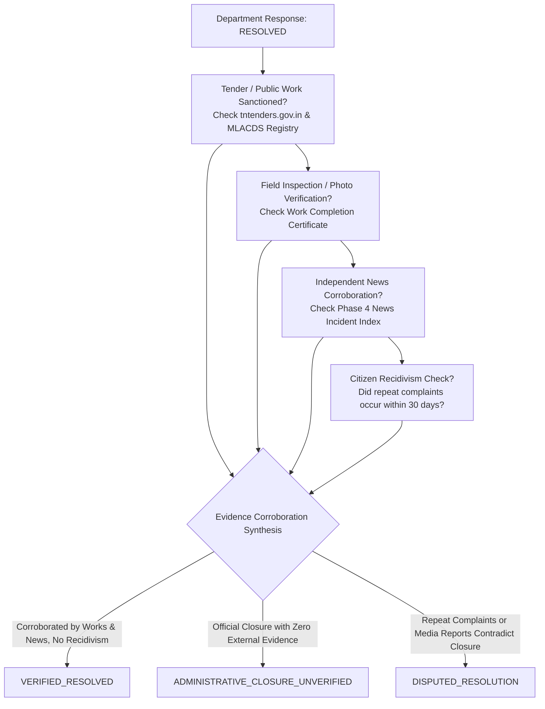

# Phase 8 — Public Grievance & Civic Issue Intelligence Methodology

## 1. Overview & Methodological Objectives

Phase 8 of **CIVICLENS TN** provides a scientific, reproducible, and privacy-respecting methodology for analyzing public grievances and civic issues across Tamil Nadu.

The methodology addresses four fundamental technical challenges:
1. **Zero-PII Compliance:** Ensuring that public records of citizen dissatisfaction are analyzed without harvesting or exposing any citizen's identity or private information.
2. **Bilingual Classification:** Accurately categorizing unstructured civic descriptions in Tamil and English across 14 domain-specific civic taxonomies.
3. **Hyperlocal Deduplication:** Clustering spatially and temporally proximate complaint events to identify the underlying structural infrastructure breakdown.
4. **Evidence-Based Resolution Validation:** Benchmarking departmental responses against statutory Citizen's Charter standards and corroborating claims with independent tenders, news, and audits.

---

## 2. Privacy & PII Scrubbing Methodology

In compliance with the **Digital Personal Data Protection Act, 2023 (DPDPA)** and CIVICLENS data governance:

### 2.1 Scrubbing Pipeline
Every raw complaint, news quote, or gazetted petition description passes through an immutable scrubbing filter `sanitize_pii(text: str)` prior to persistence or NLP extraction:

```mermaid
flowchart LR
    RAW[Raw Text Input] 
    --> PHONE[Regex: Indian Phone Numbers<br/>(\+91|0)?[6-9]\d{9}]
    --> EMAIL[Regex: RFC-5322 Emails<br/>[\w\.-]+@[\w\.-]+\.\w+]
    --> AADHAAR[Regex: 12-digit UID & EPIC Tokens<br/>\b\d{4}\s\d{4}\s\d{4}\b]
    --> TOKENS[Mask Internal Grievance Secrets & PINs]
    --> CLEAN[Sanitized Public Civic Text]
```

### 2.2 Privacy Scrubbing Rules:
- **Phone Numbers:** Replaced with `[PHONE REDACTED]`.
- **Email Addresses:** Replaced with `[EMAIL REDACTED]`.
- **Citizen Names & Salutations:** Replaced with generic token `[CITIZEN]` (e.g. `Thiru K. Ramasamy residing at...` -> `[CITIZEN] residing at...`).
- **Door Numbers & Private Residential Details:** Retain only the street, ward, and locality name (e.g. `Door No. 14/B, 3rd Cross Street, Gandhinagar` -> `3rd Cross Street, Gandhinagar`).

---

## 3. Bilingual Issue Classification Taxonomy

The system classifies complaints into 14 standardized civic categories. Each category contains curated bilingual keyword patterns and semantic anchors:

| Category Code | Keywords (English) | Keywords (Tamil) |
|:---|:---|:---|
| `ROADS` | pothole, road, asphalt, tar, crater, cave-in, pavement, speed breaker | சாலை, குண்டு குழியுமான, தார் சாலை, நடைபாதை, சாலை சேதம் |
| `WATER_SUPPLY` | drinking water, tap, pipe leak, contamination, shortage, borewell, tanker | குடிநீர், குழாய் உடைப்பு, குடிநீர் தட்டுப்பாடு, அசுத்த நீர், ஆழ்துளை |
| `DRAINAGE` | sewage, drainage, storm water drain, gutter, manhole, clogged, overflow | பாதாள சாக்கடை, கழிவுநீர், மழைநீர் வடிகால், அடைப்பு, கழிவுநீர் வழிதல் |
| `SANITATION` | public toilet, open defecation, urinal, cleaning, unhygienic, stench | பொது கழிப்பறை, சுகாதார சீர்கேடு, துர்நாற்றம், திறந்தவெளி கழிப்பிடம் |
| `WASTE_MANAGEMENT` | garbage, trash, dump, solid waste, bin, waste collection, dumper placer | குப்பை, குப்பைக் கூளம், திடக்கழிவு, குப்பைத் தொட்டி, குப்பை அகற்றம் |
| `STREETLIGHTS` | street light, lamp post, dark street, flickering, bulb replacement, LED | தெருவிளக்கு, விளக்கு கம்பம், வெளிச்சமின்மை, எரியாத விளக்கு |
| `PUBLIC_TRANSPORT` | bus, bus stop, bus shelter, route frequency, conductor, depot, train | பேருந்து, பேருந்து நிறுத்தம், பேருந்து தடம், நிழற்குடை, தாமதம் |
| `HEALTHCARE_ACCESS` | PHC, hospital, doctor, medicine shortage, emergency, ambulance, clinic | ஆரம்ப சுகாதார நிலையம், அரசு மருத்துவமனை, மருந்து தட்டுப்பாடு |
| `EDUCATION_INFRASTRUCTURE`| school building, classroom, desk, blackboard, school toilet, roof leak | அரசு பள்ளி, வகுப்பறை, பள்ளி கட்டிடம், மேற்கூரை சேதம் |
| `ELECTRICITY` | power cut, low voltage, transformer, electric wire, snapped wire, pole | மின்தடை, குறைந்த மின்னழுத்தம், மின்மாற்றி, மின்கம்பி, மின் கம்பம் |
| `PUBLIC_SAFETY_INFRASTRUCTURE`| traffic signal, CCTV, stray dogs, cattle menace, blind spot, barricade | போக்குவரத்து சிக்னல், தெருநாய்கள் தொல்லை, மாடுகள், கண்காணிப்பு கேமரா |
| `ENVIRONMENTAL_CONCERNS` | lake pollution, waterbody encroachment, air quality, chemical dumping | ஏரி ஆக்கிரமிப்பு, குளம் மாசு, காற்று மாசு, கழிவு கொட்டுதல் |
| `GOVERNMENT_SERVICE_DELAYS`| patta, certificate, ration card, pension, mutation delay, bribe, token | பட்டா தாமதம், ரேஷன் அட்டை, சான்றிதழ், முதியோர் உதவித்தொகை |
| `OTHER_CIVIC_ISSUES` | civic problem, public nuisance, municipal grievance | குடிமைப் பிரச்சனை, பொது தொல்லை, நகராட்சி புகார் |

---

## 4. Geographic Resolution Hierarchy

Tamil Nadu's administrative boundaries operate on a nested spatial model:

```mermaid
flowchart TD
    STATE[State: Tamil Nadu<br/>ADM-TN-STATE]
    STATE --> DIST[38 Districts<br/>e.g. ADM-TN-DIST-013 Chennai]
    
    DIST --> TALUK[312 Taluks<br/>e.g. Guindy, Mylapore]
    DIST --> BLOCK[388 Revenue Blocks / Panchayat Unions]
    
    DIST --> ULB[21 Municipal Corporations / 138 Municipalities]
    ULB --> ZONE[Corporation Zones<br/>e.g. Zone 13 Adyar]
    ZONE --> WARD[Municipal Wards<br/>e.g. Ward 174]
    
    DIST --> LAC[234 Assembly Constituencies (LAC)<br/>e.g. Velachery AC]
    LAC --> HPC[39 Parliamentary Constituencies (HPC)<br/>e.g. Chennai South]
```

### Spatial Mapping Algorithm:
1. **Named Entity Match:** Parse location tokens using bilingual gazetteer dictionaries.
2. **Ward/Zone Resolution:** Map ward numbers to the enclosing urban local body and assembly constituency.
3. **Centroid Coordinates:** Fall back to the centroid of the smallest resolved administrative unit if explicit street coordinates are omitted.

---

## 5. Spatio-Temporal Issue Deduplication & Clustering

Individual citizens frequently lodge independent petitions about the same underlying breakdown (e.g., a burst 300mm water pipe on Jawaharlal Nehru Road triggers 15 complaints over 3 days).

The pipeline unifies proximate complaints into a single master `CivicIssue`:

$$\text{Distance}(P_1, P_2) \le R_{\text{cluster}} \quad \text{AND} \quad |\Delta t| \le T_{\text{window}} \quad \text{AND} \quad \text{Category}(P_1) == \text{Category}(P_2)$$

- **Spatial Radius ($R_{\text{cluster}}$):** Default 250 meters for urban wards; 1,000 meters for rural panchayats.
- **Temporal Window ($T_{\text{window}}$):** 7 calendar days.
- **Semantic Textual Similarity:** Cosine similarity $\ge 0.65$ using bilingual sentence embeddings or token Jaccard overlap $\ge 0.50$.

When clustered:
- A canonical `CivicIssue` is created or updated.
- Each individual complaint is attached as a related `GrievanceRecord`.
- The aggregate severity score is escalated dynamically based on complaint frequency.

---

## 6. Service Standard Benchmarking & SLA Delay Calculation

Every civic issue is benchmarked against statutory Citizen's Charters (`ServiceStandard`):

```mermaid
flowchart LR
    LODGED[Reported Date: T_0] 
    --> SLA[Statutory SLA Limit: H_limit (hours)]
    --> TARGET[Target Resolution Date: T_target = T_0 + H_limit]
    --> RESOLVED{Actual Resolution: T_res?}
    TARGET -->|If T_res > T_target| BREACHED[SLA_BREACHED<br/>Delay = T_res - T_target]
    TARGET -->|If T_res <= T_target| COMPLIANT[SLA_COMPLIANT<br/>Turnaround = T_res - T_0]
```

### Delay Index ($I_{\text{delay}}$):
$$I_{\text{delay}} = \frac{T_{\text{actual}} - T_{\text{standard}}}{T_{\text{standard}}}$$
- $I_{\text{delay}} \le 0$: Met standard within statutory deadline.
- $0 < I_{\text{delay}} \le 1.0$: Moderate delay (up to 2x the statutory SLA).
- $I_{\text{delay}} > 1.0$: Severe administrative delay (> 2x the statutory SLA).

---

## 7. Resolution Validation & Evidence Corroboration

Government Action Taken Reports (ATRs) claiming "Closed / Resolved" are evaluated against 4 corroborating evidence channels:



---

## 8. High-Level Civic Intelligence Metrics

The analytics layer produces 4 standardized performance indices for every district and department:

1. **Resolution Velocity Rate ($R_{\text{res}}$):**
   $$R_{\text{res}} = \frac{\text{Total Resolved Issues}}{\text{Total Registered Issues}} \times 100\%$$
2. **Mean Turnaround Time ($\mu_{\text{TAT}}$):**
   $$\mu_{\text{TAT}} = \frac{1}{N} \sum_{i=1}^N (T_{\text{resolved}, i} - T_{\text{lodged}, i}) \quad \text{[in days]}$$
3. **Grievance Density Index ($GD$):**
   $$GD = \frac{\text{Total Civic Issues lodged in period}}{\text{Population of Administrative Area}} \times 100,000$$
4. **Recidivism Rate ($R_{\text{recid}}$):**
   $$R_{\text{recid}} = \frac{\text{Issues reopened or re-reported within 30 days of closure}}{\text{Total Closed Issues}} \times 100\%$$

---

## 9. Data Quality Audit Framework

The pipeline automatically identifies and tags data defects in `DataQualityIssue`:
- `MISSING_COORDINATES`: Issue lacks valid geo-coordinates.
- `UNKNOWN_DEPARTMENT`: Issue description cannot be routed to a responsible department.
- `ANOMALOUS_VELOCITY`: Department marks 100% of complaints resolved in < 1 minute (indicative of automated bulk script closing without real inspection).
- `CHRONIC_BACKLOG`: Open issue pending > 180 days with zero interim response notes.
