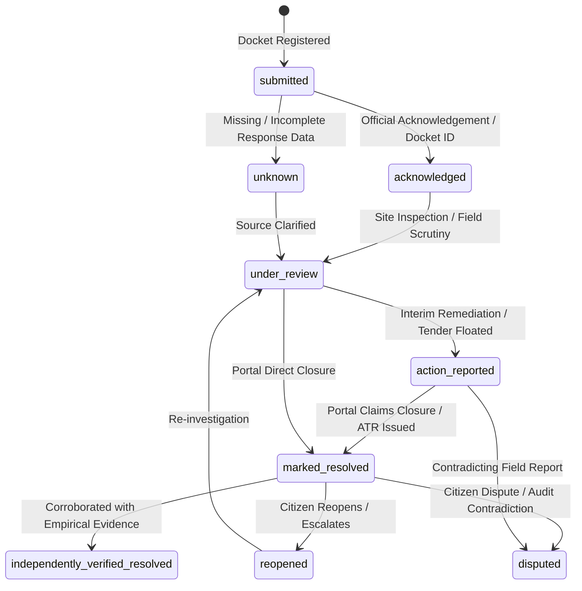
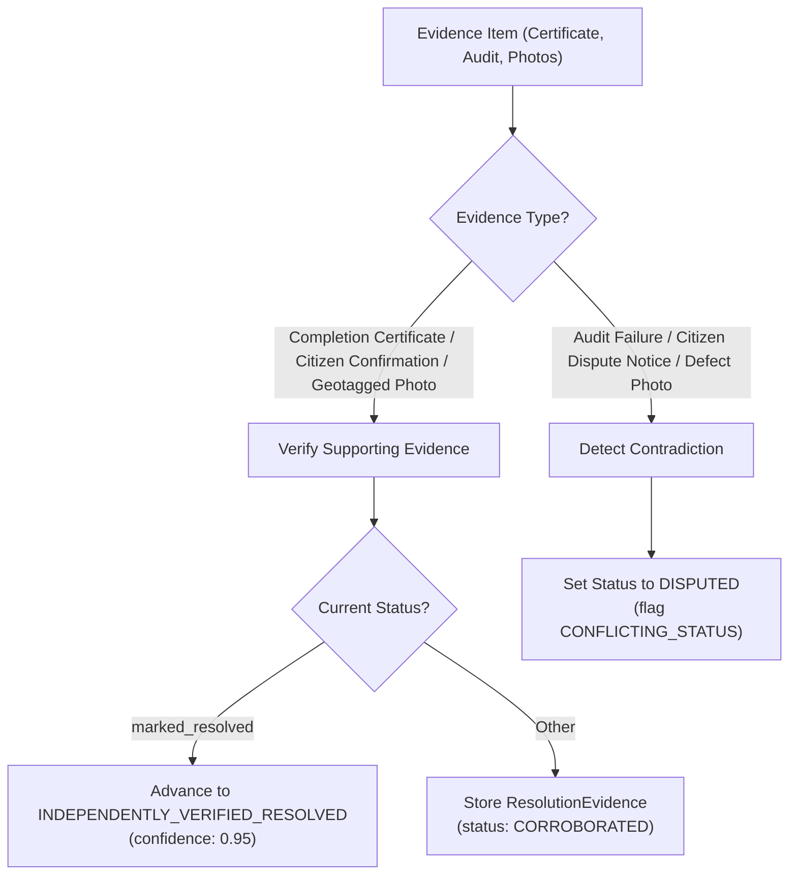
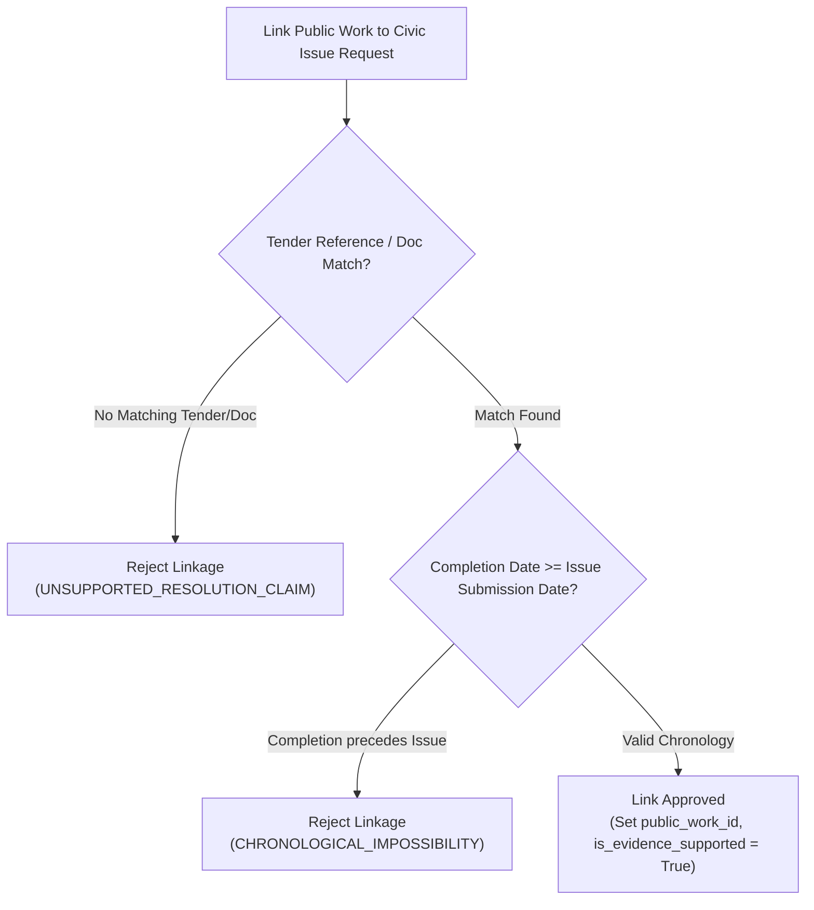

# CIVICLENS TN — Phase 8.6: Grievance Response and Resolution Evidence Tracker Methodology

**Document Version:** 1.0.0  
**Phase:** 8.6 — Grievance Response and Resolution Evidence Tracker  
**Status:** Operational Pipeline  
**Standards:** Tamil Nadu e-Governance Grievance Guidelines, Citizen's Charter Statutory Standards, CAG Performance Redressal Audit Protocols  

---

## 1. Executive Summary

In public grievance monitoring systems, a recurring vulnerability is the unverified conflation between **administrative closure** and **physical resolution**. Official portals (such as CM Helpline, GCC 1913, or CPGRAMS) frequently mark complaints as "Disposed" or "Closed" upon issuing an internal endorsement, forwarding the docket to a subordinate official, or reporting interim paperwork.

**CIVICLENS TN Phase 8.6** establishes an empirical, evidence-anchored tracking system that:
1. Tracks nine distinct, non-overlapping lifecycle states based solely on verifiable source documentation.
2. Enforces a strict separation between **`marked_resolved`** (official administrative claim of closure) and **`independently_verified_resolved`** (empirical corroboration via field audit, completion certificates, or citizen confirmation).
3. Automatically detects and flags **conflicting statuses** when departmental closures contradict citizen feedback or reopening notices.
4. Handles **incomplete records** and **missing responses** without inventing synthetic resolution dates or statuses.
5. Implements rigorous evidentiary linkage rules for **Public Works**: preventing the unverified assertion that a nearby civic tender or municipal project resolved a grievance without documentary proof.

---

## 2. Canonical Lifecycle States

The pipeline models all grievance responses through the `CivicTrackingState` taxonomy:

### State Definitions & Evidence Rules

| State | Definition | Permitted Evidence Sources |
| :--- | :--- | :--- |
| **`submitted`** | The grievance has been registered on the portal with an official docket timestamp. | Initial filing receipt, citizen docket confirmation. |
| **`acknowledged`** | The authority has assigned a reference number and designated a nodal officer. | SMS acknowledgement, portal docket generation, letter of receipt. |
| **`under_review`** | The grievance is undergoing administrative scrutiny, departmental inquiry, or site inspection. | Forwarding endorsement, inspection notice, inter-departmental memo. |
| **`action_reported`** | The department has recorded interim or palliative action (e.g. temporary patching, tender notification). | Action-Taken Report (ATR), interim municipal bulletin, work order copy. |
| **`marked_resolved`** | The portal or department has officially marked the docket as "Disposed" or "Resolved". | Portal disposal screenshot, closure endorsement, ATR signed off. |
| **`independently_verified_resolved`** | The physical resolution is corroborated by external empirical proof. | Completion certificate, contractor MB record, citizen sign-off, geotagged site photo. |
| **`reopened`** | The citizen or petitioner has formally rejected the disposal and reopened the docket. | Reopening docket entry, escalation notice, public hearing appeal. |
| **`disputed`** | Contradicting claims exist (e.g. department claims resolved, but field audit or petitioner reports failure). | Audit failure report, field verification challenge, NGO civic audit report. |
| **`unknown`** | Response data is missing, heavily redacted, corrupted, or inconclusive. | Unreadable scanned ATR, incomplete portal scrape. |

> [!IMPORTANT]
> **The Closure Dichotomy Principle:**  
> Under no circumstances does `marked_resolved` elevate automatically to `independently_verified_resolved`. A closure reported by a municipal portal indicates only that an administrative action was logged. Elevation to verified resolution requires explicit corroboration.

---

## 3. Evidence-Based Verification Matrix

To evaluate resolution claims, the `CivicResolutionTrackerService` evaluates incoming evidence payloads against a rigorous corroboration/contradiction matrix:

### Corroborating vs. Contradicting Artifact Types

1. **Corroborating Evidence Types**:
   - `COMPLETION_CERTIFICATE`: Formal measurement book (MB) sign-off or engineer handover certificate.
   - `CITIZEN_CONFIRMATION`: Petitioner satisfaction acknowledgement on portal or recorded in grievance hearing.
   - `GEOTAGGED_PHOTOS`: Before-and-after photographic evidence with verified coordinates and timestamps.
   - `THIRD_PARTY_AUDIT`: Independent verification by resident welfare associations (RWAs), NGOs, or social audit committees.
   - `SITE_INSPECTION_REPORT`: Field inspection report from a supervisory authority certifying defect rectification.

2. **Contradicting Evidence Types**:
   - `CITIZEN_REOPENING_NOTICE`: Formal petition contesting the closure.
   - `FIELD_AUDIT_FAILURE`: Physical inspection demonstrating recurring defect (e.g., potholes unpatched, water supply dry).
   - `PERSISTENT_DEFECT_PHOTO`: Dated post-closure photography demonstrating defect persistence.

---

## 4. Handling Conflicting Statuses & Disputes

A common systemic pattern in civic administration is the premature disposal of grievances while the petitioner continues to experience the underlying issue. The pipeline implements automated conflict detection:

1. **Reopened vs. Marked Resolved Collision**:
   - If an issue is in the `reopened` or `disputed` state, and a newly ingested departmental response claims `marked_resolved` without supplying fresh corroborating evidence, the tracker:
     - Rejects premature re-closure.
     - Assigns `reported_status = CivicTrackingState.DISPUTED`.
     - Logs review notes: *"Department reported resolution while an active dispute or reopening was pending; routed to DISPUTED."*
     - Generates an immutable `DataQualityIssue` with `issue_type = "CONFLICTING_STATUS"` and `severity = "HIGH"`.

2. **Citizen Dispute After Marked Resolved**:
   - If an evidence record of type `CITIZEN_REOPENING_NOTICE` or `FIELD_AUDIT_FAILURE` arrives for an issue currently `marked_resolved`, the service transitions the issue directly to `disputed`.

---

## 5. Incomplete Records and Missing Responses

When public portals publish incomplete or corrupted grievance dumps:

1. **Missing or Corrupted Status**:
   - If `reported_status` is missing, blank, or unrecognizable, the service defaults to `CivicTrackingState.UNKNOWN`.
   - Flags `DataQualityIssue(issue_type="MISSING_RESPONSE_METADATA", severity="MEDIUM")`.
   - Never assumes an unknown status represents "resolved".

2. **Chronology & Turnaround Time (TAT) Calculation**:
   - Turnaround days are computed strictly as:
     $$\text{TAT} = \text{Response Date} - \text{Grievance Submission Date}$$
   - If $\text{Response Date} < \text{Submission Date}$, the chronology is flagged as invalid (`INVALID_CHRONOLOGY`).
   - If the TAT exceeds the statutory Citizen's Charter standard for the category (e.g. 7 days for streetlights, 30 days for roads), the response is flagged with `sla_breached = True` and recorded in the audit trail.

---

## 6. Public Works Evidentiary Linkage Engine

Municipal authorities often claim that widespread grievances in a zone have been resolved through capital infrastructure projects (e.g., "Bus route road relaid under CMDA funding"). CIVICLENS TN enforces strict evidentiary requirements before linking a `PublicWork` to a `CivicIssue`:

### Linkage Validation Rules

1. **Evidentiary Connection**:
   - The grievance and the public work must share an explicit cross-reference:
     - Matching tender reference / work code (`tender_reference` matches or is cited in ATR), OR
     - Shared official source document ID (`source_document_id`).
   - *A vague assertion such as "A road work occurred in the same district" is rejected outright.*

2. **Chronological Validity**:
   - The public work completion date cannot precede the grievance submission date:
     $$\text{Work Completion Date} \ge \text{Grievance Submission Date}$$
   - Linking a work completed in 2023 to a pothole grievance filed in 2025 is an evidentiary contradiction and is flagged as `CHRONOLOGICAL_IMPOSSIBILITY`.

3. **Unsupported Resolution Claim Audit**:
   - Whenever an uncorroborated public work linkage is attempted, the tracker logs:
     `DataQualityIssue(issue_type="UNSUPPORTED_RESOLUTION_CLAIM", severity="HIGH")`

---

## 7. Implementation & Data Entities

The tracking pipeline is implemented in [`backend/services/civic_resolution_service.py`](file:///e:/CIVCLENS/backend/services/civic_resolution_service.py) with the following core entities:

- **`CivicTrackingState`**: Canonical enum (`submitted`, `acknowledged`, `under_review`, `action_reported`, `marked_resolved`, `independently_verified_resolved`, `reopened`, `disputed`, `unknown`).
- **`ResponseRecord`**: Normalized historical action/response record (`issue_id`, `response_date`, `response_summary`, `reported_status`, `verification_status`, `supporting_evidence`, `review_notes`, `public_work_id`, `is_evidence_supported`).
- **`ResolutionEvidence`**: Corroborating or contradicting evidence artifact (`issue_id`, `evidence_type`, `evidence_url`, `corroboration_status`, `confidence`).
- **`PublicWork`**: Municipal work/tender record (`work_id`, `work_name`, `tender_reference`, `completion_date`, `expenditure`).
- **`CivicResolutionTrackerService`**: Operational engine providing:
  - `record_official_response()`: Ingests ATRs, manages status transitions, flags SLA breaches and conflicts.
  - `verify_resolution_with_evidence()`: Processes corroborating/contradicting evidence to upgrade to `independently_verified_resolved` or flag `disputed`.
  - `validate_and_link_public_work()`: Enforces evidentiary rules for capital works.

---

## 8. Verification & Test Suite

The response and resolution tracking methodology is verified by comprehensive unit tests in [`tests/unit/test_phase8_resolution.py`](file:///e:/CIVCLENS/tests/unit/test_phase8_resolution.py):

| Test Case | Scenario Verified | Result |
| :--- | :--- | :--- |
| `test_tracking_states_enum` | Verifies all 9 canonical states exist and match specification. | Passed |
| `test_record_official_response_success` | Records standard portal response with TAT and Citizen's Charter SLA check. | Passed |
| `test_marked_resolved_does_not_equal_verified_resolved` | Confirms portal disposal remains `marked_resolved` without auto-elevation. | Passed |
| `test_independent_verification_with_corroborating_evidence` | Promotes `marked_resolved` to `independently_verified_resolved` upon valid proof. | Passed |
| `test_conflicting_status_reopened_vs_marked_resolved` | Flags status conflict and routes to `disputed` when portal closes an active dispute. | Passed |
| `test_contradicting_evidence_routes_to_disputed` | Audit failure evidence routes `marked_resolved` issue to `disputed`. | Passed |
| `test_missing_and_incomplete_response_handling` | Incomplete/blank status defaults to `unknown` with data quality warning. | Passed |
| `test_sla_breach_detection` | Detects statutory SLA exceedance and calculates elapsed days. | Passed |
| `test_public_work_linkage_validation_success` | Validates and links infrastructure work when tender reference matches. | Passed |
| `test_unsupported_public_work_claim_rejection` | Rejects unverified public work claim with `UNSUPPORTED_RESOLUTION_CLAIM`. | Passed |

---

## 9. Conclusion

Phase 8.6 delivers a rigorous, auditable framework for tracking public grievance resolution across Tamil Nadu. By maintaining clear evidentiary firewalls between administrative claims and empirical reality, CIVICLENS TN guarantees factual integrity, protects citizens against false disposal claims, and enables authentic accountability analytics.
