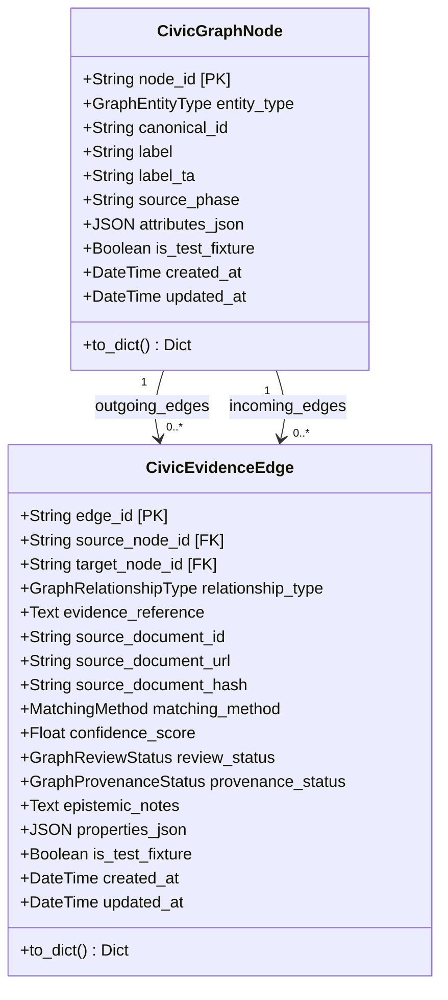

# Phase 9 — Unified Civic Intelligence & Evidence Graph Architecture

## 1. Executive Summary & Objective

Phase 9 of **CIVICLENS TN** introduces the **Unified Civic Intelligence & Evidence Graph**. Its objective is to interconnect the disparate empirical intelligence gathered across Phases 1 through 8 into a strongly typed, provenance-backed civic knowledge and evidence graph.

Rather than treating state budgets, election manifestos, news media reports, political party funding, legislative activities, fact-checked claims, and public grievances as isolated silos, Phase 9 weaves them into an interconnected web of civic accountability:

```
[Political Parties / Donors] --(funds)--> [Political Parties]
           |
       (promises)
           v
  [Manifesto Promises] --(relates_to)--> [Budget Schemes] <--(funds)-- [State Budgets]
                                                |
                                           (implements)
                                                v
  [Public Civic Issues] <--(concerns)-- [Public Works] <--(implements)-- [Government Departments]
           ^                                    ^
           |                                    |
      (reports_on)                       (represented_by)
           |                                    |
     [News Articles]                     [Elected Representatives / MLAs]
           ^                                    ^
           |                                    |
      (mentions)                          (mentions)
           |                                    |
  [Political Claims] --(provides_evidence_for / contradicts)--> [Statutory Source Documents / Gazettes]
```

> [!IMPORTANT]
> **Core Architectural Principles & Directives:**
> 1. **Zero Fabrication Policy:** Real Phase 9 graph datasets have **NOT** been collected or scraped separately. All schemas, relationship definitions, provenance controls, and test fixtures are fully established before real-world dataset ingestion.
> 2. **Reuse Existing Schemas & Components:** The graph layer does **not** duplicate underlying records or rebuild existing analyzers. It sits as a lightweight, generic topological layer connecting canonical entities across Phases 1–8.
> 3. **Epistemic Integrity & Non-Inference:** Causation is **never** inferred from simple association or co-occurrence. Spatial proximity (e.g., a civic issue occurring in an MLA's constituency) or temporal alignment is recorded strictly as `located_in` or `contextualizes`—never as `implements`, `funds`, or `caused_by` without explicit documentary evidence.
> 4. **Strict Provenance Retention:** Every graph edge retains its source entity, target entity, relationship type, evidence reference, source document ID, document URL, SHA-256 checksum, matching method, confidence score, and human review status.
> 5. **Multi-Source Pluralism:** Conflicting evidence across official, journalistic, and civic sources is preserved in the graph without arbitrary suppression.

---

## 2. Comprehensive Project Audit (Phases 1–8 Infrastructure)

A rigorous audit of the existing CIVICLENS TN codebase was conducted across all system layers:

### 2.1 Database Schema & Migrations
- **ORM Foundation:** Declarative base `Base` located in [`backend/database/base_class.py`](file:///e:/CIVCLENS/backend/database/base_class.py).
- **Session Management:** Centralized session factory in [`backend/database/session.py`](file:///e:/CIVCLENS/backend/database/session.py) defaulting to SQLite at `civiclens.db` / `data/processed/civiclens.db`.
- **Alembic Migrations:** Alembic configuration in `alembic.ini` with migration revisions in `alembic/versions/` covering budget schemas, historical schemes, and Phase 5 funding models.
- **Model Registry:** [`backend/models/__init__.py`](file:///e:/CIVCLENS/backend/models/__init__.py) imports all modules to guarantee SQLAlchemy mapper relationships register cleanly without circular dependencies.

### 2.2 Phase 1–8 Data Models
The repository features deep canonical domain models:
- **Phase 1 (Budget):** `BudgetDepartment`, `BudgetScheme`, `BudgetSourceDocument`, `BudgetImportBatch`, `BudgetRecord` ([`backend/models/budget.py`](file:///e:/CIVCLENS/backend/models/budget.py)).
- **Phase 2 (Historical Scheme & Semantic NLP):** `HistoricalScheme`, `SchemeCategory`, `SchemeSourceRelationship`, `SchemeSimilarity` ([`backend/models/budget.py`](file:///e:/CIVCLENS/backend/models/budget.py)).
- **Phase 3 (Political Promises):** `ManifestoSource`, `ManifestoDocument`, `Manifesto`, `PoliticalPromise`, `PromiseCategory`, `PromiseEvidenceLink`, `PromiseSchemeLink`, `PromiseAssessment`, `PromiseAssessmentHistory` ([`backend/models/manifesto.py`](file:///e:/CIVCLENS/backend/models/manifesto.py), [`backend/models/promise.py`](file:///e:/CIVCLENS/backend/models/promise.py)).
- **Phase 4 (Tamil News Media):** `NewsSource`, `Article`, `ArticleVersion`, `PoliticalParty`, `PoliticalPerson`, `GovernmentDepartment`, `PoliticalEntity`, `PoliticalEvent`, `Topic`, `ArticleEntity`, `ArticleTopic`, `ArticleEvent`, `ArticleFeature`, `CoverageMetric`, `BiasIndicator`, `SourceComparison` ([`backend/models/news.py`](file:///e:/CIVCLENS/backend/models/news.py)).
- **Phase 5 (Political Funding):** `FinancialDocument`, `Donor`, `ElectoralTrust`, `Contribution`, `PartyFinancialStatement`, `ElectionExpenditure`, `FinancialMetric`, `ValidationIssue` ([`backend/models/funding.py`](file:///e:/CIVCLENS/backend/models/funding.py)).
- **Phase 6 (Representatives & Works):** `Representative`, `Constituency`, `Election`, `RepresentativeTerm`, `ConstituencyBoundaryHistory`, `LegislativeActivity`, `ConstituencyWork`, `DevelopmentIndicator`, `ConstituencyGeographicMapping`, `PromisePerformanceLink`, `PerformanceMetric`, `SourceDocumentRegistry`, `FactEvidenceLink`, `MetricLineage`, `ConflictingEvidenceRecord`, `AuditTrailEvent` ([`backend/models/representative.py`](file:///e:/CIVCLENS/backend/models/representative.py)).
- **Phase 7 (Claims & Evidence):** `Claim`, `ClaimVersion`, `ClaimSubject`, `ClaimSource`, `EvidenceDocument`, `EvidencePassage`, `ClaimEvidenceRelationship`, `ClaimRetrievalCandidate`, `AtomicClaim`, `ClaimCrossPhaseLink`, `VerificationRun`, `VerificationResult`, `VerificationHistory`, `SourceAssessment`, `ReviewRecord` ([`backend/models/claim.py`](file:///e:/CIVCLENS/backend/models/claim.py)).
- **Phase 8 (Public Grievance & Civic Issues):** `CivicIssue`, `GrievanceRecord`, `IssueCategory`, `CivicDepartment`, `AdministrativeArea`, `ServiceStandard`, `SourceDocument`, `ResponseRecord`, `ResolutionEvidence`, `PublicWork`, `IssueEvent`, `IssueMetric`, `DataQualityIssue`, `CivicCrossPhaseLink` ([`backend/models/civic_issue.py`](file:///e:/CIVCLENS/backend/models/civic_issue.py)).

### 2.3 Document and Source Registries
The project already implements robust document registries:
- `Source` and `Document` in `backend/models/common.py`
- `BudgetSourceDocument` in Phase 1
- `ManifestoSource` and `ManifestoDocument` in Phase 3
- `NewsSource` in Phase 4
- `FinancialDocument` in Phase 5
- `SourceDocumentRegistry` (`phase6_source_documents`) in Phase 6
- `EvidenceDocument` in Phase 7
- `SourceDocument` (`civic_source_documents`) in Phase 8

Every registry captures publisher authority, official URLs, retrieval timestamps, file format, and cryptographic SHA-256 digests.

### 2.4 Provenance Utilities
Cryptographic tracking is deeply embedded:
- `Evidence` in `backend/models/common.py`
- `FactEvidenceLink` in Phase 6 linking facts to source documents, page numbers, and exact excerpts
- `ClaimEvidenceRelationship` in Phase 7 recording supporting/contradicting text references, source stance, and alignment scores
- `ResolutionEvidence` in Phase 8 linking official closures to physical work orders and citizen verification
- Automated PII scrubbing via `sanitize_pii()` in Phase 8 ensuring DPDPA 2023 compliance.

### 2.5 API Conventions
- Centralized Flask application factory in [`backend/api/app.py`](file:///e:/CIVCLENS/backend/api/app.py).
- Standardized response envelopes in [`backend/api/responses.py`](file:///e:/CIVCLENS/backend/api/responses.py):
  - `success_response(data=..., message=..., status_code=200)` -> `{"status": "success", "message": ..., "data": ...}`
  - `error_response(message=..., error_details=..., status_code=400)` -> `{"status": "error", "message": ..., "details": ...}`
- Standardized error handlers in [`backend/api/errors.py`](file:///e:/CIVCLENS/backend/api/errors.py).
- Modular Blueprints mounted under `/api` in [`backend/api/routes.py`](file:///e:/CIVCLENS/backend/api/routes.py): `/api/budget`, `/api/schemes`, `/api/promises`, `/api/news`, `/api/funding`, `/api/representatives`, `/api/claims`, `/api/civic`.

### 2.6 Frontend Navigation and Components
- Multi-page Streamlit architecture in `frontend/app.py` and `frontend/pages/`:
  - `1_Budget_&_Schemes.py`
  - `2_Budget_Insights.py`
  - `2_Political_Promises.py`
  - `3_Tamil_News.py`
  - `4_Representatives.py`
  - `5_Political_Funding.py`
  - `6_Claim_Verification.py`
  - `7_Historical_Scheme_Intelligence.py`
  - `8_Civic_Issue_Intelligence.py`
- Reusable UI cards, tables, search inputs, and status badges.
- Unified API client in [`frontend/services/api.py`](file:///e:/CIVCLENS/frontend/services/api.py).

### 2.7 Authentication, Authorization & Access Control
- CIVICLENS TN is primarily a public open data and civic research intelligence platform.
- Public read endpoints are open and do not require user authentication.
- Outbound scrapers operate strictly under read-only, rate-limited public access without bypassing portal authentication, CAPTCHAs, or OTP gates.
- Mutation and review actions (such as `ReviewRecord` in Phase 7 and `AuditTrailEvent` in Phase 6) log actor identifiers (`human_expert`, `analyst`, `SYSTEM_PIPELINE`) and timestamps for auditable human-in-the-loop oversight.

### 2.8 Traceability and Audit Mechanisms
- `AuditTrailEvent`: Immutable audit ledger in Phase 6 recording event types (`DOCUMENT_INGESTION`, `DATA_EXTRACTION`, `NORMALIZATION`, `MANUAL_CORRECTION`, `VERIFICATION_UPDATE`, `METRIC_RECALCULATION`, `CONFLICT_RESOLUTION`).
- `MetricLineage`: Full mathematical formulation and input record ID tracking in Phase 6.
- `ConflictingEvidenceRecord`: Direct registration of divergent claims across official sources.
- `VerificationHistory`: Audit history of automated claim verification runs in Phase 7.
- `IssueEvent`: Complete lifecycle state transition tracking in Phase 8.

### 2.9 Test Conventions
- Test suite executed via `pytest` configured in `pytest.ini`.
- Isolated test directories: `tests/unit/`, `tests/integration/`, `tests/fixtures/`, `tests/nlp/`.
- Synthetic test fixtures explicitly flagged with `is_test_fixture=True` and deterministic IDs (`FIX-`, `TEST-`, `D-TEST-`, `ISSUE-TEST-`, `CLAIM-TEST-`, `EDGE:TEST:`).

---

## 3. Unified Evidence Graph Architecture

The generic graph layer introduces two foundational models in [`backend/models/graph.py`](file:///e:/CIVCLENS/backend/models/graph.py):



### 3.1 Node Abstraction (`CivicGraphNode`)
A lightweight proxy representing an entity in any underlying table.
- `node_id`: Deterministic prefixed identifier (e.g., `NODE:REP:REP-TN-013-001`, `NODE:SCHEME:SCH-042`).
- `entity_type`: Canonical enum (`GraphEntityType`) mapping to one of 37 recognized entity types across Phases 1–8.
- `canonical_id`: Primary key in the underlying domain table.
- `label` & `label_ta`: Bilingual human-readable English and Tamil titles.
- `source_phase`: The originating phase (`PHASE_1` through `PHASE_8`).
- `attributes_json`: Selected lightweight metadata fields for instant graph visualization.

### 3.2 Edge Abstraction (`CivicEvidenceEdge`)
A first-class directed relationship backed by empirical provenance.
- `edge_id`: Unique deterministic edge identifier (e.g., `EDGE:FUNDS:DOC-001:BUD-01:SCH-02`).
- `source_node_id` & `target_node_id`: Source and target nodes.
- `relationship_type`: Explicit relationship from `GraphRelationshipType` (`funds`, `implements`, `promises`, `relates_to`, `reports_on`, `mentions`, `concerns`, `represents`, `responds_to`, `provides_evidence_for`, `contradicts`, `contextualizes`, `located_in`, `derived_from`).
- `evidence_reference`: Exact quotation, table row, section, or page excerpt supporting the link.
- `source_document_id`, `source_document_url`, `source_document_hash`: Originating document with cryptographic SHA-256 validation.
- `matching_method`: `DIRECT_DOCUMENTARY`, `DETERMINISTIC_ID`, `AUTOMATED_CANDIDATE`, or `HUMAN_REVIEWED`.
- `confidence_score`: Metric value between 0.0 and 1.0.
- `review_status`: `PENDING_REVIEW`, `VERIFIED`, `REJECTED`, or `OVERRIDDEN`.
- `provenance_status`: `VALID`, `PROVISIONAL`, `DISPUTED`, `SUPERSEDED`, or `RETRACTED`.
- `epistemic_notes`: Causal disclaimer or methodological justification.

---

## 4. End-to-End Data Flow

The following diagram illustrates how raw Phase 1–8 records flow into the Unified Civic Intelligence & Evidence Graph without redundant replication:

```mermaid
flowchart TD
    subgraph P1_8[Phase 1–8 Canonical Records & Registries]
        B1[Phase 1: Budgets & Demand Grants]
        S2[Phase 2: Historical Schemes & NLP]
        P3[Phase 3: Manifestos & Promises]
        N4[Phase 4: Tamil News & Outlets]
        F5[Phase 5: Funding, Donors & Filings]
        R6[Phase 6: MLAs, Questions & Works]
        C7[Phase 7: Claims, Passages & Proof]
        I8[Phase 8: Civic Issues & Grievances]
        D0[Statutory Source Documents & Gazettes]
    end

    subgraph Phase9_Ingestion[Phase 9 Graph Construction Engine]
        NR[1. Canonical Node Registration<br/>Deterministic node_id, bilingual labels, phase tagging]
        EE[2. Evidence & Relationship Extraction<br/>Apply strict relationship types & non-causation rules]
        MM[3. Matching Method Classification<br/>Direct documentary, deterministic ID, NLP candidate, human review]
        PV[4. Cryptographic Provenance Anchoring<br/>Link to source document SHA-256, page & excerpt]
        EG[5. Edge Generation & Constraint Validation<br/>Verify node existence, unique constraints & epistemic caveats]
    end

    subgraph Graph_Storage[Graph Persistence & Memory Layer]
        CGN[(civic_graph_nodes)]
        CEE[(civic_evidence_edges)]
    end

    subgraph Graph_Analytics[Graph Query & Intelligence Engine]
        GQ[Neighborhood Discovery<br/>1-hop & 2-hop entity context]
        PT[Multi-Hop Accountability Tracing<br/>Promise -> Scheme -> Budget -> Work -> Issue -> Evidence]
        VC[Verification Subgraphs<br/>Claim -> Evidence Passage -> Source Document]
        CF[Conflicting Stance Analyzer<br/>Identify opposing evidence edges]
    end

    subgraph Presentation[Delivery Layer]
        API[/api/graph REST Endpoints]
        DASH[Streamlit 9_Civic_Evidence_Graph.py]
    end

    P1_8 --> NR
    D0 --> PV
    NR --> CGN
    NR --> EE
    EE --> MM
    MM --> PV
    PV --> EG
    EG --> CEE

    CGN --> GQ
    CEE --> GQ
    GQ --> PT
    GQ --> VC
    GQ --> CF

    PT --> API
    VC --> API
    CF --> API
    API --> DASH
```

---

## 5. Explicit Component Reuse Matrix

To avoid rebuilding existing analyzers or duplicating data, Phase 9 reuses existing components across the stack:

| Subsystem | Existing Model / Service | Phase 9 Graph Role | Reuse Rationale |
|:---|:---|:---|:---|
| **Phase 0** | `backend/models/common.py` (`Source`, `Document`, `Evidence`) | Source anchoring | Provides base document and evidence schema across the application. |
| **Phase 1** | `backend/models/budget.py` (`BudgetRecord`, `BudgetScheme`, `BudgetDepartment`) | `funds`, `implements` edges | Supplies official fiscal expenditure numbers without re-ingesting DDG books. |
| **Phase 2** | `backend/models/budget.py` (`HistoricalScheme`), `backend/nlp/multilingual_pipeline.py` | `relates_to` edges & Tamil entity extraction | Supplies normalized scheme catalog and bilingual tokenizer. |
| **Phase 3** | `backend/models/promise.py` (`PoliticalPromise`, `Manifesto`), `backend/services/promise_assessment_engine.py` | `promises`, `relates_to` edges | Supplies manifesto promises and implementation status. |
| **Phase 4** | `backend/models/news.py` (`Article`, `PoliticalParty`, `PoliticalPerson`), `backend/services/news_service.py` | `reports_on`, `mentions` edges | Supplies indexed Tamil/English news articles and party entity models. |
| **Phase 5** | `backend/models/funding.py` (`Donor`, `Contribution`, `FinancialDocument`) | `funds` edges | Supplies disaggregated political donations and Form 24A filings. |
| **Phase 6** | `backend/models/representative.py` (`Representative`, `Constituency`, `ConstituencyWork`, `SourceDocumentRegistry`) | `represents`, `concerns`, `located_in` edges | Supplies elected official profiles, MLACDS tenders, and statutory document registry. |
| **Phase 7** | `backend/models/claim.py` (`Claim`, `AtomicClaim`, `EvidencePassage`), `backend/services/claim_verification.py` | `provides_evidence_for`, `contradicts` edges | Supplies decomposed propositions and multi-signal evidence passages. |
| **Phase 8** | `backend/models/civic_issue.py` (`CivicIssue`, `CivicDepartment`, `ResponseRecord`, `ResolutionEvidence`) | `concerns`, `responds_to`, `located_in` edges | Supplies civic issues, municipal response records, and physical resolution proofs. |

---

## 6. Zero-Fabrication & Labelled Test Fixture Policy

1. **No Mock Data in Production Tables:** Production tables never contain simulated citizen grievances or synthetic political statements.
2. **Explicit Labeling:** All Phase 9 test nodes and edges reside in [`tests/fixtures/phase9_fixtures.py`](file:///e:/CIVCLENS/tests/fixtures/phase9_fixtures.py) and carry `is_test_fixture=True`.
3. **Automated Verification:** Test suite [`tests/unit/test_phase9_architecture.py`](file:///e:/CIVCLENS/tests/unit/test_phase9_architecture.py) verifies that all fixtures maintain valid cryptographic hashes, explicit relationship types, and epistemic guardrails.
