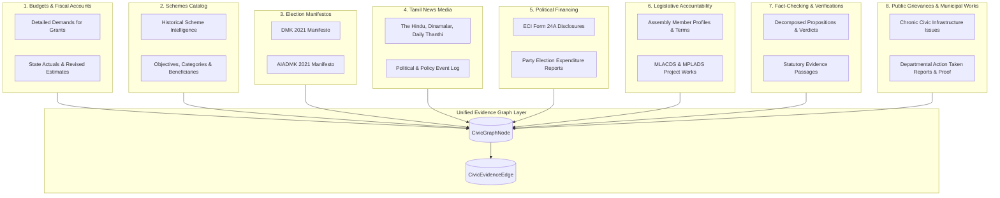

# Phase 9 — Unified Civic Intelligence & Evidence Graph Dataset Requirements

## 1. Executive Summary & Data Governance Strategy

Phase 9 of **CIVICLENS TN** integrates existing datasets from Phases 1 through 8 into a unified evidence graph. 

> [!IMPORTANT]
> **Data Governance & Non-Fabrication Directives:**
> 1. **Zero Fabrication Policy:** Real Phase 9 graph datasets have **NOT** been collected or scraped separately.
> 2. **Reusing Existing Records:** All entity nodes and evidence edges in Phase 9 are generated by resolving and linking existing project records from Phases 1–8.
> 3. **Labelled Test Fixtures Only:** Any synthetic entities or demonstration graph edges are stored exclusively in `tests/fixtures/phase9_fixtures.py` and carry `is_test_fixture=True`.
> 4. **Strict DPDPA 2023 Compliance:** Citizen privacy remains paramount. No PII is ingested into the graph layer; citizen complaints remain aggregated and anonymized.

---

## 2. Dataset Requirements by Domain

To construct the unified civic evidence graph, the ingestion engine maps existing records across 10 empirical domains:

---

### 2.1 State Budget & Expenditure Datasets (Phase 1)
- **Source Artifacts:** Tamil Nadu Finance Department Budget Books (FY 2011-12 to FY 2024-25), Detailed Demands for Grants (DDG).
- **Required Fields:** Demand Number (e.g., `Demand 34`), Scheme Head of Account (e.g., `2215-01-102-AA`), Financial Year, Budget Estimate (BE), Revised Estimate (RE), Actual Expenditure, Source Page Number, PDF Checksum.
- **Node Identifier Prefix:** `NODE:BUD:<ID>` and `NODE:SCHEME:<ID>`.
- **Graph Contribution:** Forms the ground-truth fiscal allocation for `funds` edges.

---

### 2.2 Historical Schemes Catalog (Phase 2)
- **Source Artifacts:** Tamil Nadu Department Policy Notes, scheme guidelines, citizen service portals.
- **Required Fields:** Scheme Name (Tamil and English), Administrative Department ID, Category ID, Target Beneficiary Population, Year of Launch, Funding Model (State, Centrally Sponsored, Shared).
- **Node Identifier Prefix:** `NODE:SCHEME:<ID>`.
- **Graph Contribution:** Anchors policy delivery for `implements`, `promises`, and `relates_to` edges.

---

### 2.3 Political Manifestos & Election Promises (Phase 3)
- **Source Artifacts:** Official party manifesto publications for the 2021 Tamil Nadu Legislative Assembly Election (DMK, AIADMK, INC, BJP).
- **Required Fields:** Manifesto ID, Party Code, Election Year, Promise ID, Verbatim Tamil Text, Normalized English Text, Chapter/Section, Page Number, Implementation Assessment Status.
- **Node Identifier Prefix:** `NODE:PROM:<ID>`.
- **Graph Contribution:** Supplies election commitments for `promises` and `relates_to` edges.

---

### 2.4 Tamil & English News Media (Phase 4)
- **Source Artifacts:** Ingested news articles across leading Tamil publications (Dinamalar, Daily Thanthi, Hindu Tamil Thisai) and English dailies (The Hindu, Indian Express, Times of India).
- **Required Fields:** Canonical URL, Headline, Publication Date, Language, Extracted Political Entities, Stance Signals, Text Hash.
- **Node Identifier Prefix:** `NODE:ART:<ID>`.
- **Graph Contribution:** Supplies independent contemporaneous reporting for `reports_on` and `mentions` edges.

---

### 2.5 Statutory Political Funding Disclosures (Phase 5)
- **Source Artifacts:** Election Commission of India (ECI) Form 24A Contribution Reports (> ₹20,000), Annual Audited Accounts, Electoral Trust filings, Election Expenditure statements.
- **Required Fields:** Party Code, Financial Year, Donor Legal Name, Donor Normalized Name, Contribution Amount, Payment Mode, Filing Date, Document SHA-256.
- **Node Identifier Prefix:** `NODE:DONOR:<ID>`, `NODE:CONTRIB:<ID>`.
- **Graph Contribution:** Supplies disaggregated political financing for `funds` edges.

---

### 2.6 Representative & Constituency Records (Phase 6)
- **Source Artifacts:** ECI Form 20 Final Result Sheets, Delimitation Orders 2008, Tamil Nadu Legislative Assembly Member Directory, Sansad Lok Sabha Questions Portal, MLACDS/MPLADS portal releases.
- **Required Fields:** Representative ID, Official Name, Known Aliases, Assembly Constituency Code (`AC-001` to `AC-234`), Parliamentary Constituency Code (`PC-01` to `PC-39`), Party ID, Term Dates, Legislative Activity Counts, Work Project Sanctions.
- **Node Identifier Prefix:** `NODE:REP:<ID>`, `NODE:CONST:<ID>`, `NODE:WORK:<ID>`.
- **Graph Contribution:** Supplies democratic mandate and local works for `represents`, `implements`, and `located_in` edges.

---

### 2.7 Fact-Checked Claims & Verification Evidence (Phase 7)
- **Source Artifacts:** Verified public political speeches, press releases, legislative debates, IFCN fact-check reports, and primary statutory documents.
- **Required Fields:** Claim ID, Verbatim Text, Speaker Name, Date, Atomic Proposition Decomposition, Evidence Document ID, Evidence Passage Text, Stance (`SUPPORTS`, `CONTRADICTS`), Confidence Score.
- **Node Identifier Prefix:** `NODE:CLAIM:<ID>`, `NODE:PASSAGE:<ID>`.
- **Graph Contribution:** Connects public discourse to empirical verification for `provides_evidence_for` and `contradicts` edges.

---

### 2.8 Public Grievances, Civic Issues & Resolution Evidence (Phase 8)
- **Source Artifacts:** DARPG CPGRAMS Monthly Progress Reports, TNeGA CM Helpline 1100 departmental statistics, Municipal Council Proceedings, GCC 1913 tenders and resolution reports.
- **Required Fields:** Civic Issue ID, Category (`ROADS`, `WATER_SUPPLY`, `DRAINAGE`, etc.), Department ID, Administrative Area Code, Geographic Coordinates, Status, Response Record ID, Work Order ID, Resolution Evidence SHA-256.
- **Node Identifier Prefix:** `NODE:ISSUE:<ID>`, `NODE:RESP:<ID>`, `NODE:RESEV:<ID>`.
- **Graph Contribution:** Supplies on-the-ground citizen grievances and municipal delivery for `concerns`, `responds_to`, and `located_in` edges.

---

## 3. Identity Resolution & Canonical Key Mapping

Cross-domain knowledge graphs suffer from entity fragmentation when identical real-world entities appear under disparate naming conventions across government agencies. Phase 9 implements strict canonical identifier resolution:

### 3.1 Canonical Entity Prefix Directory

| Entity Domain | Canonical Prefix | ID Format Example | Example Entity |
|:---|:---|:---|:---|
| Government Department | `NODE:DEPT:` | `NODE:DEPT:MAWS` | Municipal Administration & Water Supply |
| Historical Scheme | `NODE:SCHEME:` | `NODE:SCHEME:SCH-042` | Kalaignar Magalir Urimai Thittam |
| Manifesto Promise | `NODE:PROM:` | `NODE:PROM:DMK-2021-314` | Nutritious Breakfast Scheme Promise |
| News Article | `NODE:ART:` | `NODE:ART:TH-2023-0825` | The Hindu Breakfast Scheme Launch Report |
| Political Party | `NODE:PARTY:` | `NODE:PARTY:DMK` | Dravida Munnetra Kazhagam |
| Donor Entity | `NODE:DONOR:` | `NODE:DONOR:PET-001` | Prudent Electoral Trust |
| Elected Representative | `NODE:REP:` | `NODE:REP:TN-013-001` | M. K. Stalin (MLA Kolathur) |
| Constituency | `NODE:CONST:` | `NODE:CONST:AC-013` | Kolathur Assembly Constituency |
| Verified Claim | `NODE:CLAIM:` | `NODE:CLAIM:CLM-2023-009` | 17 Lakh Beneficiaries Claim |
| Civic Issue | `NODE:ISSUE:` | `NODE:ISSUE:CIVIC-2024-8841` | Paper Mills Road Pothole Complaint |
| Response Record | `NODE:RESP:` | `NODE:RESP:GCC-2024-8841` | GCC Zone 6 ATR Closure |
| Resolution Evidence | `NODE:RESEV:` | `NODE:RESEV:WO-492-2024` | Municipal Contract Work Order 492 |
| Statutory Document | `NODE:DOC:` | `NODE:DOC:GOMS-104-2023` | Social Welfare Department G.O. Ms. No. 104 |

---

### 3.2 Bilingual Entity Aliasing & Disambiguation Rules
Tamil political records frequently use honorifics, transliteration differences, or initials variations. The graph ingestion pipeline applies deterministic normalization:

1. **Representative Names:**
   - English: Strip honorifics (`Thiru`, `Dr.`, `Hon'ble`). Normalize initials to space-separated format (`M. K. Stalin` vs `MK Stalin` vs `M.K.Stalin` -> `M. K. Stalin`).
   - Tamil: Map Tamil orthography (`மு.க. ஸ்டாலின்`, `மு.க.ஸ்டாலின்`) to the canonical English representative key `REP-TN-013-001`.
2. **Constituency Identifiers:**
   - Always resolve constituency names to ECI official Delimitation 2008 numeric codes (`AC-001` to `AC-234`).
   - Example: `Kolathur` / `கொளத்தூர்` -> `AC-013`.
3. **Government Department Identifiers:**
   - Map colloquial, portal, and Secretariat titles to unified demand codes:
     - `MAWS` / `Municipal Administration and Water Supply` / `நகராட்சி நிர்வாகம்` -> `DEPT-MAWS-034`.
     - `Highways` / `Highways and Minor Ports` / `நெடுஞ்சாலைகள் துறை` -> `DEPT-HIGHWAYS-021`.

---

## 4. Provenance & Cryptographic Verification Standards

Every edge inserted into the evidence graph must satisfy the following cryptographic data contract:

1. **Primary Origin Anchoring:**
   - The edge must reference a specific originating source document (`source_document_id`).
   - The document record must possess a verified SHA-256 hash (`source_document_hash`).
2. **Exact Textual Anchor:**
   - The `evidence_reference` field must contain the verbatim passage, table coordinate (e.g. `Table 4, Row 12, Column 3`), or Government Order paragraph.
3. **Epistemic Classification:**
   - The edge must declare its `matching_method` (`DIRECT_DOCUMENTARY`, `DETERMINISTIC_ID`, `AUTOMATED_CANDIDATE`, `HUMAN_REVIEWED`).
   - Edges produced by automated NLP or vector cosine similarity must have `confidence_score < 1.0` and `review_status = PENDING_REVIEW`.
4. **Lifecycle Provenance Tracking:**
   - Changes to edges (e.g. revisions, retractions, disputations) update `provenance_status` (`VALID`, `PROVISIONAL`, `DISPUTED`, `SUPERSEDED`, `RETRACTED`) without destroying historical audit trails.
