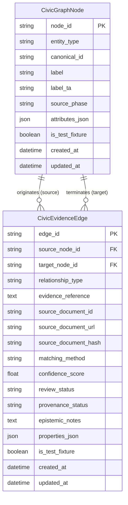

# Phase 9 — Unified Civic Intelligence & Evidence Graph Entity-Relationship Model

## 1. Overview & Conceptual Architecture

The **Unified Civic Intelligence & Evidence Graph** provides a canonical network layer connecting empirical civic data across all phases of CIVICLENS TN. Rather than rewriting or duplicating underlying relational tables, Phase 9 defines a graph layer:

1. **`CivicGraphNode`:** Uniform proxy node addressing any canonical entity from Phases 1 through 8.
2. **`CivicEvidenceEdge`:** Directed, evidence-backed relationship retaining complete documentary provenance, methodology, confidence, review status, and epistemic caveats.



---

## 2. Reused Canonical Entities Across Phases 1–8

The evidence graph maps and connects 12 core entity families already present in the CIVICLENS TN database:

### 2.1 Budgets
- **`BudgetDepartment`** (`backend/models/budget.py`): State government administrative department under Demand for Grants.
- **`BudgetScheme`** (`backend/models/budget.py`): Scheme-level line item under a department with head of account.
- **`BudgetRecord`** (`backend/models/budget.py`): Transactional fiscal record capturing BE, RE, or Actuals with financial year.
- **`BudgetSourceDocument`** (`backend/models/budget.py`): Originating DDG PDF document with checksum.
- **`SchemeCategory`** (`backend/models/budget.py`): Standardized budget category taxonomy.
- **Canonical Node Format:** `NODE:BUD:<CANONICAL_ID>` or `NODE:SCHEME:<CANONICAL_ID>`.

### 2.2 Schemes
- **`HistoricalScheme`** (`backend/models/budget.py`): Qualitative multi-year policy scheme entity with objectives, target beneficiaries, and category.
- **`SchemeSimilarity`** (`backend/models/budget.py`): Computed semantic overlap between schemes.
- **Canonical Node Format:** `NODE:SCHEME:<CANONICAL_ID>`.

### 2.3 Promises
- **`PoliticalPromise`** (`backend/models/promise.py`): Extracted verbatim and normalized manifesto pledge.
- **`Manifesto`** (`backend/models/manifesto.py`): Political election manifesto document with party and year.
- **`PromiseCategory`** (`backend/models/promise.py`): Taxonomy classification (Education, Agriculture, etc.).
- **`PromiseAssessment`** (`backend/models/promise.py`): Implementation delivery evaluation (Implemented, Partially Implemented, Unclear).
- **Canonical Node Format:** `NODE:PROM:<CANONICAL_ID>` or `NODE:MAN:<CANONICAL_ID>`.

### 2.4 News Articles
- **`Article`** (`backend/models/news.py`): Ingested news article with headline, full text, canonical URL, and SHA-256 hash.
- **`NewsSource`** (`backend/models/news.py`): Media outlet publisher (The Hindu, Dinamalar, Daily Thanthi, etc.).
- **`Topic`** (`backend/models/news.py`): Extracted news policy topic.
- **`PoliticalEvent`** (`backend/models/news.py`): Real-world event covered by media.
- **Canonical Node Format:** `NODE:ART:<CANONICAL_ID>` or `NODE:NEWSSRC:<CANONICAL_ID>`.

### 2.5 Political Parties & Funding Disclosures
- **`PoliticalParty`** (`backend/models/news.py`): Registered political party in Tamil Nadu (DMK, AIADMK, etc.).
- **`FinancialDocument`** (`backend/models/funding.py`): Statutory Form 24A, Annual Audit, or Election Expenditure disclosure.
- **`Donor`** (`backend/models/funding.py`): Individual or corporate entity donating to political parties.
- **`ElectoralTrust`** (`backend/models/funding.py`): Intermediary electoral funding trust.
- **`Contribution`** (`backend/models/funding.py`): Granular itemized donation exceeding ₹20,000.
- **`PartyFinancialStatement`** (`backend/models/funding.py`): Audited balance sheet and income/expenditure totals.
- **`ElectionExpenditure`** (`backend/models/funding.py`): Campaign spending return per election cycle.
- **Canonical Node Format:** `NODE:PARTY:<CANONICAL_ID>`, `NODE:DONOR:<CANONICAL_ID>`, `NODE:CONTRIB:<CANONICAL_ID>`.

### 2.6 Representatives
- **`Representative`** (`backend/models/representative.py`): Elected MLA or MP with official name, aliases, and affiliations.
- **`RepresentativeTerm`** (`backend/models/representative.py`): Granular tenure tying representative to constituency, election, and party.
- **`LegislativeActivity`** (`backend/models/representative.py`): Starred/unstarred questions, assembly debates, attendance.
- **`ConstituencyWork`** (`backend/models/representative.py`): MLACDS or MPLADS sanctioned project.
- **`DevelopmentIndicator`** (`backend/models/representative.py`): Socioeconomic demographic metric at constituency/district level.
- **Canonical Node Format:** `NODE:REP:<CANONICAL_ID>`, `NODE:WORK:<CANONICAL_ID>`.

### 2.7 Constituencies
- **`Constituency`** (`backend/models/representative.py`): Assembly (234) or Parliamentary (39) electoral constituency in Tamil Nadu.
- **`AdministrativeArea`** (`backend/models/civic_issue.py`): State administrative jurisdiction (District, Taluk, Municipal Corporation, Ward).
- **Canonical Node Format:** `NODE:CONST:<CANONICAL_ID>`, `NODE:AREA:<CANONICAL_ID>`.

### 2.8 Claims
- **`Claim`** (`backend/models/claim.py`): Verbatim public statement by political leader.
- **`AtomicClaim`** (`backend/models/claim.py`): Decomposed checkable factual proposition.
- **`EvidencePassage`** (`backend/models/claim.py`): Precise text excerpt or table cell offering verification proof.
- **`VerificationResult`** (`backend/models/claim.py`): Verdict assessment with explanation and confidence.
- **Canonical Node Format:** `NODE:CLAIM:<CANONICAL_ID>`, `NODE:PASSAGE:<CANONICAL_ID>`.

### 2.9 Civic Issues
- **`CivicIssue`** (`backend/models/civic_issue.py`): Real-world public problem (waterlogging, road damage, garbage accumulation).
- **`GrievanceRecord`** (`backend/models/civic_issue.py`): Strictly anonymized citizen petition or complaint report.
- **`PublicWork`** (`backend/models/civic_issue.py`): Municipal engineering work or maintenance contract.
- **Canonical Node Format:** `NODE:ISSUE:<CANONICAL_ID>`, `NODE:GRIEV:<CANONICAL_ID>`.

### 2.10 Government Departments
- **`CivicDepartment` / `GovernmentDepartment`** (`backend/models/civic_issue.py` / `backend/models/news.py`): State secretariat department, directorate, or municipal local body.
- **`ServiceStandard`** (`backend/models/civic_issue.py`): Statutory Citizen's Charter SLA standard.
- **Canonical Node Format:** `NODE:DEPT:<CANONICAL_ID>`.

### 2.11 Responses & Resolution Evidence
- **`ResponseRecord`** (`backend/models/civic_issue.py`): Official departmental action taken or status update.
- **`ResolutionEvidence`** (`backend/models/civic_issue.py`): Empirical artifact validating closure (work order, field report, citizen audit).
- **Canonical Node Format:** `NODE:RESP:<CANONICAL_ID>`, `NODE:RESEV:<CANONICAL_ID>`.

### 2.12 Source Documents
- **`SourceDocument` / `EvidenceDocument` / `SourceDocumentRegistry`** (`backend/models/civic_issue.py`, `backend/models/claim.py`, `backend/models/representative.py`): Canonical statutory documents (Gazettes, ECI returns, Hansard, Budget books) with SHA-256 hashes.
- **Canonical Node Format:** `NODE:DOC:<CANONICAL_ID>`.

---

## 3. Evidence Graph Cross-Domain Schema

```mermaid
flowchart LR
    Donor[Donor / Electoral Trust] -->|funds| Party[Political Party]
    Party -->|promises| Promise[Manifesto Promise]
    Party -->|represents (via Term)| Rep[Elected Representative / MLA]
    Rep -->|represents| Const[Constituency]
    
    Budget[State Budget Record] -->|funds| Scheme[Government Scheme]
    Dept[Government Department] -->|implements| Scheme
    Promise -->|relates_to| Scheme
    
    Dept -->|implements| Work[Public Work / MLACDS]
    Work -->|located_in| Const
    
    Issue[Civic Issue] -->|concerns| Dept
    Issue -->|located_in| Const
    Issue -->|relates_to| Scheme
    
    Resp[Departmental Response] -->|responds_to| Issue
    ResEv[Resolution Evidence] -->|provides_evidence_for| Resp
    
    Article[News Article] -->|reports_on| Issue
    Article -->|reports_on| Scheme
    Article -->|mentions| Rep
    
    Claim[Political Claim] -->|mentions| Rep
    Claim -->|relates_to| Scheme
    Doc[Statutory Document / Gazette] -->|provides_evidence_for| Claim
    Doc -->|contradicts| Claim
    Doc -->|contextualizes| Claim
```

---

## 4. Entity Schema Specifications

### 4.1 `CivicGraphNode` Table Definition

| Field Name | Type | Nullable | Description |
|:---|:---|:---|:---|
| `node_id` | `VARCHAR(120)` | No (PK) | Prefixed canonical node identifier (e.g. `NODE:REP:REP-013-001`). |
| `entity_type` | `ENUM(GraphEntityType)` | No | Enumerated domain entity type (37 supported values). |
| `canonical_id` | `VARCHAR(100)` | No | Primary key ID in originating Phase 1–8 domain table. |
| `label` | `VARCHAR(300)` | No | Canonical English title or display name. |
| `label_ta` | `VARCHAR(400)` | Yes | Canonical Tamil title or display name. |
| `source_phase` | `VARCHAR(50)` | No | Originating project phase (`PHASE_1` to `PHASE_8`). |
| `attributes_json` | `JSON` | Yes | Cached summary properties for fast query rendering. |
| `is_test_fixture` | `BOOLEAN` | No | Flag indicating synthetic fixture (`True`) vs real data (`False`). |
| `created_at` | `DATETIME` | No | Record creation timestamp in UTC. |
| `updated_at` | `DATETIME` | No | Last update timestamp in UTC. |

**Constraints:**
- Primary Key: `node_id`
- Unique Constraint: `(entity_type, canonical_id)`

---

### 4.2 `CivicEvidenceEdge` Table Definition

| Field Name | Type | Nullable | Description |
|:---|:---|:---|:---|
| `edge_id` | `VARCHAR(120)` | No (PK) | Prefixed unique edge identifier (e.g. `EDGE:FUNDS:DOC-01:N1:N2`). |
| `source_node_id` | `VARCHAR(120)` | No (FK) | Foreign key referencing `civic_graph_nodes.node_id`. |
| `target_node_id` | `VARCHAR(120)` | No (FK) | Foreign key referencing `civic_graph_nodes.node_id`. |
| `relationship_type` | `ENUM(GraphRelationshipType)` | No | Explicit semantic relationship type (14 supported values). |
| `evidence_reference` | `TEXT` | Yes | Exact textual quote, section, table cell, or citation. |
| `source_document_id` | `VARCHAR(120)` | Yes | Cross-phase source document identifier. |
| `source_document_url` | `VARCHAR(500)` | Yes | Publicly accessible official or archived URL. |
| `source_document_hash`| `VARCHAR(64)` | Yes | Cryptographic SHA-256 hash of the supporting document. |
| `matching_method` | `ENUM(MatchingMethod)` | No | `DIRECT_DOCUMENTARY`, `DETERMINISTIC_ID`, `AUTOMATED_CANDIDATE`, `HUMAN_REVIEWED`. |
| `confidence_score` | `FLOAT` | No | Match confidence metric (0.0 to 1.0). Default `1.0`. |
| `review_status` | `ENUM(GraphReviewStatus)` | No | `PENDING_REVIEW`, `VERIFIED`, `REJECTED`, `OVERRIDDEN`. |
| `provenance_status` | `ENUM(GraphProvenanceStatus)`| No | `VALID`, `PROVISIONAL`, `DISPUTED`, `SUPERSEDED`, `RETRACTED`. |
| `epistemic_notes` | `TEXT` | Yes | Mandatory methodological caveat or non-causation justification. |
| `properties_json` | `JSON` | Yes | Relationship-specific attributes (amount, date, vote share, etc.). |
| `is_test_fixture` | `BOOLEAN` | No | Flag indicating synthetic fixture (`True`) vs real data (`False`). |
| `created_at` | `DATETIME` | No | Timestamp in UTC. |
| `updated_at` | `DATETIME` | No | Timestamp in UTC. |

**Constraints:**
- Primary Key: `edge_id`
- Foreign Key: `source_node_id` -> `civic_graph_nodes.node_id` (ON DELETE CASCADE)
- Foreign Key: `target_node_id` -> `civic_graph_nodes.node_id` (ON DELETE CASCADE)
- Unique Constraint: `(source_node_id, target_node_id, relationship_type, source_document_id)`

---

## 5. Epistemic Constraints on Relationships

To prevent false causal inferences, the graph enforces strict semantic rules:

1. **`located_in` != `implements` or `funds`:**
   - A civic issue occurring inside an assembly constituency creates a `located_in` edge.
   - It **never** creates an `implements` or `caused_by` edge pointing to the MLA unless an official assembly question, sanction order, or audit report establishes direct personal involvement.
2. **`relates_to` != `implements`:**
   - A manifesto promise sharing a policy topic with an active scheme creates a `relates_to` edge with matching method `DETERMINISTIC_ID` or `AUTOMATED_CANDIDATE`.
   - It is not claimed to be fully implemented until an official Government Order or budget expenditure is linked via `provides_evidence_for`.
3. **`reports_on` != `provides_evidence_for`:**
   - A news article reporting on a controversy creates a `reports_on` edge.
   - It is marked as `provides_evidence_for` only for claims concerning public statements or media reporting, whereas primary fiscal/statutory claims require statutory documents (Gazettes, Audits).
