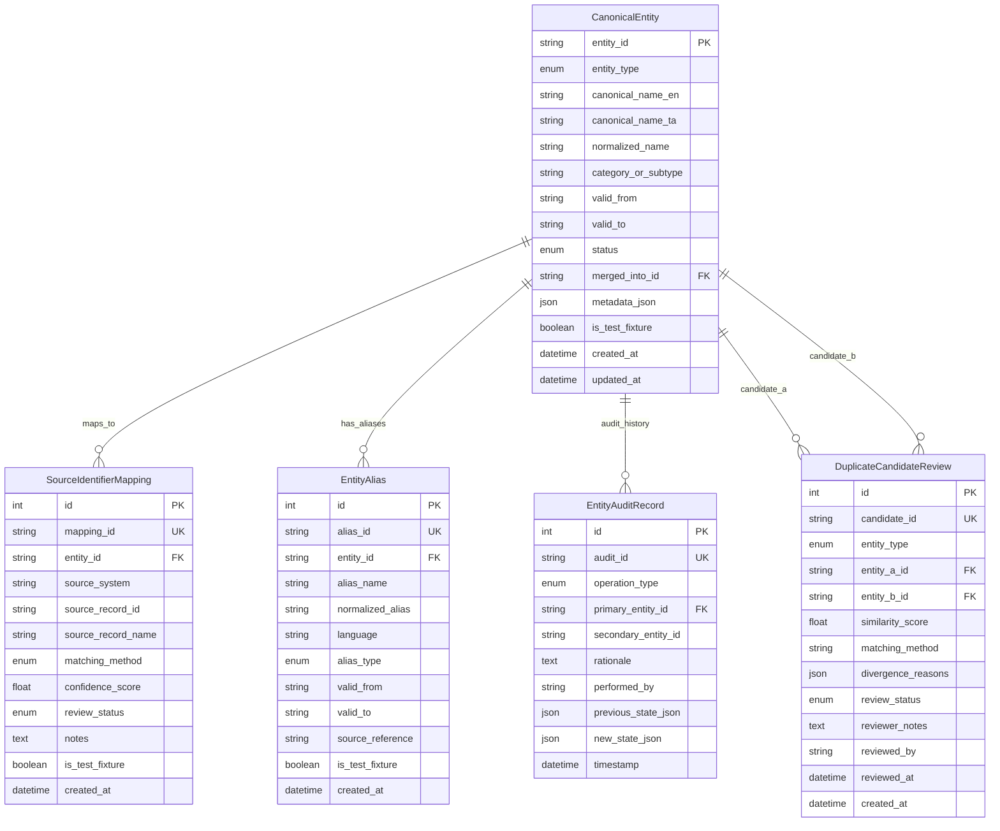
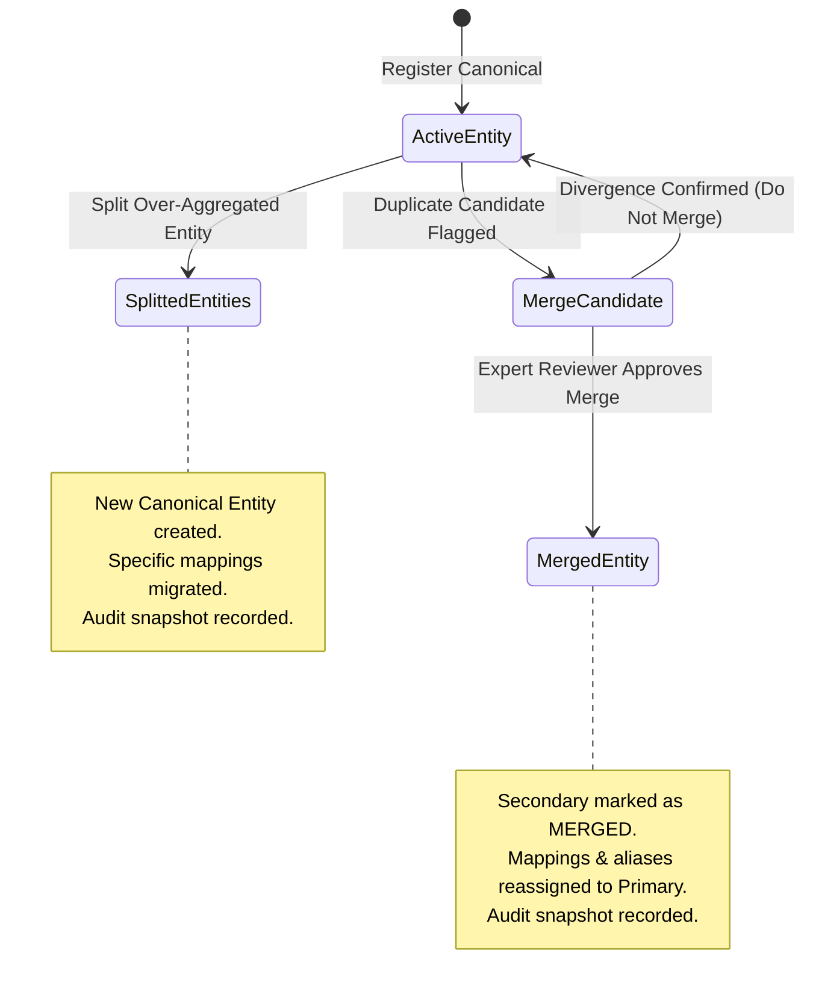

# Phase 9 — Cross-Phase Entity Registry & Identity Resolution

## 1. Overview & Objective

Phase 9.2 implements the **Cross-Phase Entity Registry & Identity Resolution Engine** for **CIVICLENS TN**. Its goal is to provide a single, authoritative entity resolution framework that allows empirical records from Phases 1 through 8 to refer to the same real-world entity where justified.

When public records refer to the same person, department, scheme, or constituency using different spellings, languages, honorifics, or administrative codes, the shared registry disambiguates and links them without corrupting or overwriting the original source names.

> [!IMPORTANT]
> **Core Non-Negotiable Directives:**
> 1. **Do Not Merge by Similarity Alone:** Two people, organizations, schemes, or locations must **never** be merged merely because their names look or sound alike.
> 2. **Preserve Original Source Names:** Source records retain their verbatim reported text (e.g. `source_record_name`) even after canonical mapping.
> 3. **Audited Lifecycle:** Every merge, split, alias addition, and status change is immutably logged in `EntityAuditRecord`.
> 4. **Bilingual Equity:** Both Tamil and English names and transliterations are first-class attributes.
> 5. **Time-Bounded Validity:** Historical names (e.g. Madras vs Chennai) and reorganizations (e.g. Chengalpattu split from Kancheepuram) are preserved with valid date windows.

---

## 2. Supported Entity Types & Canonical ID Standards

The registry supports **10 canonical entity types**, reusing existing identifiers wherever established:

| Entity Type | Canonical Prefix | ID Format Example | Example Canonical Entity |
|:---|:---|:---|:---|
| **`government_department`** | `ENT:DEPT:` | `ENT:DEPT:MAWS-034` | Municipal Administration & Water Supply Department |
| **`scheme`** | `ENT:SCHEME:` | `ENT:SCHEME:SCH-042` | Kalaignar Magalir Urimai Thittam |
| **`political_party`** | `ENT:PARTY:` | `ENT:PARTY:DMK` | Dravida Munnetra Kazhagam |
| **`representative`** | `ENT:REP:` | `ENT:REP:MK-STALIN` | M. K. Stalin (MLA Kolathur) |
| **`constituency`** | `ENT:CONST:` | `ENT:CONST:AC-013` | Kolathur Assembly Constituency |
| **`administrative_area`** | `ENT:AREA:` | `ENT:AREA:GCC-Z06` | GCC Zone 6 (Thiru Vi Ka Nagar) |
| **`public_claim`** | `ENT:CLAIM:` | `ENT:CLAIM:CLM-2023-009` | 17 Lakh Breakfast Beneficiaries Claim |
| **`civic_issue`** | `ENT:ISSUE:` | `ENT:ISSUE:CIVIC-2024-8841` | Paper Mills Road Waterlogging & Potholes |
| **`source_document`** | `ENT:DOC:` | `ENT:DOC:GOMS-104-2023` | Social Welfare Department G.O. (Ms) No. 104 |
| **`public_work`** | `ENT:WORK:` | `ENT:WORK:WO-492-2024` | GCC BT Relaying Tender Work Order 492 |

---

## 3. Database Architecture & Entity-Relationship Model



---

## 4. Normalization & Multilingual Transliteration

The resolution service implements a pipeline for standardizing strings across Tamil and English:

### 4.1 Honorific & Punctuation Stripping
- **English Honorifics Stripped:** `Thiru`, `Tmt`, `Selvi`, `Mr`, `Mrs`, `Ms`, `Dr`, `Prof`, `Hon'ble`, `Shri`, `Smt`.
- **Tamil Honorifics Stripped:** `திரு`, `திருமதி`, `செல்வி`, `முனைவர்`, `மாண்புமிகு`, `பேராசிரியர்`.
- **Initials & Spacing:** Periods and hyphens are replaced with single spaces (`M. K. Stalin` vs `MK Stalin` vs `M.K.Stalin` -> `m k stalin`).

### 4.2 Transliteration Equivalences
Direct phonological dictionaries bridge English and Tamil entity variants:
- `சென்னை` <-> `chennai` (Historical: `மதராஸ்` <-> `madras`)
- `மதுரை` <-> `madurai`
- `கோயம்புத்தூர்` / `கோவை` <-> `coimbatore`
- `திருச்சிராப்பள்ளி` / `திருச்சி` <-> `trichy`
- `கொளத்தூர்` <-> `kolathur`
- `செங்கல்பட்டு` <-> `chengalpattu`
- `திமுக` <-> `dmk`, `அதிமுக` <-> `aiadmk`
- `மு.க. ஸ்டாலின்` <-> `m k stalin`

---

## 5. Non-Merging Rules & Disambiguation Safeguards

To prevent catastrophic false-positive merges, the engine enforces 4 strict disambiguation rules:

```
+----------------------------------------------------------------------------------------------------+
|                                    NON-MERGING DISAMBIGUATION RULES                                |
+----------------------------------------------------------------------------------------------------+
| 1. HOMONYM PERSON RULE:                                                                            |
|    Two representatives with identical names (e.g. 'R. Murugesan' and 'K. Murugesan')               |
|    are kept separate if their constituency codes, terms, or parentage differ.                     |
|                                                                                                    |
| 2. HOMONYM PLACE RULE:                                                                             |
|    Localities with identical names (e.g. 'Anna Nagar' in Chennai vs 'Anna Nagar' in Madurai)        |
|    require district or ULB context. If context is missing, resolution flags AMBIGUOUS_HOMONYM.    |
|                                                                                                    |
| 3. HISTORICAL RENAMING RULE:                                                                       |
|    Renamed entities (e.g. 'Madras' -> 'Chennai' in 1996) maintain an alias with valid_to='1996'.    |
|    Queries specifying a reference year in the past return the historical alias without overwriting. |
|                                                                                                    |
| 4. GEOGRAPHIC PARTITION RULE:                                                                      |
|    Administrative splits (e.g. Chengalpattu split from Kancheepuram in Nov 2019) are preserved    |
|    as separate entities with predecessor/successor relationships, never merged as identical.       |
+----------------------------------------------------------------------------------------------------+
```

---

## 6. Entity Merge & Split Lifecycle



### 6.1 Merge Operation
- `POST /api/entities/merge`
- Re-points all `SourceIdentifierMapping` and `EntityAlias` records from `secondary_entity_id` to `primary_entity_id`.
- Secondary entity status is set to `MERGED` with `merged_into_id = primary_entity_id`.
- Creates immutable `EntityAuditRecord` documenting exact pre-merge and post-merge snapshots, actor, and rationale.

### 6.2 Split Operation
- `POST /api/entities/split`
- Creates new distinct canonical entity.
- Migrates selected source identifier mappings to the new entity.
- Creates immutable `EntityAuditRecord` with split rationale and migration manifest.

---

## 7. REST API Reference

### 7.1 Entity Lookup
- **`GET /api/entities/lookup`**
- **Query Parameters:**
  - `name`: Name or alias query string (e.g. `மு.க. ஸ்டாலின்` or `MAWS`).
  - `type`: Optional entity type filter (`government_department`, `representative`, `constituency`, etc.).
  - `district`: Optional geographic filter to resolve homonyms.
  - `source_system` & `source_record_id`: Deterministic key lookup.
  - `year`: Reference year for historical name lookups.
- **Example Response:**
  ```json
  {
    "status": "success",
    "message": "Entity resolution evaluated.",
    "data": {
      "resolved": true,
      "entity": {
        "entity_id": "ENT:REP:MK-STALIN",
        "canonical_name_en": "M. K. Stalin",
        "canonical_name_ta": "மு.க. ஸ்டாலின்",
        "entity_type": "representative",
        "status": "ACTIVE"
      },
      "matching_method": "ALIAS_MATCH",
      "confidence": 1.0,
      "matched_by": "alias:மு.க. ஸ்டாலின்:TRANSLITERATION"
    }
  }
  ```

### 7.2 Entity Profile
- **`GET /api/entities/<entity_id>`**
- Returns complete authority profile including all aliases, source-specific IDs, and original reported names.

### 7.3 Audit History
- **`GET /api/entities/<entity_id>/history`**
- Returns full chronologically sorted audit ledger entries for the entity.

### 7.4 Duplicate Candidate Scanning
- **`GET /api/entities/duplicates?type=<type>`**
- Returns potential duplicate pairs with similarity scores and divergence reasons.

### 7.5 Candidate Review
- **`POST /api/entities/candidates/<candidate_id>/review`**
- **Payload:** `{"disposition": "CONFIRMED_DISTINCT", "reviewed_by": "EXPERT_AUDITOR", "notes": "Different individuals serving in different constituencies."}`
