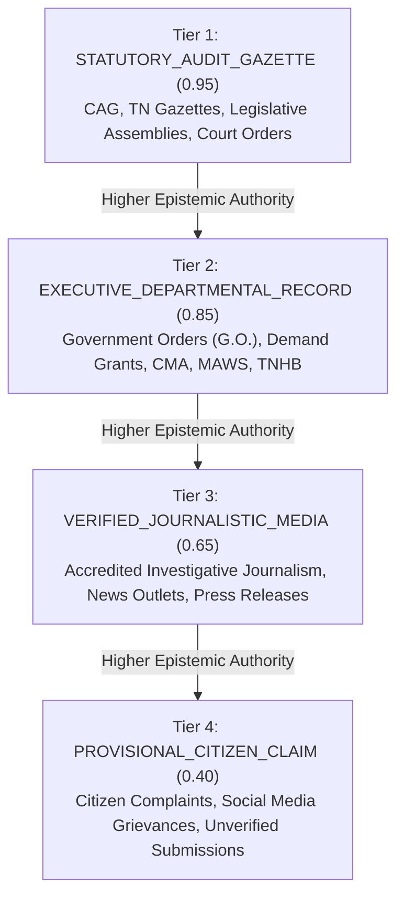
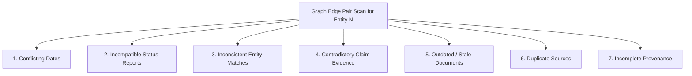

# Phase 9.6 — Evidence Quality and Contradiction Analysis Methodology

## 1. Overview & Core Epistemic Principles

The **Civic Intelligence & Evidence Graph** for CIVICLENS TN connects records across Phases 1 through 8 (budgets, schemes, election promises, press statements, legislative debates, civic grievances, and audit reports).

Because civic records originate from disparate sources—ranging from constitutional audit bodies to departmental press releases and citizen-reported social media grievances—the evidentiary value of records varies significantly. However, **CIVICLENS TN strictly prohibits arbitrary "universal credibility scores"**.

Instead, Phase 9.6 establishes an explainable, multi-factor evidence quality evaluation and conflict detection architecture governed by four fundamental principles:

1. **Separation of Concerns**: Four epistemic concepts are strictly distinguished and never conflated into a single flat score:
   - **Source Reliability**: The statutory authority and institutional provenance tier of the originating document publisher.
   - **Relationship Confidence**: The algorithmic or documentary precision of the edge link between two entities.
   - **Claim Verification Outcome**: The epistemic truth-value determination of a factual claim (e.g., supported, refuted, dialectical tension).
   - **Completeness of Evidence**: The degree of corroboration across the required statutory lifecycle (budget sanction $\rightarrow$ administrative disbursement $\rightarrow$ implementation audit $\rightarrow$ citizen outcome).
2. **Dialectical Conflict Preservation**: When records contradict one another (e.g., an executive press release claims a water project is complete while a CAG audit finds capacity shortfalls), the system **never deletes, overwrites, or silences either record**. Conflicting records are preserved side-by-side with full provenance and classified as dialectical tension.
3. **No Automatic "Newest is Correct" Bias**: Newer publication dates do **not** automatically override older statutory records. A 2024 press release does not supersede a 2023 Comptroller and Auditor General (CAG) performance audit without explicit statutory reconciliation.
4. **Transparent Scoring with Limitations**: Any computed numerical score must expose its exact factor weights, calculation formula, qualitative interpretation tier, and epistemic limitations disclaimer.

---

## 2. Distinction of Four Core Epistemic Concepts

| Concept | Dimension Measured | Typical Values / Scale | Example in CIVICLENS |
| :--- | :--- | :--- | :--- |
| **Source Reliability** | Originating publisher's statutory standing, editorial oversight, and legal accountability | 4 Tiers: Statutory Audit (0.95), Executive Filing (0.85), Journalistic Media (0.65), Provisional Citizen (0.40) | CAG Audit Report vs. Daily News Article |
| **Relationship Confidence** | Certainty that Entity A is legitimately connected to Entity B | 0.0 – 1.0 (deterministic = 1.0, candidate match = 0.60–0.85) | Exact canonical ID link vs. Levenshtein text match |
| **Claim Verification Outcome** | Factual truth assessment of a specific empirical assertion | `VERIFIED_TRUE`, `CONTRADICTED`, `DIALECTICAL_TENSION`, `UNVERIFIABLE` | "150 MLD output reached" vs. "Output capped at 92 MLD" |
| **Evidence Completeness** | Structural coverage of the required corroboration chain | Boolean `is_complete` + list of present vs. missing statutory elements | Scheme has budget allocation but lacks implementation record |

---

## 3. Publisher Authority Taxonomy (Source Reliability Tiers)

Originating documents and evidence sources are categorized into a four-tier institutional taxonomy:



- **Statutory Audit & Gazette (`0.95`)**: Legally mandated oversight bodies, Comptroller and Auditor General (CAG) audit reports, Tamil Nadu Government Gazettes, and Legislative Assembly transcripts. Highest evidentiary weight.
- **Executive Departmental Records (`0.85`)**: Official Government Orders (G.O.s), departmental budget demand grant books, official data portals (CMA, GCC, MAWS, TWAD). High operational authority, subject to statutory audit verification.
- **Verified Journalistic Media (`0.65`)**: Registered and accredited investigative news reporting, press articles, and departmental press conference briefings. Carries journalistic credibility but secondary evidentiary status.
- **Provisional Citizen Claims (`0.40`)**: Citizen grievance submissions, RTI application queries, social media posts. Provisional status requiring documentary corroboration.

---

## 4. Multi-Factor Evidence Quality Scorecard (9 Documented Factors)

Each evidence edge in the graph is evaluated across **9 documented factors**, each rated on a normalized scale $[0.0, 1.0]$:

| # | Factor | Description & Evaluation Logic | Default Weight |
|---|---|---|---|
| 1 | **Source Authenticity** | Derived from publisher tier (`STATUTORY_AUDIT_GAZETTE` = 0.95, down to `PROVISIONAL_CITIZEN` = 0.40). | 20% (0.20) |
| 2 | **Directness** | Primary documentary evidence (`1.0`) vs. secondary commentary (`0.75`) vs. indirect citation (`0.50`). | 15% (0.15) |
| 3 | **Document Availability** | Complete verification: Valid URL + SHA-256 hash (`1.0`), URL only (`0.80`), ID only (`0.50`), Missing (`0.20`). | 10% (0.10) |
| 4 | **Date Relevance** | Temporal recency and validity bounds. Fresh (<2 years = 1.0; 2–5 years = 0.85; >5 years or stale = 0.50). | 10% (0.10) |
| 5 | **Geographic Relevance** | Alignment between source jurisdiction and entity administrative area (exact = 1.0; state-wide = 0.90; fallback = 0.70). | 10% (0.10) |
| 6 | **Entity-Match Quality** | Provenance matching method: `DIRECT_DOCUMENTARY` (`1.0`), `EXACT_IDENTIFIER` (`0.95`), `TEXT_SIMILARITY` (`0.70`). | 10% (0.10) |
| 7 | **Source Completeness** | Presence of substantive verbatim textual citation / excerpt (`len >= 30` = 1.0; short = 0.60; empty = 0.10). | 10% (0.10) |
| 8 | **Consistency** | Absence of known contradictory or incompatible records connected to the same entity. | 10% (0.10) |
| 9 | **Review Status** | Human review state: `VERIFIED` (`1.0`), `DISPUTED` (`0.30`), `PENDING_REVIEW` (`0.60`). | 5% (0.05) |

### Composite Score Formula
$$\text{Composite Score} = \sum_{i=1}^{9} (w_i \cdot f_i)$$
Where $\sum w_i = 1.0$ and $f_i \in [0.0, 1.0]$.

### Qualitative Score Interpretation Tiers
- **`HIGH_CREDIBILITY`** ($\ge 0.80$): Backed by verified statutory or departmental records with cryptographic hash and verbatim citations.
- **`MODERATE_CREDIBILITY`** ($0.60 \le s < 0.80$): Sourced from accredited media or unreviewed departmental releases with valid references.
- **`PROVISIONAL`** ($0.40 \le s < 0.60$): Secondary reporting or citizen submissions awaiting statutory confirmation.
- **`LOW_CREDIBILITY_OR_INCOMPLETE`** ($< 0.40$): Missing source documents, broken hashes, or disputed records.

### Documented Limitations
> **Epistemic Limitation Disclaimer**: This composite score reflects **documentary provenance rigor and structural corroboration**, NOT indisputable empirical truth. High-scoring government orders may record budget sanctions that were subsequently lapsed or diverted. All graph paths should be analyzed in conjunction with citizen verification and field audit observations.

---

## 5. Conflict & Contradiction Detection Engine

The `EvidenceQualityService.detect_conflicts(...)` engine scans graph nodes and incident edges for **7 explicit conflict types**:



### Conflict Categories & Detection Rules

1. **`CONFLICTING_DATES` (HIGH Severity)**:
   - **Trigger**: Two edges asserting operational states for the same entity report conflicting completion years or non-overlapping temporal windows (e.g., edge A asserts completion in 2023, while edge B asserts completion in 2026).
   - **Handling**: Preserves both chronological claims. Does not assume the latest report is accurate.
2. **`INCOMPATIBLE_STATUS` (CRITICAL Severity)**:
   - **Trigger**: Conflicting status pairs between edges or node metadata (e.g., `COMPLETED` vs. `STALLED`, `SANCTIONED` vs. `DROPPED`, `OPERATIONAL` vs. `ABANDONED`).
   - **Handling**: Flags critical dialectical tension; triggers human review workflow.
3. **`INCONSISTENT_ENTITY_MATCH` (HIGH Severity)**:
   - **Trigger**: Edges link the same source record to distinct canonical entities with incompatible administrative types or conflicting jurisdictions.
4. **`CONTRADICTORY_CLAIM_EVIDENCE` (HIGH Severity)**:
   - **Trigger**: An empirical claim node possesses both `PROVIDES_EVIDENCE_FOR` and `CONTRADICTS` relationships simultaneously.
   - **Evidentiary Weight Comparison**: Evaluates publisher tier weights and factor scorecards for both sides.
   - **Dialectical Preservation**: Sourced in `CivicConflictRecord` with `EXPLAINED_DIALECTIC` status.
5. **`OUTDATED_DOCUMENT` (MEDIUM Severity)**:
   - **Trigger**: An edge cites a document that has been superseded by a later statutory revision or is explicitly flagged as `is_stale_source`.
6. **`DUPLICATE_SOURCE` (LOW Severity)**:
   - **Trigger**: Multiple edges cite identical document URLs or matching SHA-256 hashes for the same relationship type.
7. **`INCOMPLETE_PROVENANCE` (MEDIUM Severity)**:
   - **Trigger**: Edges lacking a cryptographic SHA-256 hash or omitting a verbatim textual excerpt.

---

## 6. Conflict Persistence Model: `CivicConflictRecord`

Detected contradictions are persisted in the relational database without modifying or deleting the underlying graph edges:

```sql
CREATE TABLE civic_conflict_records (
    conflict_id VARCHAR(64) PRIMARY KEY,
    conflict_type VARCHAR(64) NOT NULL,
    severity VARCHAR(32) NOT NULL,
    primary_node_id VARCHAR(128) REFERENCES civic_graph_nodes(node_id),
    secondary_node_id VARCHAR(128) REFERENCES civic_graph_nodes(node_id),
    edge_a_id VARCHAR(128) REFERENCES civic_evidence_edges(edge_id),
    edge_b_id VARCHAR(128) REFERENCES civic_evidence_edges(edge_id),
    description TEXT NOT NULL,
    epistemic_weight_comparison JSON,
    resolution_status VARCHAR(32) DEFAULT 'UNRESOLVED',
    created_at TIMESTAMP WITHOUT TIME ZONE DEFAULT CURRENT_TIMESTAMP
);
```

When dialectical claim conflicts are detected, `epistemic_weight_comparison` persists the structured comparison:
```json
{
  "supporting_edge": {
    "edge_id": "EDGE:DOC_PR:CLAIM_DESAL",
    "source_tier": "VERIFIED_JOURNALISTIC_MEDIA",
    "composite_score": 0.72
  },
  "contradicting_edge": {
    "edge_id": "EDGE:DOC_CAG:CLAIM_DESAL",
    "source_tier": "STATUTORY_AUDIT_GAZETTE",
    "composite_score": 0.94
  },
  "methodological_note": "Newer publication date does not automatically override statutory audit without formal departmental reconciliation."
}
```

---

## 7. Evidence Completeness Evaluation

Completeness assesses whether the required chain of statutory records is present for an entity:

- **Scheme (`BUDGET_SCHEME`)**:
  - Requires: `BUDGET_FUNDING_RECORD` (`FUNDS`) AND `IMPLEMENTATION_RECORD` (`IMPLEMENTS` or `RESPONDS_TO`).
- **Claim (`CLAIM`)**:
  - Requires: Corroborating evidence document (`PROVIDES_EVIDENCE_FOR` or `CONTRADICTS`).
- **Civic Issue (`CIVIC_ISSUE`)**:
  - Requires: Official government response (`RESPONDS_TO`) AND departmental resolution evidence (`PROVIDES_EVIDENCE_FOR`).

The API returns `is_complete: bool`, `present_elements: list[str]`, and `missing_elements: list[str]`.

---

## 8. REST API Specifications

### 1. `GET /api/graph/conflicts`
Scans for and returns detected conflicts across the graph or filtered by node.
- **Query Parameters**:
  - `node_id` (optional): Filter conflicts involving a specific graph node.
  - `persist` (optional, default `false`): Set `true` to store detected conflicts in `CivicConflictRecord`.
- **Response**:
```json
{
  "status": "success",
  "data": {
    "total_conflicts": 1,
    "conflicts": [
      {
        "conflict_type": "CONTRADICTORY_CLAIM_EVIDENCE",
        "severity": "HIGH",
        "primary_node_id": "NODE:CLAIM:DESAL_OUTPUT_MET",
        "edge_a_id": "EDGE:DOC_PR:CLAIM_DESAL",
        "edge_b_id": "EDGE:DOC_CAG:CLAIM_DESAL",
        "description": "Claim has both supporting and contradicting evidence edges...",
        "epistemic_weight_comparison": { ... }
      }
    ]
  }
}
```

### 2. `GET /api/graph/edges/<edge_id>/quality`
Returns the 9-factor evidence quality scorecard for a specific edge.
- **Response**:
```json
{
  "status": "success",
  "data": {
    "scorecard": {
      "edge_id": "EDGE:BUDGET:SCHEME",
      "composite_score": 0.92,
      "interpretation": "HIGH_CREDIBILITY: Backed by verified statutory/official records with strong provenance.",
      "factor_breakdown": {
        "source_authenticity": 0.95,
        "directness": 1.0,
        "document_availability": 1.0,
        "date_relevance": 1.0,
        "geographic_relevance": 0.90,
        "entity_match_quality": 1.0,
        "source_completeness": 1.0,
        "consistency": 1.0,
        "review_status": 1.0
      },
      "documented_inputs": { ... },
      "limitations": "This score reflects documentary provenance rigor and structural corroboration, NOT indisputable empirical truth..."
    }
  }
}
```

### 3. `GET /api/graph/nodes/<node_id>/completeness`
Evaluates statutory corroboration completeness for an entity node.
- **Response**:
```json
{
  "status": "success",
  "data": {
    "node_id": "NODE:SCHEME:DESAL_NEMMELI",
    "completeness": {
      "node_id": "NODE:SCHEME:DESAL_NEMMELI",
      "entity_type": "BUDGET_SCHEME",
      "is_complete": false,
      "present_elements": ["BUDGET_FUNDING_RECORD"],
      "missing_elements": ["MISSING_IMPLEMENTATION_RECORD: Scheme lacks official implementation or resolution links"]
    }
  }
}
```
