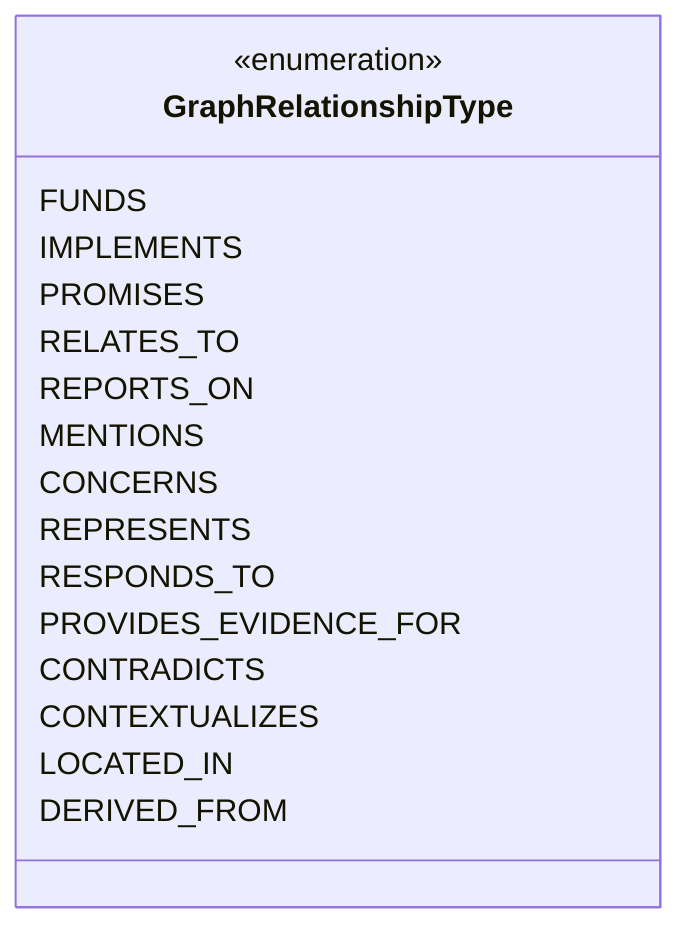
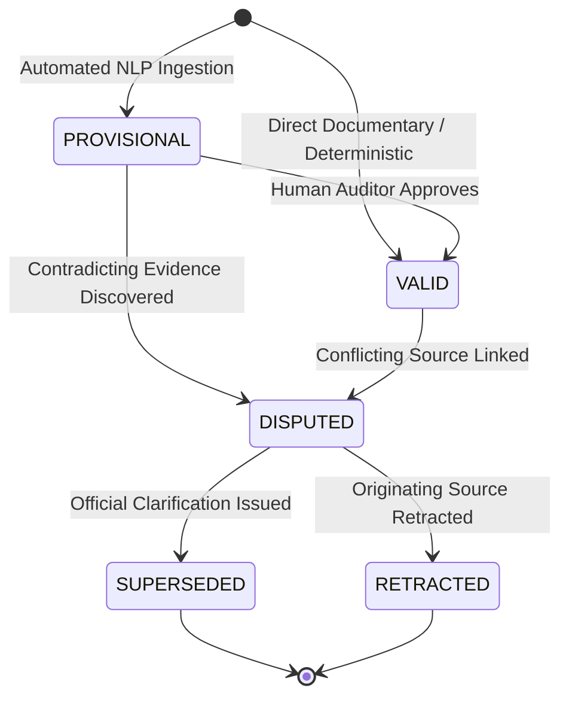
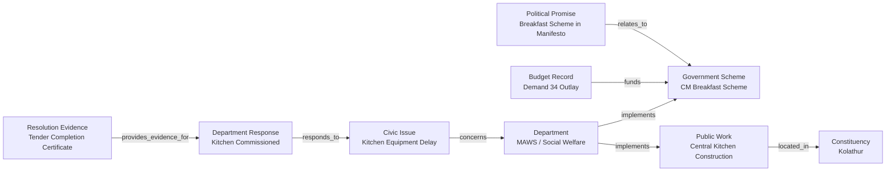

# Phase 9 — Unified Civic Intelligence & Evidence Graph Methodology

## 1. Executive Summary & Epistemic Framework

The **Unified Civic Intelligence & Evidence Graph** is an evidence-backed network representation of public policy, fiscal allocation, legislative activity, political claims, and civic delivery in Tamil Nadu.

Traditional knowledge graphs frequently commit epistemic fallacies by collapsing distinct forms of relationship into generic "related_to" links, or by erroneously inferring causal connections from mere spatio-temporal co-occurrence. Phase 9 introduces a rigorous, auditable methodology designed to enforce:

1. **Semantic Precision:** 14 strictly typed relationships with defined source and target type constraints.
2. **Epistemic Modesty:** Strict prohibition against inferring causation from correlation or spatial intersection.
3. **Multi-Source Pluralism:** Preserving conflicting claims and divergent data points without subjective suppression.
4. **Transparent Provenance:** Cryptographic verification and clear labeling across 4 distinct matching tiers.

---

## 2. Explicit Relationship Types & Semantics

The evidence graph recognizes **14 explicit relationship types**. Each type is bounded by semantic constraints:



### 2.1 `funds`
- **Definition:** Source entity provides verified financial capital or budgetary allocation to target entity.
- **Allowed Source Types:** `DONOR`, `ELECTORAL_TRUST`, `BUDGET_RECORD`, `FINANCIAL_DOCUMENT`.
- **Allowed Target Types:** `POLITICAL_PARTY`, `BUDGET_SCHEME`, `PUBLIC_WORK`, `CONSTITUENCY_WORK`.
- **Epistemic Rule:** Must reference a statutory financial disclosure (Form 24A), budget demand book (DDG), or approved administrative tender sanction with an explicit INR amount.
- **Example:** `NODE:DONOR:PET-001` --(funds: ₹2.5 Cr)--> `NODE:PARTY:DMK`.

### 2.2 `implements`
- **Definition:** Source executive agency executes, administers, or constructs target policy, scheme, or public work.
- **Allowed Source Types:** `GOVERNMENT_DEPARTMENT`, `BUDGET_DEPARTMENT`.
- **Allowed Target Types:** `HISTORICAL_SCHEME`, `BUDGET_SCHEME`, `PUBLIC_WORK`, `SERVICE_STANDARD`.
- **Epistemic Rule:** Must reference an official Government Order (G.O.), department policy note, or municipal contract assignment.
- **Example:** `NODE:DEPT:MAWS` --(implements)--> `NODE:SCHEME:SCH_CM_BREAKFAST`.

### 2.3 `promises`
- **Definition:** Source political organization pledges target policy action in an election manifesto.
- **Allowed Source Types:** `POLITICAL_PARTY`.
- **Allowed Target Types:** `POLITICAL_PROMISE`.
- **Epistemic Rule:** Must reference an official party election manifesto with chapter, page, and promise number.
- **Example:** `NODE:PARTY:DMK` --(promises)--> `NODE:PROM:DMK_2021_BREAKFAST`.

### 2.4 `relates_to`
- **Definition:** Semantic or thematic connection between two policy entities, schemes, or promises.
- **Allowed Source Types:** `POLITICAL_PROMISE`, `CIVIC_ISSUE`, `CLAIM`, `BUDGET_SCHEME`.
- **Allowed Target Types:** `HISTORICAL_SCHEME`, `SCHEME_CATEGORY`, `CIVIC_ISSUE`, `POLITICAL_PROMISE`.
- **Epistemic Rule:** Indicates thematic relevance. Does **not** assert implementation or fulfillment.
- **Example:** `NODE:PROM:DMK_2021_BREAKFAST` --(relates_to)--> `NODE:SCHEME:SCH_CM_BREAKFAST`.

### 2.5 `reports_on`
- **Definition:** Journalistic or media article covers, investigates, or describes target civic event, scheme, or issue.
- **Allowed Source Types:** `NEWS_ARTICLE`, `NEWS_SOURCE`.
- **Allowed Target Types:** `POLITICAL_EVENT`, `CIVIC_ISSUE`, `HISTORICAL_SCHEME`, `PUBLIC_WORK`.
- **Epistemic Rule:** Captures news reporting of record. Does not certify statutory truth of reported assertions.
- **Example:** `NODE:ART:TH_2023_0825` --(reports_on)--> `NODE:SCHEME:SCH_CM_BREAKFAST`.

### 2.6 `mentions`
- **Definition:** Textual document, news article, or public claim directly names target political figure or organization.
- **Allowed Source Types:** `NEWS_ARTICLE`, `CLAIM`, `ATOMIC_CLAIM`.
- **Allowed Target Types:** `REPRESENTATIVE`, `POLITICAL_PARTY`, `POLITICAL_PERSON`, `GOVERNMENT_DEPARTMENT`.
- **Epistemic Rule:** Verifiable named-entity occurrence. Does not impute endorsement, guilt, or causality.
- **Example:** `NODE:ART:TH_2023_0825` --(mentions)--> `NODE:REP:REP_MK_STALIN`.

### 2.7 `concerns`
- **Definition:** Grievance, civic issue, or legislative question falls under the administrative jurisdiction of target entity.
- **Allowed Source Types:** `CIVIC_ISSUE`, `GRIEVANCE_RECORD`, `LEGISLATIVE_ACTIVITY`.
- **Allowed Target Types:** `GOVERNMENT_DEPARTMENT`, `ADMINISTRATIVE_AREA`, `PUBLIC_WORK`.
- **Epistemic Rule:** Administrative assignment of responsibility.
- **Example:** `NODE:ISSUE:CIVIC_KOLATHUR_ROAD_01` --(concerns)--> `NODE:DEPT:MAWS`.

### 2.8 `represents`
- **Definition:** Elected official holds constitutional or statutory mandate for target constituency or legislative body.
- **Allowed Source Types:** `REPRESENTATIVE`, `REPRESENTATIVE_TERM`.
- **Allowed Target Types:** `CONSTITUENCY`, `POLITICAL_PARTY`.
- **Epistemic Rule:** Must reference ECI Form 20 or official legislative assembly gazette.
- **Example:** `NODE:REP:REP_MK_STALIN` --(represents)--> `NODE:CONST:AC_KOLATHUR`.

### 2.9 `responds_to`
- **Definition:** Official departmental action taken, inspection, or status report replies to target civic issue or petition.
- **Allowed Source Types:** `RESPONSE_RECORD`, `LEGISLATIVE_ACTIVITY`.
- **Allowed Target Types:** `CIVIC_ISSUE`, `GRIEVANCE_RECORD`.
- **Epistemic Rule:** Departmental tracking link. Does not signify independent verification of physical completion.
- **Example:** `NODE:RESP:RESP_GCC_ROAD_01` --(responds_to)--> `NODE:ISSUE:CIVIC_KOLATHUR_ROAD_01`.

### 2.10 `provides_evidence_for`
- **Definition:** Source document, excerpt, or empirical proof corroborates or supports target assertion or claim.
- **Allowed Source Types:** `SOURCE_DOCUMENT`, `EVIDENCE_DOCUMENT`, `EVIDENCE_PASSAGE`, `RESOLUTION_EVIDENCE`.
- **Allowed Target Types:** `CLAIM`, `ATOMIC_CLAIM`, `RESPONSE_RECORD`, `PROMISE_ASSESSMENT`.
- **Epistemic Rule:** Requires exact quotation, table row, or verifiable photographic/work-order artifact with SHA-256 hash.
- **Example:** `NODE:DOC:GOMs_MAWS_104` --(provides_evidence_for)--> `NODE:CLAIM:CLM_BREAKFAST_BENEFICIARIES`.

### 2.11 `contradicts`
- **Definition:** Source document, data point, or empirical evidence directly refutes or disputes target claim or status.
- **Allowed Source Types:** `SOURCE_DOCUMENT`, `EVIDENCE_DOCUMENT`, `EVIDENCE_PASSAGE`, `RESOLUTION_EVIDENCE`.
- **Allowed Target Types:** `CLAIM`, `ATOMIC_CLAIM`, `RESPONSE_RECORD`, `PROMISE_ASSESSMENT`.
- **Epistemic Rule:** Requires explicit factual divergence (e.g. claim asserts ₹5,000 Cr allocated; budget DDG proves ₹2,100 Cr allocated).
- **Example:** `NODE:DOC:GOMs_MAWS_104` --(contradicts)--> `NODE:CLAIM:CLM_BREAKFAST_TERMINATED`.

### 2.12 `contextualizes`
- **Definition:** Source entity provides vital background, baseline statistics, or macroeconomic environment for target entity.
- **Allowed Source Types:** `DEVELOPMENT_INDICATOR`, `NEWS_ARTICLE`, `BIAS_INDICATOR`.
- **Allowed Target Types:** `CIVIC_ISSUE`, `CONSTITUENCY`, `CLAIM`, `REPRESENTATIVE`.
- **Epistemic Rule:** Connects statistical or historical context without claiming direct causation.
- **Example:** `NODE:ART:TH_2023_0825` --(contextualizes)--> `NODE:CLAIM:CLM_BREAKFAST_BENEFICIARIES`.

### 2.13 `located_in`
- **Definition:** Source entity physically or administratively intersects target geographic boundary.
- **Allowed Source Types:** `CIVIC_ISSUE`, `CONSTITUENCY`, `PUBLIC_WORK`, `CONSTITUENCY_WORK`.
- **Allowed Target Types:** `CONSTITUENCY`, `ADMINISTRATIVE_AREA`.
- **Epistemic Rule:** Spatial intersection only. Does **not** imply personal fault or causation.
- **Example:** `NODE:ISSUE:CIVIC_KOLATHUR_ROAD_01` --(located_in)--> `NODE:CONST:AC_KOLATHUR`.

### 2.14 `derived_from`
- **Definition:** Target entity is an analytical aggregation, normalization, or mathematical transformation of source entity.
- **Allowed Source Types:** `PERFORMANCE_METRIC`, `METRIC_LINEAGE`, `ATOMIC_CLAIM`, `FINANCIAL_METRIC`.
- **Allowed Target Types:** `LEGISLATIVE_ACTIVITY`, `CLAIM`, `PARTY_FINANCIAL_STATEMENT`.
- **Epistemic Rule:** Lineage tracking ensuring reproducible mathematical and NLP derivation.
- **Example:** `NODE:METRIC:QUESTIONS_PER_SITTING` --(derived_from)--> `NODE:ACT:QUESTION_STARRED_14`.

---

## 3. Epistemic Integrity & Non-Inference Guardrails

The evidence graph enforces strict epistemological rules to guarantee civic credibility:

```
+-----------------------------------------------------------------------------------------+
|                                    EPISTEMIC GUARDRAILS                                 |
+-----------------------------------------------------------------------------------------+
| 1. SPATIAL INTERSECTION != CAUSATION:                                                   |
|    Issue in Constituency -> located_in (NEVER implements or caused_by)                   |
|                                                                                         |
| 2. TOPICAL ALIGNMENT != FULFILLMENT:                                                    |
|    Promise matches Scheme topic -> relates_to (NEVER fulfilled without statutory proof)  |
|                                                                                         |
| 3. REPORTED CLOSURE != PHYSICAL COMPLETION:                                             |
|    Department reply -> responds_to (NEVER verified_resolved without empirical evidence) |
|                                                                                         |
| 4. MEDIA COVERAGE != STATUTORY PROOF:                                                   |
|    News report -> reports_on (Provides evidence for statements, NOT fiscal accounts)    |
+-----------------------------------------------------------------------------------------+
```

---

## 4. Matching Method Taxonomy

Every edge in the graph is assigned one of **4 explicit matching methods**:

| Matching Method | Confidence Benchmark | Definition | Verification Requirement |
|:---|:---|:---|:---|
| `DIRECT_DOCUMENTARY` | `1.0` (or >= 0.95) | Link is explicitly declared in statutory gazette, Hansard, or primary legal document. | Page number, section, paragraph, and SHA-256 hash required. |
| `DETERMINISTIC_ID` | `1.0` | Link connects two records via exact primary key, demand code, or portal grievance token. | Foreign key or canonical identifier alignment required. |
| `AUTOMATED_CANDIDATE`| `0.50` – `0.94` | Link discovered via bilingual NLP entity extraction, semantic embedding cosine similarity, or rule heuristic. | Candidate score recorded; review status defaults to `PENDING_REVIEW`. |
| `HUMAN_REVIEWED` | `1.0` (overridden) | Link inspected, validated, or corrected by domain researcher or civic auditor. | Auditor identity token and timestamp recorded in audit log. |

---

## 5. Provenance Lifecycle

Edges follow an auditable state transition lifecycle:



- **`VALID`:** Corroborated and active evidence edge.
- **`PROVISIONAL`:** Heuristic or automated candidate edge awaiting human or statutory confirmation.
- **`DISPUTED`:** Contested by conflicting primary evidence (both perspectives retained in graph).
- **`SUPERSEDED`:** Replaced by newer official gazette or corrected filing.
- **`RETRACTED`:** Underlying source document retracted or annulled.

---

## 6. Graph Traversal & Multi-Hop Accountability Reasoning

The graph enables multi-hop reasoning algorithms to answer complex civic accountability questions:

### 6.1 Accountability Tracing Chain (Promise to Physical Resolution)


### 6.2 Path Confidence Decay Formulation
When traversing multi-hop paths of candidate links, aggregate path confidence decays multiplicatively:

$$\text{Confidence}(P) = \prod_{e \in P} \text{confidence}(e)$$

For paths containing only `DIRECT_DOCUMENTARY` and `DETERMINISTIC_ID` edges ($\text{confidence} = 1.0$), aggregate confidence remains strictly $1.0$.

---

## 7. Graph Integrity & Evaluation Benchmarks

Before any graph release, the graph layer is evaluated against 5 automated benchmarks:

1. **Dangling Edge Check:** Every edge must connect two valid, active nodes.
2. **Cryptographic Integrity:** Every `source_document_hash` must be a valid 64-character hexadecimal SHA-256 string.
3. **Epistemic Invariance:** No edge with `relationship_type = implements` may have a `CIVIC_ISSUE` as source.
4. **Bilingual Symmetry:** At least 90% of representative and department nodes must provide valid `label_ta` Tamil titles.
5. **Zero-Fabrication Audit:** 100% of synthetic demonstration entities must be tagged with `is_test_fixture = True`.
